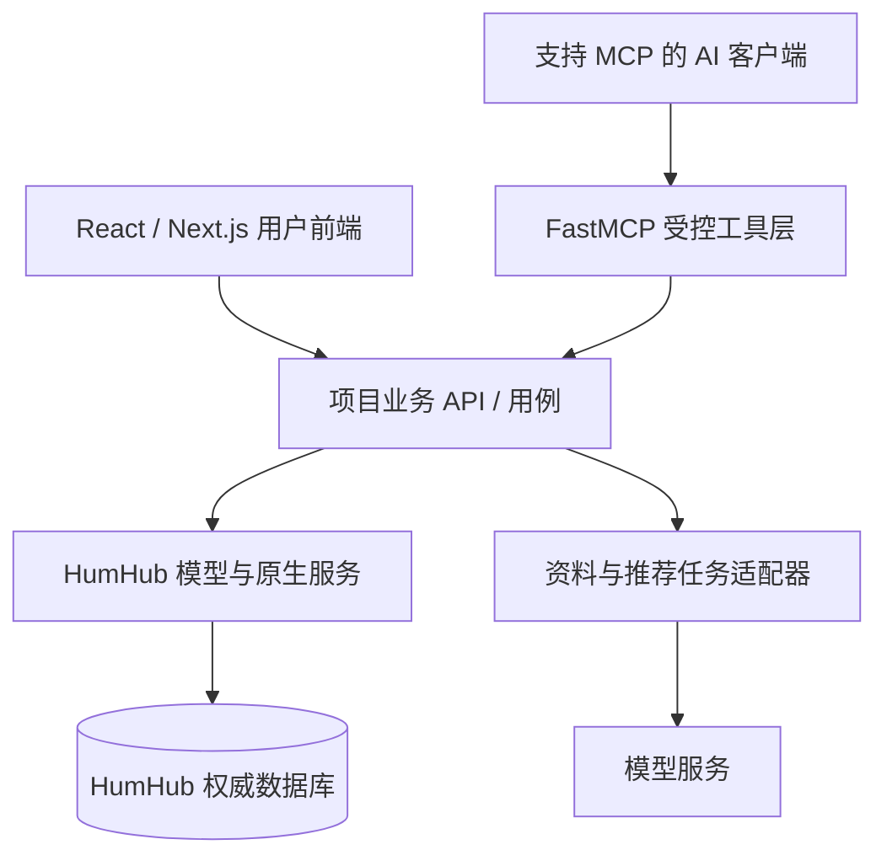

# HumHub 前后端解耦、消息与 MCP 可行性评估

> 核验日期：2026-11-11（Asia/Shanghai）。本地 HumHub 1.19.4、Messenger 3.4.6、REST 0.12.7。
> 本轮是源码、官方资料和只读运行配置评估；引用上一轮已有的访问检查，不表示新 React 前端、实时消息推送或 MCP 已实现。未修改冻结原稿、核心、插件源码和运行配置。

## 1. 先澄清：这些工作量是不是后端缺陷

需要分开判断，不能把所有待开发项归为后端设计错误。

| 情况 | 本次证据 | 对我们的影响 |
|---|---|---|
| 原生功能有，独立前端接口不完整 | 本人资料编辑在 AccountController 中可用；REST UserController 要求 ManageUsers；好友 AJAX 返回按钮 HTML | 复用已有模型与规则，整理部分页面控制器逻辑并补 JSON 接口。这是 headless 接口覆盖与耦合问题 |
| 原生产品取舍与期望不同 | Messenger 有会话、消息、未读状态和自动更新，但当前使用轮询；界面采用主题式会话列表 | 原生社区可以正常使用；现代聊天界面、推送、补拉和交互需要另做 |
| 我们新增了更细的业务规则 | 当前活动发现、用户逐条可见性、AI 草稿确认、联系人独立授权等 | 是新增产品能力，无法靠更换主题或转换 API 自动获得 |
| 具体实现存在权限问题 | 上轮实测已知 PDF GUID 的非成员能看到预览弹窗文件名，原文件下载仍返回 401 | 这是实际的插件入口授权缺口，需修补与回归，不能归为单纯产品差异 |

**判断：HumHub 可以继续作为社区内核候选，但它没有成为本项目现成的完整 headless 后端。** 原生模块可运行，说明可复用基础存在；不能由此推断我们只剩换 UI。反过来，界面不符合目标也不足以证明用户、Space、内容和消息存储都需要重写。

## 2. Messenger 是邮件，还是聊天

包名是 `mail`，数据模型是站内会话 `Message`、消息条目 `MessageEntry`、参与者/未读状态 `UserMessage`。消息可以保存在站内并显示在会话页；邮件提醒属于另一条通知通道。

源码中已有：

- 发送回复后，在当前会话追加返回的消息内容。
- 收到 `NewUserMessage` 事件后拉取新增条目，更新列表和未读状态。
- 会话视图支持滚到底部、加载历史、编辑和删除消息等原生交互。
- REST 提供会话列表/详情/创建、消息列表/详情/新增/编辑/删除、参与者和标签。

当前实际运行的 live driver 是 `Poll`，默认最小间隔 15 秒、最大 45 秒；Messenger 代码另有 `setDelay(5)` 调整。用户活跃与空闲会影响轮询，**这些配置不是实测送达延迟，更不是毫秒级承诺**。本轮没有发送测试消息测双端时延。

核心源码也包含 `MercurePushDriver`，浏览器通过 SSE 订阅，PHP 向 Hub 发布；本机预览没有部署或启用该 Hub。因此可以沿现有事件机制研究推送改造，无需预先断定整个消息存储必须重建。

改造可以分两层：

1. **界面层**：React 会话列表、聊天气泡、输入框、附件、移动端布局。原生会话标题可由产品适配管理，不必沿用“写主题式站内信”的全部操作。
2. **交互与可靠性**：增量消息接口、稳定排序、重连补拉、重复发送防护、发送状态、已读/未读、订阅授权。原生有部分内部能力，现有 REST 未完整提供我们需要的前端契约。

例如 Mail REST 会话序列化主要返回 ID、标题、创建/更新时间；消息列表沿用 page/limit，读状态和最新消息摘要未在该会话响应中完整返回。原生网页会话更新则读取后端渲染的 HTML。React 需要合适的数据响应，不能照搬这些 HTML 更新调用。

Messenger 的一对一规则仍需在创建和加人等服务端入口执行。已有好友私聊不随切换活动消失；活动内想法讨论另有成员与历史范围，不挪用 Messenger 多人能力来绕过已确认方向。

证据：[会话 JS](../backend/protected/modules/mail/resources/js/humhub.mail.ConversationView.js)、[事件监听](../backend/protected/modules/mail/resources/js/humhub.mail.conversation.js)、[轮询驱动](../backend/protected/humhub/modules/live/driver/Poll.php)、[Mercure 驱动](../backend/protected/humhub/modules/live/driver/MercurePushDriver.php)、[Mail REST 定义](../backend/protected/modules/mail/helpers/RestDefinitions.php)。

## 3. 前后端解耦到哪一层

原生 HumHub 是 PHP/Yii2 MVC，页面模板、Widget、表单和 jQuery/PJAX 配合工作。部分 AJAX 返回 HTML，原生用户前端与 PHP 页面实现有明显耦合。

REST 是额外的 JSON 控制器层，会复用已有模型、表单和权限。这使独立 React 前端成为可行路线，但接口覆盖并不等于原生页面覆盖。

| 层次 | 现在的状态 | 我们的工作 |
|---|---|---|
| 数据与基础对象 | 用户、Space、帖子、评论、会话等已存在 | 评估并复用，不另建同一数据的第二套权威状态 |
| 原生页面 | PHP 模板与原生 JS 联动 | 普通用户页面用 React 重写；保留原生管理后台的价值 |
| 供 React 使用的 API | 部分完整，部分缺失或偏管理用途 | 建立项目接口，统一本人操作、对象权限、错误、分页与版本规则 |
| 插件自带页面 | 安装即可在 HumHub 页面中使用 | 前端重写后，每个模块所需的数据接口和 UI 都要重新核对 |

AffectUI + Shadcn UI Kit 可以降低页面、表单、布局和交互组件的开发量。实际业务请求、登录会话、权限状态、文件授权与消息同步依然需要接入。

可以采用独立 Next.js 用户前端，也可以让自有插件提供完全隔离原生资产的 React 页面入口；两种部署方式都需要项目 API。继续遵守已有的完整视觉隔离方向，避免在大部分页面里同时维护 Bootstrap/jQuery 与 React/Tailwind 两套 DOM 交互。详见 [既有前端专项](HumHub前端复用与双库接入分析.md)。

## 4. REST 的实际价值与缺口

**评价：有价值的接口基础，仍需产品级适配。**

优点是已经有 `/api/v1`、OpenAPI 3.0 文档、认证、分页以及多个核心控制器；Mail 和 Calendar 也有接口扩展。当前运行环境查询到的已启用扩展 API 提供者为 `calendar`、`mail`；核心 REST 端点另外存在，不包含在这两个 ID 中。

| 场景 | 本次核实结果 | 判断 |
|---|---|---|
| Space、帖子、评论、点赞、文件、通知 | REST 手册和源码有相应端点；上轮已验证部分 Space/帖子读取及权限 | 可优先复用，不能把少数读取通过当成所有写操作验收 |
| 普通用户编辑本人资料 | 原生 AccountController 直接取得当前用户编辑；REST UserController 要求 ManageUsers | 补本人资料用例的 JSON 接口，不给普通用户管理权限 |
| 好友申请 | 原生控制器 AJAX 返回 FriendshipButton Widget HTML | 需 JSON 状态与项目 expected_version、幂等等契约 |
| 资料输出 | UserDefinitions 使用 profile attributes，并输出 account 中的邮箱等字段 | 不能将管理型/通用输出直接作为获准画像或送模型摘要；需明确字段投影 |
| Messenger | 已有消息 CRUD 和参与者检查；原生未读状态与页面增量机制存在 | 聊天数据接口与即时体验仍需补齐、验证 |
| Q&A、Gallery、Link List | 本次已安装包未查到对应 REST 注册事件；运行中的 API 扩展清单不含三者 | 所需操作逐项补接口，不能按“界面能用”计算 React 已能调用 |
| 当前活动发现与画像授权 | 原生 REST 不实现本项目的活动上下文和逐条披露规则 | 项目插件负责；不可只在前端过滤 |
| 契约稳定性 | REST 0.12.7 README 仍标 Beta；分页是 page/limit，默认与上限 100 | 固定版本；与签名 cursor、默认 24/最大 48 等项目规则适配 |

具体代码证据：[原生本人资料](../backend/protected/humhub/modules/user/controllers/AccountController.php)、[REST UserController](../backend/protected/modules/rest/controllers/user/UserController.php)、[好友返回格式](../backend/protected/humhub/modules/friendship/controllers/RequestController.php)、[资料序列化](../backend/protected/modules/rest/definitions/UserDefinitions.php)、[REST 基类](../backend/protected/modules/rest/components/BaseController.php)、[上一轮访问检查](../backend/deploy/access-smoke.json)。

资料 UI 看起来完整，主要说明基本字段、表单与账号模型可以复用。我们的“技能登录可见、经历好友可见、某条资料仅自己可见、联系人另行授权、AI 草稿未确认不展示”仍是更细的业务模型。

## 5. AI 与 MCP 怎么接

先区分两种方向：

- **应用调用模型**：本人主动导入资料后抽取草稿、推荐精排、回答问题。可以由服务端应用用例通过模型适配器调用，MCP 不是必需前置条件。
- **AI 客户端调用我们的业务能力**：读取当前活动、获准人物摘要或活动帖子。可以用 FastMCP 把这些能力做成标准 MCP 工具。

独立 FastMCP 项目可以调用 PHP REST 后端，无需先把 HumHub 改成 FastAPI。官方文档提供 `FastMCP.from_openapi()`，支持路由映射与排除；也明确建议生产场景认真设计工具，而非仅机械转换所有 REST 端点。

截至本次核验，官方仓库为 PrefectHQ/fastmcp，GitHub latest release 返回 v4.1.8，发布于 2026-11-10 20:44:13 UTC，即北京时间 2026-11-11 04:44:13。这里记录调研版本，没有安装 FastMCP 或验证客户端兼容性。

HumHub 的 OpenAPI 按模块分 YAML，存在跨文件 `$ref`。自动转换前应处理依赖引用、服务器地址、路径冲突和认证配置；把 YAML 读成一个普通 dict 不意味着已经解决全部引用。

建议结构如下，均为待实施方案：

先在一个 `team-matcher` 插件内组织活动、资料、发现、想法和社交用例，遵守 [architecture-patterns](../.agents/skills/architecture-patterns/SKILL.md)。FastMCP 做协议与身份适配，共用后端对象授权；不再建立另一份好友、活动或资料权威数据库。

第一批可考虑以下只读工具，名称仅为设计示例，相关项目 API 尚未实现：

| 工具示例 | 后端必须执行的约束 |
|---|---|
| get_current_activity | 从受验证用户上下文取得活动，不相信模型声明的身份 |
| discover_people | 限当前活动，正常发现 0 次 LLM；不足如实返回 |
| read_allowed_profile | 校验合法来源及字段范围；公开帖子作者例外按原规则处理 |
| list_activity_posts | 校验当前活动成员资格、帖子和附件权限、分页 |

协议层认证和业务对象授权都需要：MCP 验证调用者后，通过有正确受众与权限范围的受控身份调用后端。不能把服务端管理员凭据当成所有用户的身份，也不能直接透传一个受众不同的 MCP token；模型传入的 actor_id/event_id 只能作为待验证输入。

远程服务可用标准 HTTP 传输；本机原型可用 stdio。FastMCP 默认没有自动替项目建立认证和对象授权，配置与测试仍需完成。读取工具也必须受活动与资料授权限制。首期不向模型开放发布、发消息、好友接受或联系人授权；AI 可以生成草稿，由用户真实操作调用普通业务接口。

MCP 不承担用户聊天推送或 AI 输出逐字显示；这些由产品消息/流式响应链路处理。推荐的 200/24/5 上限、异步结果失效和确认版本规则仍在业务用例里执行。

## 6. 难度判断

以下是针对当前代码与目标的工程估计，不是完成度百分比或固定报价。

| 工作项 | 相对难度 | 主要原因 |
|---|---|---|
| 使用组件库做现代 React 页面 | 中 | 页面与状态需要重新实现，组件库省下通用 UI 工作 |
| 接 Space、帖子、评论等基础操作 | 中 | 有 REST 基础，仍需普通用户写操作与附件验证 |
| 补本人资料、好友、当前活动发现接口 | 中高 | 部分流程在原生页面中，项目又有独立领域规则 |
| 把现有会话改成基本聊天 UI | 中 | 会话和消息存储可复用，需适合 React 的数据响应 |
| 完整消息体验与可靠性 | 中高 | 推送、补拉、幂等、已读、订阅撤权和故障恢复 |
| 少数已可用只读 API 的 MCP 原型 | 低 | FastMCP 已处理大量协议工作 |
| 供多用户使用的远程 MCP | 中 | 身份委托、对象授权、工具白名单、审计与客户端兼容 |
| 实现冻结简介及当前全部产品规则 | 高 | 大量工作属于我们自己的资料、发现与协作产品 |

若 API 已存在、返回结构与权限明确，熟悉 Python 的工程师可把少数只读接口的 MCP 原型按约 1–2 人日估计。这个范围不含缺失业务 API、远程 OAuth 全流程、生产运维、安全审计或完整 AI 产品，不能拿它代表项目总工期。完整前端和产品用例需先按页面、交互和契约拆清，再估算。

## 7. 当前建议与验证门槛

保留 HumHub 的用户、Space、内容、消息存储与管理后台作为候选；用户前端按已确认方向重做。先做小范围的完整链路验证，再决定是否全面采用。

需要证明：

1. 两个普通用户在独立 React 页面登录、取得有效活动、发布/评论，不依赖管理员代操作。
2. 本人可编辑资料；其他用户只能取得获准字段。当前活动发现和公开帖子作者例外分别验证。
3. 两个普通用户建立符合规则的一对一会话，验证消息读取、发送、未读、重复请求及重连；对话不因切活动消失。
4. 少数 MCP 工具使用相同用例，活动 A 的调用者不能让模型读活动 B 的受限候选或其他人的私有资料。

若这些核心链路能通过自有插件、清晰接口和少量适配完成，复用有价值；若需要持续覆盖多个核心控制器，或关键路径只能靠管理员权限绕过，应重新比较原计划 FastAPI 模块化单体的成本。已经下载或部署不应成为必须继续的理由。

## 8. 官方资料与检查范围

- [HumHub REST 手册（本地固定版本）](../backend/protected/modules/rest/docs/MANUAL.md) 与 [Beta 说明](../backend/protected/modules/rest/docs/README.md)。
- [Mail REST 控制器](../backend/protected/modules/mail/controllers/rest/MessageController.php)、[消息条目接口](../backend/protected/modules/mail/controllers/rest/EntryController.php)、[接口注册](../backend/protected/modules/mail/Events.php)。
- [FastMCP OpenAPI 官方说明](https://gofastmcp.com/docs/integrations/openapi.md)。
- [FastMCP 认证说明](https://gofastmcp.com/docs/servers/auth/authentication.md) 与 [授权说明](https://gofastmcp.com/docs/servers/authorization.md)。
- [FastMCP 官方发行 v4.1.8](https://github.com/PrefectHQ/fastmcp/releases/tag/v4.1.8)。
- [MCP 官方架构与传输](https://modelcontextprotocol.io/docs/learn/architecture.md)。
- [PDF 权限观察的原始检查报告](../backend/deploy/access-smoke.json)。

本轮只读查询确认当前 live driver 和已启用 API 扩展，未执行新的跨用户聊天测试、性能压测、MCP 互通测试或全面安全审计。业务规则仍以冻结原稿后的明确要求和共享契约为准。
