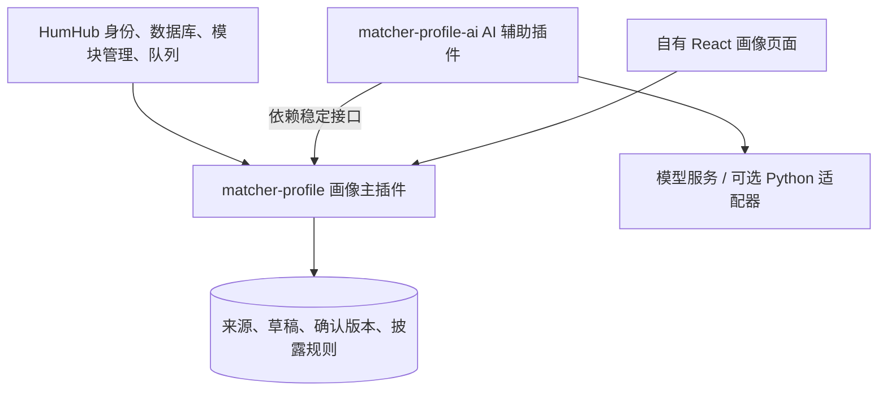

# HumHub 插件机制与画像主插件、AI 扩展方案

> 当前产品设计见 [后端能力与插件设计](../docs/用户画像收集/02_后端能力与插件设计.md)。普通资料与隐私作为独立基础能力，填写引导调用统一接口。本文保留 HumHub 模块机制的源码核验过程。

> 核验日期：2026-11-11（Asia/Shanghai）。固定底座 HumHub v1.19.4。
> 本轮读取源码与官方资料，并调用原生依赖服务做四项只读检查。以下名称、版本和接口均为设计示例，未创建、安装或启停业务插件。

## 1. 结论

画像填写主插件 + AI 辅助填写扩展插件可行，符合 HumHub 已有的模块依赖和事件机制。无需再开发插件安装器。建议先做两个可分别发布的模块，运行在同一 HumHub 应用中。

这里的独立是代码、版本、安装包与功能职责可以独立管理；运行仍依赖 HumHub/Yii2。它不是独立微服务，也不是权限隔离沙箱。

此前集中在单一 team-matcher 包中的建议，可以按本次更具体的诉求细化为资料主流程与 AI 提供者两包；无需同时将整个项目拆成大量插件。

## 2. 什么能力可以放进插件

| 原生扩展能力 | 对画像流程的用途 |
|---|---|
| 控制器、路由、JSON 响应 | 本人读写草稿、保存进度、确认资料、输出获准字段 |
| 模型与数据库迁移 | 来源、草稿、确认版本、字段可见性、任务状态 |
| 页面、静态资源、Widget | 画像入口、React 表单、辅助填写区域 |
| 身份与权限接口 | 复用登录用户，并执行本人编辑及他人披露规则 |
| 自定义事件和事件监听 | 注册辅助能力、连接已有流程与模块 |
| 队列任务和服务适配 | 调用模型、处理结果、校验版本 |
| 模块配置入口 | 管理功能开关和提供者配置 |

普通 Module 在全站启用；ContentContainerModule 还可在 Space 或用户容器层级启用。画像填写建议采用全站模块，数据按用户隔离，不要求每个新用户先在自己资料页安装插件。全局画像与活动偏好仍分别存放。

## 3. 插件如何接入

最小目录：

```text
matcher-profile/
├── module.json    ID、版本、兼容性与依赖
├── config.php     模块类、命名空间、事件、路由
└── Module.php     模块入口与生命周期
```

业务实现再增加 controllers、models、migrations、services、jobs、permissions、resources 和前端源码等目录。

1. 放入模块加载路径，默认 protected/modules；也能配置项目专用路径。私有模块可本地部署，不必先上架市场。
2. HumHub 发现配置与元数据，在管理界面列出模块；文件存在不等于业务启用。
3. 管理员或控制台启用时检查依赖和要求，执行注册与迁移。v1.19.4 源码先注册、再迁移，迁移失败撤销注册。
4. 正常请求加载已启用模块的路由、命名空间和事件处理器；控制器调用业务服务。

config.php 会被缓存，顶层不应发模型请求或按当前用户动态生成配置。用户校验与外部调用应在实际用例中完成。

## 4. 插件依赖是原生能力

在 module.json 的 humhub.modules 中声明。下面是拟定 AI 包的元数据示例，尚未写入模块目录：

```json
{
  "id": "matcher-profile-ai",
  "name": "Profile AI Assistance",
  "description": "Optional AI assistance for the profile workflow",
  "version": "0.1.0",
  "humhub": {
    "minVersion": "1.19.4",
    "modules": {
      "matcher-profile": {
        "minVersion": "0.1.0"
      }
    }
  }
}
```

依赖包必须存在、已启用且满足最低版本。当前解析器支持依赖项 minVersion；不能自行假设支持 Composer 任意版本表达式或依赖项 maxVersion。核心版本的 minVersion/maxVersion 是另外一组配置。

| 原生依赖服务的只读检查 | 实际结果 |
|---|---|
| 已启用 REST，要求最低 0.12.7 | 满足 |
| 已启用 REST，要求最低 99.0.0 | 拒绝，提示版本不足 |
| 已安装但未启用的 twofa | 拒绝，要求先启用 |
| 不存在的测试依赖 ID | 拒绝，要求先安装并启用 |

检查未安装虚构模块，未执行迁移。声明依赖也不会自动实现数据接口、UI 挂载或业务调用，不表示自动购买或下载缺失包。

建议采用两个并列模块包，AI 包单向依赖主包。Yii 另有嵌套子模块，适合包内部组织；独立安装和更新 AI 能力用两包依赖更清楚。

## 5. 两包职责与数据所有权



| 主插件 matcher-profile | 扩展插件 matcher-profile-ai |
|---|---|
| 本人资料与十步引导 | AI 辅助填写提供者 |
| 草稿、保存退出与继续 | 抽取、补缺提问、润色建议 |
| 简历/GitHub 来源接收、私存与授权 | 按授权读取必要来源、调用模型 |
| 字段校验、确认、版本与可见性 | 将输出转换为标准草稿建议 |
| 正式资料和关键流程状态的权威所有权 | 不维护另一份正式画像，不直接发布资料 |
| React 页面与辅助填写区域 | 注册可用能力、提供任务适配与配置 |

主插件定义辅助能力接口，AI 包实现并注册；主插件不硬依赖 AI 包。将来其他提供者可以实现同一接口，无需改变正式资料模型。

来源和已确认资料不能因 AI 扩展停用而丢失。AI 专属配置可属于 AI 包；长期需要保留的版本及任务适用性应由主插件或统一资料域管理。

没有 AI 提供者时仍可手动编辑、保存、确认，AI 显示明确的不可用状态。技术可选性不改变首期产品要求：简历与 GitHub 导入仍必备，手填为兜底。

## 6. 如何让 AI 插件接入主流程

建议采用主插件定义服务接口、提供者注册事件的方式。HumHub/Yii 已支持自定义事件和跨模块监听，具体业务契约由我们定义：

- 取得本人草稿与编辑版本。
- 取得本次处理获准使用的来源。
- 注册辅助填写提供者，返回可用能力。
- 提交带来源、任务 ID、期望版本的草稿建议。
- 由用户真实操作确认字段和可见性。

```text
本人导入 / 主动重新编辑
  → 主插件校验身份、来源权限、草稿版本
  → 用户触发辅助填写，选择已注册的提供者
  → AI 插件调用模型并返回结构化建议
  → 主插件再次校验权限、版本和任务适用性
  → 建议进入草稿，用户修改并确认
  → 主插件保存正式资料及所选披露范围
```

AI 不直接写主插件的正式资料表。成功但已 superseded/revoked 的任务不得覆盖新版本；execution_status 与 applicability 沿用共享契约。React、AI 与未来 MCP 共用主插件的权限和确认用例。

按项目 architecture-patterns 将领域规则、应用用例、HumHub 数据适配与模型适配分开。先用内存适配器验证业务规则，再验真实集成。同进程模块可直接通过 PHP 服务接口协作，不必为了模块化绕 HTTP 或拆微服务。

## 7. 前端如何出现 AI 辅助区

PHP 依赖声明不会自动加载 React 组件。初期最简单的方案是统一 React 页面预留辅助区，通过后端能力信息显示 AI 按钮、对话和建议预览；AI 包负责注册后端提供者。无需再造动态加载任意前端插件的框架。

如果以后不同 AI 包需要完全不同的界面，再设计有版本约束的前端扩展位。组件继续采用 AffectUI + Shadcn UI Kit，并遵守完整视觉隔离条件：独立页面入口、核查资源清单，不把插件安装成功当成已隔离 Clean/HumHub 样式。详见 [完整前端插件边界](CleanTheme机制与双库插件方案.md)。

## 8. 停用与数据保留

v1.19.4 的 Module::disable() 会调用卸载迁移，清理模块设置、容器设置和启用记录；是否删除某张表取决于该插件的卸载迁移。原生停用不能默认当作保留数据的暂停按钮。

建议暂时关闭 AI 时使用业务功能开关，停止新任务并保留资料。真正停用/删除 AI 包之前处理在途任务，并保证主插件仍可读取、编辑和确认既有资料。AI 包的卸载逻辑不得删除主插件的数据。

基础画像插件的停用/卸载需要独立的数据策略；依赖声明证明的是启用/更新前提，不能据此假设停用基础包会自动完整处理所有依赖者。

资料私存、不自动过期；普通登录、浏览、切活动、改可见性不触发重编辑或模型调用。GitHub 首次注册关联并读取本人公开来源的首期要求保留。本人主动删除仍执行删除流程。

## 9. 难度与下一步

| 工作 | 难度判断 |
|---|---|
| 模块目录、入口、依赖声明 | 低，已有机制 |
| 基础填写、草稿保存与恢复 | 中，适合作为首个自研插件 |
| 逐条授权、版本确认、私有来源与旧入口一致性 | 中高，属于主业务规则 |
| 一个 AI 提供者返回结构化建议 | 中，拆分后职责清楚 |
| 任务撤销、覆盖保护、失败恢复与停用兼容 | 中高，需要针对性验证 |

先验证主插件的草稿/确认和扩展接口，再接 AI；首期验收仍包含导入、十步引导、逐条可见性和明确错误状态。两个包已足够，不先开发通用插件市场。

主插件可以自行实现 JSON 控制器；若继承 REST 控制器或依赖其接口注册，则明确声明 rest 依赖。HumHub 模块并不一概需要 REST。最终接口仍以 /api/v1 共享契约为准。

## 10. 证据与范围

- [模块开发与依赖](../backend/docs/develop/module-development.md)、[生命周期](../backend/docs/develop/module-lifecycle.md)、[基类与容器模块](../backend/docs/develop/module-base-class.md)、[自定义事件](../backend/docs/develop/concept-events.md)。
- [依赖服务](../backend/protected/humhub/services/ModuleDependencyService.php)、[发现服务](../backend/protected/humhub/services/ModuleDiscoveryService.php)、[注册管理](../backend/protected/humhub/components/ModuleManager.php)、[启停实现](../backend/protected/humhub/components/Module.php)。
- [只读检查记录](evidence/humhub-module-dependencies-2026-11-11.json)。
- [architecture-patterns](../.agents/skills/architecture-patterns/SKILL.md)。
- 官方对应版本：[模块开发](https://github.com/humhub/humhub/blob/v1.19.4/docs/develop/module-development.md)、[依赖实现](https://github.com/humhub/humhub/blob/v1.19.4/protected/humhub/services/ModuleDependencyService.php)、[生命周期](https://github.com/humhub/humhub/blob/v1.19.4/docs/develop/module-lifecycle.md)、[事件](https://github.com/humhub/humhub/blob/v1.19.4/docs/develop/concept-events.md)、[Yii 嵌套模块](https://www.yiiframework.com/doc/guide/2.0/en/structure-modules)。

本轮没有实施两个插件，没有调用模型、读取项目 .local 凭据、测试画像权限或验证 React 视觉隔离。依赖检查仅证明机制可用，不代表产品流程完成。
