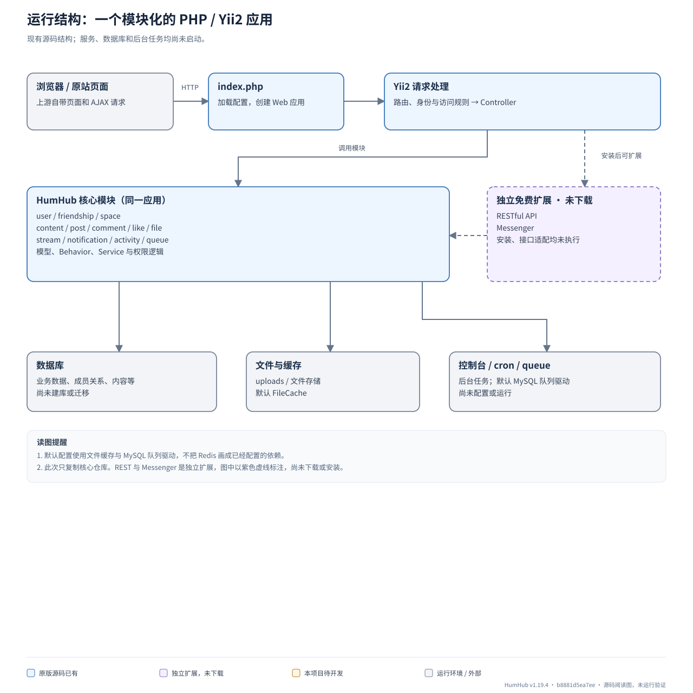
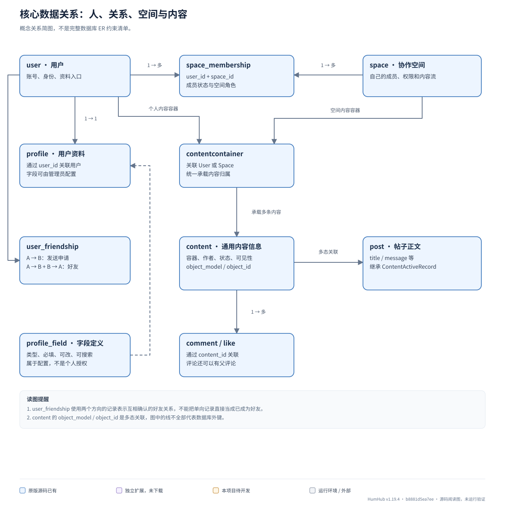
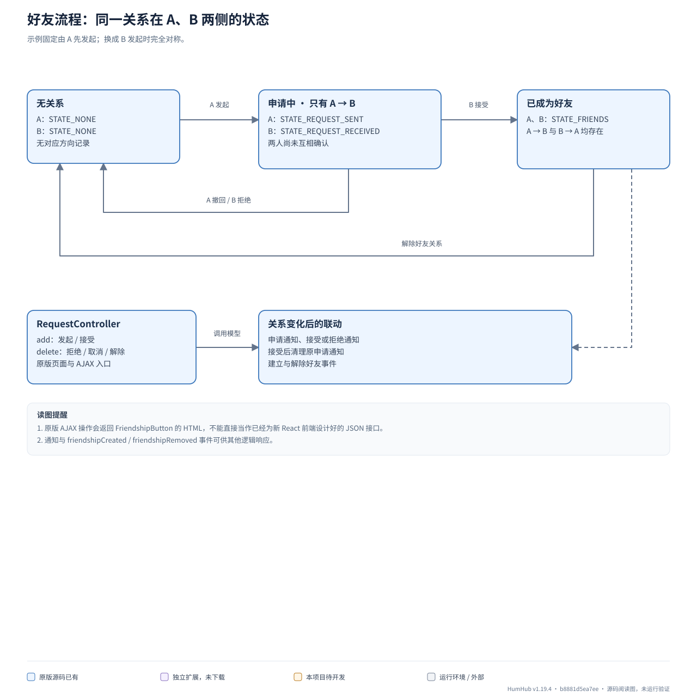
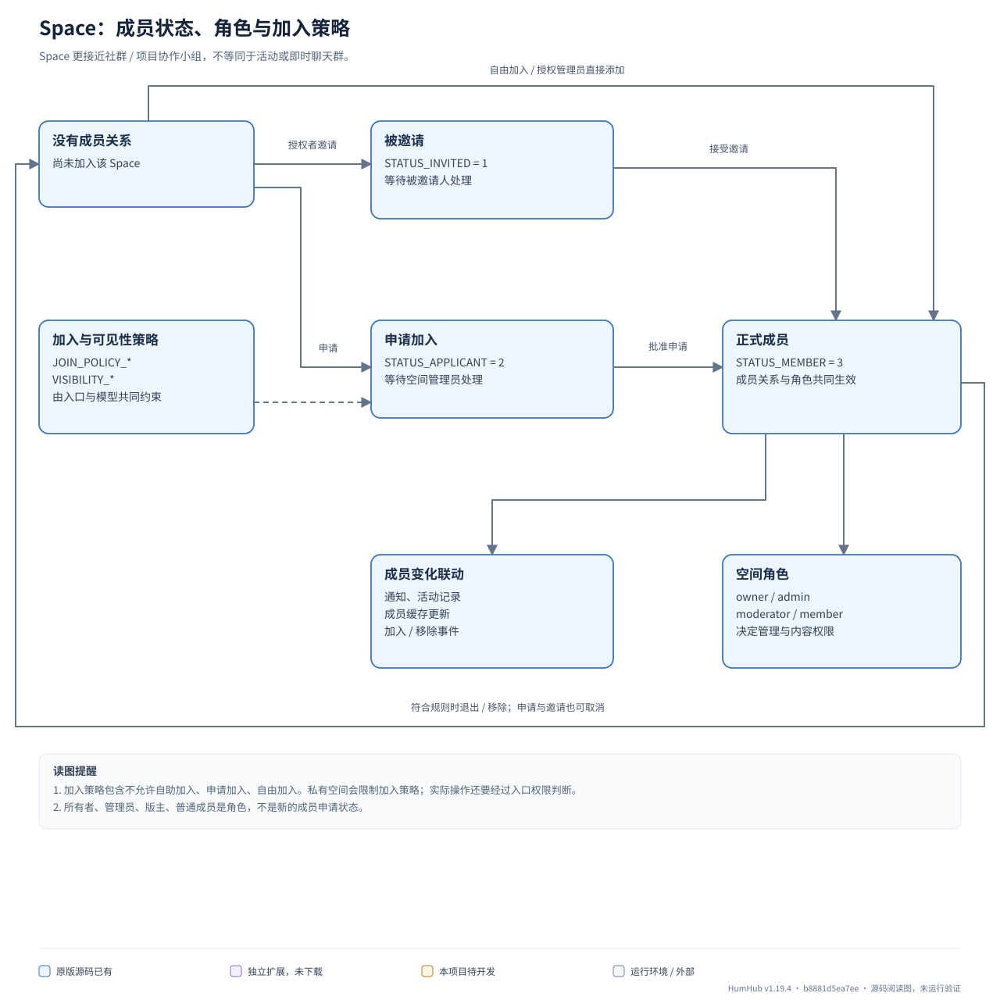
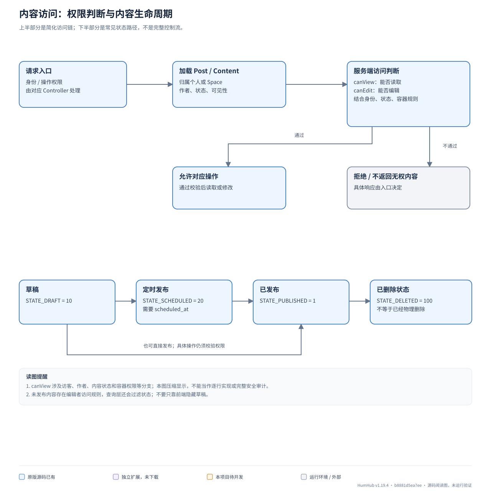
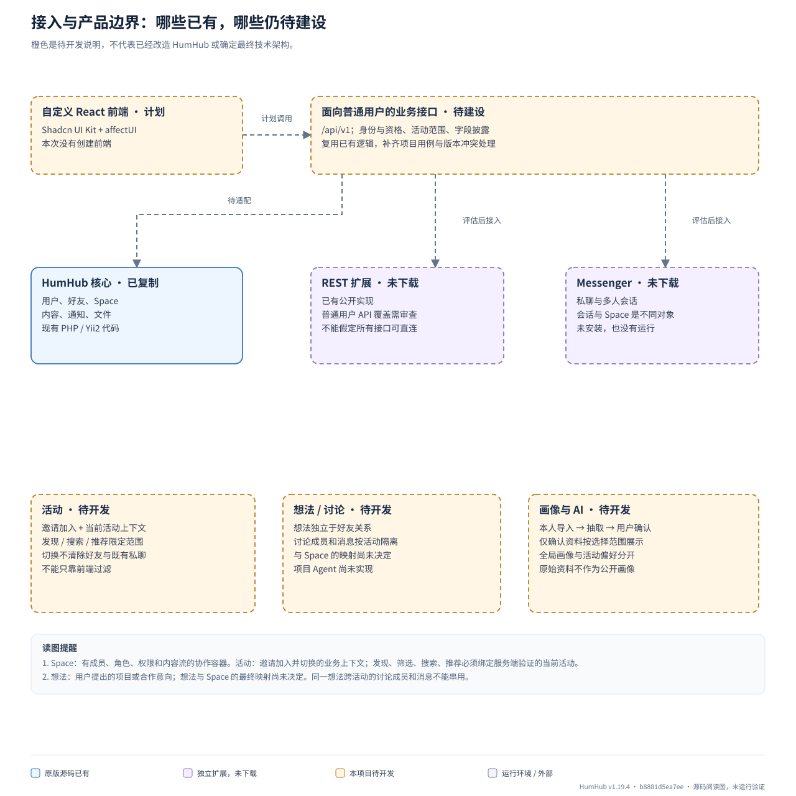

# HumHub 后端阅读图

**范围：原版源码阅读辅助，不是项目后端已经实现的说明。**

- 基线：HumHub v1.19.4，提交 b8881d5ea7ee27384a33adeaa23100c73472c4ce。
- 原版保存在 references/humhub；backend 是包含 Git 元数据的独立文件副本。
- 本次新增内容只在 docs/architecture；没有修改上游应用代码、配置或依赖。
- 没有安装依赖、建库、迁移、启动应用或安装 REST / Messenger 扩展。
- 这次使用项目 architecture-patterns 技能区分已有实现、接口边界和待开发业务，不把原版 MVC / ActiveRecord 结构改画成已实现的分层重构。

[离线图册：直接用浏览器打开](index.html)

## 先区分四个概念

| 概念 | 含义 | 当前副本状态 |
|---|---|---|
| Space | 有成员、角色、权限和内容流的社群 / 项目协作空间 | 核心已有源码 |
| 活动 | 邀请加入、切换当前活动，并限制发现 / 搜索 / 推荐范围的业务上下文 | 本项目待开发 |
| 想法 | 用户发起的项目或合作意向，可有按活动隔离的讨论 | 本项目待开发；与 Space 的映射未决定 |
| 聊天会话 | 私聊或多人聊天的消息与参与者集合 | 独立 Messenger 扩展；本次未下载 |

Space 更接近群组 / 社区小组，但不是即时聊天群。可以借用它的成员与权限能力建设活动功能，不能把改名当作已经实现活动规则。

图例：蓝色为原版源码已有，紫色虚线为未下载的独立扩展，橙色虚线为待开发，灰色为运行环境。所有箭头表示结构或流程，不代表应用当前已在运行。

## 运行结构：一个模块化的 PHP / Yii2 应用

先把 HumHub 理解成一个应用。用户、好友、Space、内容和通知是同一应用内的模块，不是多个微服务。当前实现使用 Controller、ActiveRecord、Behavior 和部分 Service；这张图不把它描述成已经完成的 Clean Architecture。

[打开 SVG](01-runtime.svg) · [Mermaid 源文件](01-runtime.mmd)

阅读要点：

- 默认配置使用文件缓存与 MySQL 队列驱动，不把 Redis 画成已经配置的依赖。
- 此次只复制核心仓库。REST 与 Messenger 是独立扩展，图中以紫色虚线标注，尚未下载或安装。

本地源码依据：

- [index.php](../../index.php)
- [protected/humhub/config/common.php](../../protected/humhub/config/common.php)
- [protected/humhub/config/web.php](../../protected/humhub/config/web.php)
- [protected/humhub/modules/queue/driver/MySQL.php](../../protected/humhub/modules/queue/driver/MySQL.php)

## 核心数据关系：人、关系、空间与内容

用户与 Space 都可以成为内容容器。帖子正文与通用内容元数据分开；评论和点赞再关联内容。好友和空间成员是两种独立关系。

[打开 SVG](02-data.svg) · [Mermaid 源文件](02-data.mmd)

阅读要点：

- user_friendship 使用两个方向的记录表示互相确认的好友关系，不能把单向记录直接当成已成为好友。
- content 的 object_model / object_id 是多态关联，图中的线不全部代表数据库外键。
- profile_field 是字段定义；不等于已经实现用户逐字段选择 authenticated / friends / private 的授权。

本地源码依据：

- [protected/humhub/modules/user/models/User.php](../../protected/humhub/modules/user/models/User.php)
- [protected/humhub/modules/user/models/Profile.php](../../protected/humhub/modules/user/models/Profile.php)
- [protected/humhub/modules/user/models/ProfileField.php](../../protected/humhub/modules/user/models/ProfileField.php)
- [protected/humhub/modules/friendship/models/Friendship.php](../../protected/humhub/modules/friendship/models/Friendship.php)
- [protected/humhub/modules/space/models/Membership.php](../../protected/humhub/modules/space/models/Membership.php)
- [protected/humhub/modules/content/models/ContentContainer.php](../../protected/humhub/modules/content/models/ContentContainer.php)
- [protected/humhub/modules/content/models/Content.php](../../protected/humhub/modules/content/models/Content.php)
- [protected/humhub/modules/post/models/Post.php](../../protected/humhub/modules/post/models/Post.php)
- [protected/humhub/modules/comment/models/Comment.php](../../protected/humhub/modules/comment/models/Comment.php)
- [protected/humhub/modules/like/models/Like.php](../../protected/humhub/modules/like/models/Like.php)

## 好友流程：同一关系在 A、B 两侧的状态

原版好友逻辑把单向申请和互相确认区分开。RequestController 的 add 同时承担发起和接受，delete 承担取消申请或解除关系。

[打开 SVG](03-friendship.svg) · [Mermaid 源文件](03-friendship.mmd)

阅读要点：

- 原版 AJAX 操作会返回 FriendshipButton 的 HTML，不能直接当作已经为新 React 前端设计好的 JSON 接口。
- 通知与 friendshipCreated / friendshipRemoved 事件可供其他逻辑响应。
- 项目所需的来源验证和 expected_version 不在本图中冒充已完成，需要后续单独适配。

本地源码依据：

- [protected/humhub/modules/friendship/models/Friendship.php](../../protected/humhub/modules/friendship/models/Friendship.php)
- [protected/humhub/modules/friendship/controllers/RequestController.php](../../protected/humhub/modules/friendship/controllers/RequestController.php)

## Space：成员状态、角色与加入策略

Space 拥有成员、权限和内容流。成员状态决定是否正式加入；角色决定加入后能做什么。加入策略与空间可见性也是分别配置的概念。

[打开 SVG](04-space.svg) · [Mermaid 源文件](04-space.mmd)

阅读要点：

- 加入策略包含不允许自助加入、申请加入、自由加入。私有空间会限制加入策略；实际操作还要经过入口权限判断。
- 所有者、管理员、版主、普通成员是角色，不是新的成员申请状态。
- 退出或移除受规则限制；例如当前所有者不能直接按普通成员路径移除。
- 原版没有你们的当前活动上下文与发现/推荐范围规则；本图没有把它们画成已有 Space 能力。

本地源码依据：

- [protected/humhub/modules/space/models/Space.php](../../protected/humhub/modules/space/models/Space.php)
- [protected/humhub/modules/space/models/Membership.php](../../protected/humhub/modules/space/models/Membership.php)
- [protected/humhub/modules/space/behaviors/SpaceModelMembership.php](../../protected/humhub/modules/space/behaviors/SpaceModelMembership.php)

## 内容访问：权限判断与内容生命周期

帖子正文由 Post 管理，通用 Content 负责归属、状态与可见性。读取、编辑和状态转换是不同检查，页面显示与否不能替代服务端判断。

[打开 SVG](05-content.svg) · [Mermaid 源文件](05-content.mmd)

阅读要点：

- canView 涉及访客、作者、内容状态和容器权限等分支；本图压缩显示，不能当作逐行实现或完整安全审计。
- 未发布内容存在编辑者访问规则，查询层还会过滤状态；不要只靠前端隐藏草稿。
- Content 的 PRIVATE 表示随容器解释的私有内容，例如空间成员内容或好友可见的个人内容；不能直接等同于项目画像 private（仅本人）。
- 定时状态要求 scheduled_at。任务代码存在不代表当前已经运行定时发布。置顶、归档等属性也不等同于发布状态。

本地源码依据：

- [protected/humhub/modules/post/models/Post.php](../../protected/humhub/modules/post/models/Post.php)
- [protected/humhub/modules/content/models/Content.php](../../protected/humhub/modules/content/models/Content.php)
- [protected/humhub/modules/content/components/ActiveQueryContent.php](../../protected/humhub/modules/content/components/ActiveQueryContent.php)
- [protected/humhub/modules/content/services/ContentStateService.php](../../protected/humhub/modules/content/services/ContentStateService.php)

## 接入与产品边界：哪些已有，哪些仍待建设

Space、活动、想法、聊天会话要分别理解。当前仅完成原版下载与副本，没有安装扩展，没有实现下面的项目 API 或产品规则。

[打开 SVG](06-boundaries.svg) · [Mermaid 源文件](06-boundaries.mmd)

阅读要点：

- Space：有成员、角色、权限和内容流的协作容器。活动：邀请加入并切换的业务上下文；发现、筛选、搜索、推荐必须绑定服务端验证的当前活动。
- 想法：用户提出的项目或合作意向；想法与 Space 的最终映射尚未决定。同一想法跨活动的讨论成员和消息不能串用。
- 聊天会话：Messenger 的独立对象。关注想法、加入讨论、成为好友彼此独立；切活动不清除既有好友与私聊。
- 公开帖子作者的合法联系入口可以跨活动，但不是全站人物检索。
- 新接口应面向普通用户用例复用核心逻辑；不能把管理员令牌交给浏览器，也不能让模型自行认定用户已授权。
- 本文不修改项目既有技术方案；PHP/Yii2 是这份上游副本的事实，橙色区域是产品缺口而非已批准的部署拆分。

本地源码依据：

- [protected/humhub/modules/space/models/Space.php](../../protected/humhub/modules/space/models/Space.php)
- [protected/humhub/modules/friendship/controllers/RequestController.php](../../protected/humhub/modules/friendship/controllers/RequestController.php)
- [protected/humhub/modules/user/models/ProfileField.php](../../protected/humhub/modules/user/models/ProfileField.php)
- [protected/humhub/modules/content/models/Content.php](../../protected/humhub/modules/content/models/Content.php)

## 来源与检查边界

- [上游 HumHub 仓库](https://github.com/humhub/humhub/tree/v1.19.4)。
- [REST 扩展仓库](https://github.com/humhub/humhub-modules-rest)与[Messenger 扩展仓库](https://github.com/humhub/humhub-modules-mail)是独立来源，不在本次副本中。
- 项目特有规则仅按本轮用户要求和根目录 AGENTS.md 标为待开发；没有修改或取代当前设计文档。
- 图 2 是关系说明，不承诺列出全部字段、索引或数据库外键；图 5 是访问概念简图，不是完整权限审计。
- 本轮检查图形、相对链接和上游文件一致性。没有声称通过 PHP 应用测试、数据库测试或生产验证。

## 维护图稿

修改本目录 render_diagrams.py 中的 DIAGRAMS 后，以 Python 3 运行该文件，可同时重生成 SVG、Mermaid、图册和本文。只使用 Python 标准库，输出范围限制在本目录。

记录日期：2026-11-11（Asia/Shanghai）。
