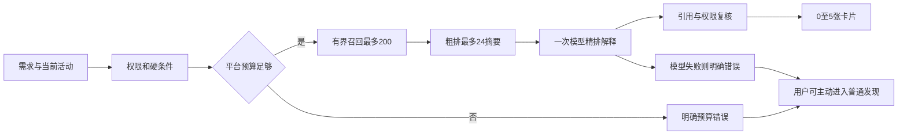

# 活动内发现与协作社交平台 · 完整方案 v3

> 更新：2026-11-10，设计同步修订 v3.4。状态：按用户最新反馈修订的设计基线，尚不代表应用已实现。
> 交付为一份总览、七份专题、一份验收；GameBuddy 是参考工程。

## 1. 产品目标与文档导航

产品首先具备完整的社交基础：登录、发现、广场发布、好友申请、文字聊天、想法讨论、个人资料编辑和隐私管理。AI 帮助整理资料、表达想法及发现协作者；关闭 AI 后基础社交流程仍可运行。

| 文档 | 主责 |
|---|---|
| 本文 | 确认决策、产品范围、需求编号及导航 |
| [系统架构与领域设计](系统架构与领域设计.md) | 模块归属、依赖、事务、参考项目 |
| [首次注册与开场引导·优化设计](首次注册与开场引导_优化设计.md) | 十步页面、恢复、可见性、独立重入 |
| [前端主应用交互设计](前端主应用交互设计.md) | 四板块与移动端/PC |
| [Agent 用户画像与资料处理设计](Agent用户画像与资料处理设计.md) | 来源、证据、草稿、确认版本及偏好 |
| [发现推荐与 Agent 工具设计](发现推荐与Agent工具设计.md) | 有界推荐、Skill、预算和降级 |
| [社交后端业务设计](社交后端业务设计.md) | 好友、会话、广场、讨论和治理 |
| [共享数据与接口契约](共享数据与接口契约.md) | 数据、状态、API、版本、权限合同 |
| [联调验收与交付路线](联调验收与交付路线.md) | 开发依赖、场景、规模测试及交付标准 |

[用户人工原稿](首次注册与开场引导_用户原稿_冻结.md) 保持冻结。[首次引导与 AI 调用实现方案](首次引导与AI调用实现方案.md) 为流程导读及早期验证记录，不另维护接口。

规则优先级为用户后续明确决定、本文确认决策、共享契约工程定义、专题实现说明。发现冲突先修订共享定义再同步专题，不能改写冻结原文。

## 2. 已确认的产品决定

| 编号 | 决定 | 主责 |
|---|---|---|
| R01 | 发现、广场、消息、个人四导航，移动端与 PC 功能等价 | 前端 |
| R02 | 推荐 GitHub 登录，同时提供邮箱验证码；账号合并须分别验证 | 社交 |
| R03 | 邀请链接/邀请码入活动；发现、搜索、随机浏览和 AI 找人限当前有效活动 | 契约 |
| R04 | 公开广场可跨活动发布及从作者头像加好友，不提供全站用户目录 | 社交 |
| R05 | 基础画像共用；参与角色、时间、目标和展示范围按活动独立 | 画像 |
| R06 | 原始文件、提取文本、来源记录在服务端数据库私有保存，不自动过期 | 画像 |
| R07 | 原始资料仅初次整理或本人主动重编辑时按需使用，不进入日常推荐与聊天 | 画像 |
| R08 | 十步引导；资料先行、主动补问 3–8 题、生成可编辑画像；规则基础与 AI 增强共用流程；多个独立想法与首轮最多 5 张卡片 | 引导 |
| R09 | 画像逐条设置 authenticated（陌生人可见）、friends（好友可见）或 private（仅自己）；访客不能读画像 | 契约 |
| R10 | 普通字段按当前好友关系动态展示；联系方式单独按人授权，原始资料不共享 | 社交 |
| R11 | 全部列表、随机浏览零 LLM；AI 推荐为独立入口和运行记录 | 推荐 |
| R12 | 召回最多 200，模型最多 24 条摘要，返回 0–5 张卡片，不跨活动凑数 | 推荐 |
| R13 | Skill 只调用受控业务能力，发送、接受、发布和授权由用户实际操作触发 | 架构 |
| R14 | 好友按全局用户对唯一；同一对最多一条待处理申请，反向申请不自动接受 | 社交 |
| R15 | 关注、入群、好友独立；长期想法可跨活动关联，各活动讨论隔离 | 社交 |
| R16 | AI 晚到结果不能覆盖用户确认版本，个人中心可独立重做模块 | 契约 |
| R17 | 关闭 AI 后可完成资料输入、规则问答、模板画像和确认；普通浏览、发布、好友、聊天和资料编辑可用 | 验收 |
| R18 | 不做人格或综合能力自动评分；推荐理由有依据，不编造契合百分比 | 画像 |
| R19 | 推荐统一使用 authenticated 字段；已发送申请的候选不重复推荐 | 推荐 |
| R20 | 可见条目超过 6 个月未确认时提示新鲜度；“确认仍有效”零 AI 成本且生成新确认版本，来源刷新不自动刷新画像时间 | 画像 |
| R21 | AI 预算不足时直接报错，不自动降级；预留用户付费字段用于后续扩展 | 推荐 |
| R22 | 自然语言需求不清晰时，允许最多 3 轮澄清对话，引导用户补充信息 | 推荐 |
| R23 | 活动结束后已有想法讨论群保持活跃，不自动归档；由发起者决定是否归档 | 社交 |
| R24 | 注册时长不限制正常协作；具备资格即可发布、发送合法外链和开放活动讨论，按真实行为限流/治理 | 社交 |
| R25 | 自然语言推荐同一 run 最多 3 轮澄清、合计最多 5 次模型调用；修复只占剩余额度，不另加第 6 次 | 推荐 |
| R26 | 资料优先：简历上传与 GitHub 导入首期必备、首屏前置；GitHub 首次注册自动关联公开来源，先预填关键信息再确认补缺，手填为兜底 | 引导/画像 |

不自动过期不取消本人主动删除和注销账号的入口。可见性扩大和数据授权均不能由模型决定。

## 3. 四个主板块

| 板块 | 入口与主流程 | 范围 |
|---|---|---|
| 发现 | AI 卡片、发布想法、想法/人选网格、筛选排序、随机换一批、详情 | 当前活动 |
| 广场 | 发帖、帖子流、详情、评论、点赞收藏、作者页、好友申请 | 明确选择公开或活动内 |
| 消息 | 好友申请、私聊、想法讨论、通知、未读和会话检索 | 既有会话独立授权 |
| 个人 | 展示页、画像来源、问答、可见性、想法、活动偏好、好友和隐私 | 本人管理及合法分享 |

手机底部导航，PC 侧栏；网格响应式一至四列。普通列表默认 24 条、最大 48 条，用服务端游标分页。随机批次稳定排序，换一批才新建批次，不调用模型。

保存草稿、发布到当前活动、分享到公开广场是三个动作。参与一个想法或成为好友不关闭继续发现的能力。

## 4. 十步引导与后续编辑

登录页保留匿名能力与想法弹幕背景；演示文本需标明，真实内容须经过公开授权。GitHub 登录不自动导入私人仓库或公开实名。

1. 首屏优先上传简历、导入 GitHub；GitHub 首次注册已自动关联账号，不重复粘贴链接。两项功能必须交付，用户可只提供其一；网页/文字为补充。
2. 读取、解析本轮来源，批量生成首批关键信息，显示真实进度，支持部分成功。
3. 规则映射或 AI 提取形成待核对资料，用户确认、纠错和补充；直接填写使用同一资料编辑入口。
4. 基于已确认首批信息，由规则题库或 AI 一次准备 3–8 题，主动了解剩余协作维度和当前目标；提供选择、自由补充和跳过。
5. 完整画像预览与逐条可见性设置。
6. 一个或多个想法输入，未成形时可写希望共创的方向。
7. 批量整理想法，保持输入与输出一一对应。
8. 画像与独立想法组合预览，复核非好友/好友视图，保存不自动发布。
9. 在有效活动内找候选；无活动时提供邀请入口或先进入广场。
10. 最多 5 张卡片，发送申请后可进入应用，无需等待对方回复。

没有已验证活动时只问通用偏好；加入活动后用确定性表单补角色、时间和目标，不重生成整份问卷。个人中心复用独立业务用例，不创建虚假的新手会话。

## 5. 推荐与 Agent

200 人时处理活动内轻量字段；规模增加后用活动和全文索引、有界语义检索。模型上下文不随人数线性增长，不预计算所有用户两两 AI 配对。

固定入口正常 1 次、含修复最多 2 次；自然语言无澄清正常 2 次、含修复最多 3 次，有澄清时同一 run 合计最多 5 次。最多 3 轮澄清，整轮最多一次检索工具；修复只有在预留后续调用后仍有余量时允许，不能在 5 次之外追加。精排目标约 6,000 token，完整模型请求 UTF-8 上限 24 KiB。平台预算不足直接报错，不自动降级；模型失败保留明确失败状态，用户可主动选择普通发现。

产品 Skill 是版本化任务包，包括指令、结构、工具白名单、预算和降级；与开发者 architecture-patterns Skill 分开。文本模型统一由服务端适配层使用已配置的 gemini-3.8-flash 网关别名；embedding 独立适配。

## 6. 字段、好友与活动边界

发现范围决定在哪里找到人，字段可见性决定合法找到后能看什么。所有登录用户可见不等于全站可搜索，好友可见不等于推荐工具可读。

普通画像按当前 visibility 与好友关系计算，不为每位好友复制静态字段清单。联系方式使用独立定向授权。活动专属字段额外要求相应活动资格；新 AI 内容保持私有草稿，未经确认不展示。

广场和活动复用好友申请。接受后事务建立好友、会话和必要的联系方式授权，并写通知；提交后才播放配对成功动画。活动切换或结束不删除既有好友及私聊，退出活动撤销对应发现和讨论权限。

## 7. 技术与交付阶段

Next.js/React 响应式前端、FastAPI 模块化单体、PostgreSQL 权威数据库、Redis 缓存/限流/队列、后台 worker。原始资料首期使用数据库私有存储；向量及缓存可重建。

| 阶段 | 闭环 |
|---|---|
| A | 普通账号、邀请活动、手工画像/想法、权限与社交接口 |
| B | 四板块、十步可手动完成、好友、文字聊天与广场 |
| C | 画像整理、固定问卷、想法整理和独立重编辑 |
| D | 有界推荐、受控自然语言 Skill |
| E | 跨活动/并发负例、双端与规模测试、活动试点 |

首期不做音视频、聊天附件、后台代聊、隐形私信画像、全平台用户评分或跨活动 AI 搜索。本人资料导入不等于聊天附件。

## 8. 完成标准与现状

本轮交付是可交接的设计文档、统一权限/接口和完整验收场景。应用实施时需验证关闭 AI 的社交闭环，并用 200/2,000/20,000 名合成成员检查预算。

文档中的 API、数据表和测试指标是待实现合同。参考工程、第三方宣传数字和有限网关探测不能当成本项目已上线或已压测的证据。
