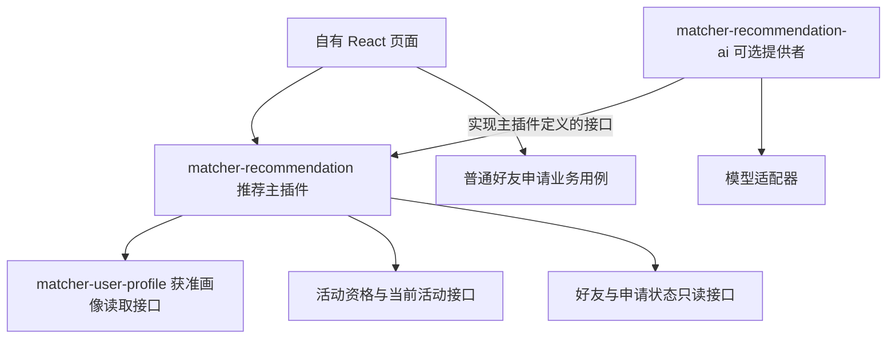

# 推荐模块：插件接入与字段配置

> 核验日期：2026-11-11（Asia/Shanghai）。范围：本机 HumHub 1.19.4 源码、安装后字段定义与公开 GitHub 项目。
> 本文是可编辑的插件设计与调研，不是已上线能力。配套 JSON 和 Python 仅做离线字段配置实验，不修改运行中的 HumHub 配置、不启用模块、不读取个人资料值。
> 本文从原 backend-research 调研迁入；项目匹配、性格/协作偏好、相似与互补规则以 [本轮细化](02_项目角色与性格协作匹配.md) 为补充，后端选择以 [新调研](03_GitHub参考后端调研.md) 为准。
> 产品规则沿用 [共享契约](../共享数据与接口契约.md) 与 [发现推荐设计](../发现推荐与Agent工具设计.md)。这里的 PHP 插件路线不自动替换项目的目标技术方案；冻结原稿保持不变。

## 1. 建议做什么

建议新增 `matcher-recommendation` 模块，让它通过稳定接口读取普通资料插件提供的获准画像，提供活动内的规则发现、候选召回、解释证据和反馈记录。可选 `matcher-recommendation-ai` 再实现重排与解释。沿用 HumHub 安装、依赖、迁移和事件机制，不另造插件框架，也不先拆推荐微服务。所有模块名均为拟定名称。

推荐先回答三个问题：你现在想认识什么人，你们有什么可以开始交流的话题，双方在时间与协作方式上是否可能配合。相似是其中一种匹配方式。找同好重视共同兴趣；找搭档同时重视能力互补。

首版重点是需求、兴趣或主题、贡献或技能、可用时间、协作方式。性格标签、活跃榜、好友数量不作为默认主分。用户不应为了获得推荐而被迫先积累发帖、关注和好友历史。

## 2. 当前 backend 已有什么

**2026-11-11 R0 补充：** 下表的 27 个字段是原生安装快照；P1 现已进入 S2，目录版本2包含37类普通资料字段，并有单用户 `ProfileService::getProfile()`、Space 正式成员和屏蔽校验。推荐必须通过应用层及用途白名单读取，不能以原生字段表或全部 authenticated 条目代替。新增联系方式默认可见也不进入匹配。最新接口与缺口以 [R0 接入合同](05_R0接入契约与边界核验.md) 为准。

| 已核对对象 | 现状 | 对接含义 |
|---|---|---|
| HumHub 模块加载 | 原生 `module.json`、`config.php`、`Module.php` 与事件、迁移机制 | 新增自己的模块目录即可承载功能，不修改核心安装器 |
| 原生 ProfileField | 定义 `internal_name`、字段类型、标题、visible 等；Profile 动态生成规则 | 可以发现字段目录并配置映射，但这些元数据不是逐用户逐字段的授权记录 |
| 安装后字段快照 | 27 个定义，包括 about、title、city、country，以及姓名、联系方式等 | 当前没有结构化 skills、interests、找人需求、可用时间、协作风格字段 |
| Suggested Following 1.0.0 | 安装包存在，部署记录为未启用；按二度关注重合数排序 | 可以看其 Widget 和服务接入；不能当成按资料匹配或当前活动推荐 |
| 活动与逐字段授权 | 原生预览仍缺项目要求的当前活动上下文、资料确认及细粒度披露 | 这些是推荐可开放给用户前的依赖，不是调几个权重就能补齐 |

安装字段以 [profile-fields.json](../../backend/deploy/profile-fields.json) 为依据；不拿 `Profile.php` 的历史 PHPDoc 当成实时字段目录。`ProfileField` 编辑表单将现有 `internal_name` 设为只读，管理员改显示标题通常不会改变内部名。跨环境迁移、删后重建和代码修改仍需要映射检查。

Suggested Following 的 [服务实现](../../backend/protected/modules/suggestedFollowing/services/SuggestedFollowingService.php) 先读取本人关注，再读取这些人的关注，按重合次数取前若干人，随后过滤账号状态。这里没有当前活动限制、画像相似计算或本项目的联系历史排除；不能通过配置数量变成完整找朋友插件。它使用 Follow，不能把关注边当成已确认好友。

## 3. 干净接入的边界

按最新 [普通资料插件与引导边界](../用户画像收集/02_后端能力与插件设计.md)，推荐依赖 P1 `matcher-user-profile`，不依赖 P2 引导是否安装或完成。资料 AI 辅助填写与推荐 AI 重排是不同提供者。



主插件只拥有推荐策略版本、映射配置、派生索引、曝光和推荐反馈。画像、活动资格、好友关系与消息仍归原业务模块所有，不另复制一份可编辑正式资料。好友按钮调用普通业务用例，推荐模块本身不创建关系、发送消息或授权联系人。

建议目录放在 `protected/modules/matcher-recommendation/`，私有开发也可以使用原生配置支持的专用加载路径。

```text
matcher-recommendation/
├── module.json / config.php / Module.php
├── domain/           候选、匹配规则、证据、策略值对象
├── application/      DiscoverPeople、PrepareCandidates、RecordFeedback
├── contracts/        领域可依赖的窄接口与纯数据类型
├── adapters/         HumHub 查询、字段目录、队列、缓存实现
├── controllers/      认证、参数解析、调用用例、响应转换
├── migrations/       只管理本模块拥有的数据
└── tests/            内存适配器用例测试、少量真实接入测试
```

建议先定义六个接口，名称是设计提案，不是 HumHub 现有 API。

| 接口 | 负责内容 |
|---|---|
| CurrentEventAccess | 服务端解析当前活动并重验成员、状态；不能信任浏览器只传一个 Space ID |
| ProfileFieldCatalog | 字段定义、类型、稳定键与 schema 指纹；不提供个人资料值 |
| CandidateProjectionReader | 返回已确认 authenticated 的最小字段和版本；不返回完整 User/原始资料 |
| ContactEligibilityReader | 屏蔽、好友、申请及本人历史联系排除；不向算法披露完整社交图 |
| CandidateScorer | 对获准投影与明确需求打内部排序分，并产生可引用证据 |
| RecommendationReranker | 可选提供者；接收已过滤候选与预算，返回有证据约束的结果 |

领域和应用用例依赖这些接口；Yii、ActiveRecord、SQL、HTTP 和模型 SDK 留在外层。同一 PHP 进程通过接口调用即可，不为插件间调用绕一圈 HTTP。原生插件不是权限沙箱，安装任意 PHP 插件也不等于隔离其数据库能力；上述限制需要代码与测试落实。

`module.json` 使用原生 `humhub.modules` 声明真实必需依赖；AI 扩展单向依赖推荐主插件，主插件不硬依赖 AI 扩展。活动接口具体由哪个包实现，应随实际实现决定，不能在元数据中假装一个尚不存在的活动模块已安装。

`config.php` 只声明模块、路由、事件等静态装配，不查询当前用户、不调用模型。业务策略配置使用经过校验的模块设置或策略版本表。启用、停用和升级只影响本包负责的数据。HumHub 原生 `disable()` 会调用卸载迁移并清理模块设置，暂停推荐应设计为业务开关，不能把原生停用默认当成无损暂停。

用户端沿用自有 React、AffectUI + Shadcn UI Kit；后端插件暴露能力与数据，不把原生 Widget 的视觉样式带入正式页面。原生 Widget 适合参考挂载方式，不代表已经完成 React 集成。

## 4. 各类信号应该怎样用

| 信号 | 建议位置 | 可接受依据与限制 |
|---|---|---|
| 当前找人需求 | 最优先，决定本次匹配方向 | 本次明确输入、本人选定的活动目标、所缺贡献；硬条件仅来自用户明确要求或系统资格规则 |
| 兴趣、主题 | 首版主要相关性 | 双方确认过的标签、项目主题、自述中的可引用证据；文本很像不代表真实需求相同 |
| 技能、贡献 | 根据目的选择相似或互补 | 同好可比较共同技能；组队应比较我的需要与对方能提供什么，反向有明确需求时再检查互补 |
| 时间、协作方式 | 首版主要可行性 | 实际可投入时段、线上或线下偏好、沟通节奏；字段缺失标为待确认 |
| 活跃程度 | 首版不进默认评分；将来只考虑有限的辅助信号 | 更偏向用户主动表示近期愿意交流，而非按登录/发帖次数给人排优劣；不惩罚新用户或回复慢的人 |
| 性格与协作倾向 | 纳入自愿提供的特征及明确偏好匹配 | 可比较沟通、决策、分工偏好；MBTI 仅作本人自述或明确筛选条件，不预置未经验证的类型绝配表，不从简历猜人格 |
| 帖子与想法 | 想法可使用既有获准活动投影；帖子作为以后独立扩展 | 首版可让本人主动选择相关作品并确认成画像信息；不自动读取全部帖子、私聊或每发帖重跑画像 |
| 熟人、共同好友 | 首版只用于关系排除，不用于排序 | 以后需先定义社交图使用与披露权限；无权查看的关系连“有几位共同好友”也不能暗示 |

广场公开帖作者的合法联系入口可以跨活动，但帖子话题不能成为跨活动推荐候选的后门。即使以后增加帖子信号，候选人仍须属于服务端验证的当前活动；隐私、删除和可见性撤回必须同步影响派生证据。

不把原生的电话、邮箱、街道、生日、性别、姓名相似度或社交 URL 当默认匹配特征。地区只有用户表达线下需求或地点偏好时才参与；同城不自动意味着更合适。GitHub 只能使用按本人导入流程确认的技术与项目摘要，不定期抓取主页、不用提交次数推断能力。

### 两个模式与双向意愿

“认识同好”与“找合作伙伴”可以复用同一个用例和候选池，区别在匹配函数：前者偏共同主题，后者偏需求与能力互补。这是建议的产品表达，增加公开参数之前应同步共享契约，当前草案没有新增 API 枚举。

例如，我会设计、正在找后端；候选人会后端、也明确想找设计伙伴。这个组合比“我们都写 React”更能解释合作价值。反向需求必须来自对方已确认且可用于推荐的字段；没有填就写“尚不确定对方需要什么”，不替对方表达意愿。

后续若要尝试双向匹配，可比较 `S(A需要, B提供)` 与 `S(B需要, A提供)`，试验几何平均或较小值聚合，避免单向很高掩盖另一方向很低。它们只是待校准的排序候选，不是双方会成为好友的概率，也不替换当前默认评分。

## 5. 动态字段配置如何适应变化

采用三层映射：原生字段目录 → 已获准的标准特征投影 → 推荐策略。算法只理解 interests、offered_skills、availability 等稳定语义，不遍历 `profile.*` 猜字段用途，也不依赖显示名称。

| 现有原生字段 | 可配置的用途 | 目前局限 |
|---|---|---|
| about / TextArea | 经过确认与脱敏投影后的 topic_text | 自述中的电话或私人段落不能因整个字段 visible 就进入索引；不能自动当成一组已确认技能 |
| title / Text | 对应普通资料的 headline，作为本人确认的一句话介绍 | 角色与本次需求分别读取 role/event_role 和 seeking/event_seeking 条目 |
| city / Text | 用户明确地点偏好时的地区比较 | 不默认做同城加分 |
| country / CountrySelect | 同上，按真实选项值比较 | 显示翻译不应改变匹配；跨环境选项编码需校验 |
| 新增结构化字段 | 兴趣、可提供技能、所需贡献、活动目标、时间、协作习惯 | 当前快照没有这些字段，需普通资料插件先建立并处理确认与授权 |

全局兴趣与能力属于全局画像；本活动想做什么、需要谁、这次什么时候有空属于活动偏好，不应都硬塞进全局 `profile` 列。原生字段可作输入映射来源，最终候选索引只消费普通资料插件的 confirmed + authenticated 投影。原生 `visible=1` 仅是必要元数据检查之一，不能代替用户授权。

管理页面建议按下列顺序配置：选择真实字段 → 显示内部名与类型 → 选择标准用途与白名单转换器 → 预览哪些维度可用 → 离线回放 → 发布版本。权重、别名词表和相似/互补策略可以配置；活动范围、权限、同意、联系状态和调用硬上限不能通过普通配置关闭。

| 变化 | 推荐系统应做什么 |
|---|---|
| 管理员把 about 的标题改为“个人介绍” | 内部名未变，映射继续有效；显示标签更新 |
| 新增一个字段 | 字段目录显示“未映射”，默认不参与推荐 |
| 管理员明确把新技能字段映射到 offered_skills | 检查字段类型、用途和授权路径，预览差异后发布新策略；不自动确认历史值 |
| 字段删除、类型变化、内部名迁移 | 阻止不兼容配置发布，停用受影响的旧派生特征并提示修复；不猜其他字段替代 |
| 枚举选项增删或含义变化 | 比较 schema 指纹，需显式更新词表映射；不能按列表位置继续解释旧值 |
| 用户把值改成 friends/private 或退出活动 | 同步撤销索引可用性，响应时重验；异步物理清理不延长访问权限 |
| 用户主动确认新资料 | 按版本增量生成获准投影，旧异步任务不得覆盖；不把后台索引更新变成重新抓来源或重跑画像 |

运行时配置绑定应记录字段来源、稳定内部键、类型和 schema 指纹。真正的用户条目与证据使用稳定 attribute_id 和确认版本；`selected_self_fields` 仍按共享契约使用本人的 attribute_id，不能用有可能重名的 key 取代。

### 本轮可执行的配置实验

以下保留为早期原生字段映射实验，不是生产配置或模块启动条件。它要求草案中被显式绑定的旧字段存在，只用于发现配置变化；不表示每位用户必须填写 about/title/city/country，更不表示推荐只能用这四列。生产方案改为 P1 语义目录→显式用途绑定→获准最小投影，新增字段默认不参与，缺可选项记未知。

- [config.draft.json](examples/field-mapping/config.draft.json) 只绑定当前真实存在的 about、title、city、country，拟增加的输入单独列出。
- [validate_config.py](examples/field-mapping/validate_config.py) 仅读取字段定义快照，检查映射、类型、白名单转换器、权重与数量上限，不读资料值。
- [离线核验报告](sources/field-mapping-checks_2026-11-11.json) 记录基线和内存中模拟的字段变化；没有修改数据库字段。

在项目根目录运行：

```sh
python3 docs/推荐模块/examples/field-mapping/validate_config.py
```

可以编辑草案的 bindings 与 weights 后重新检查；也可通过 `--catalog` 指定只包含字段定义的新快照。新增字段的模拟验证不能证明其业务意义或隐私合规已经验证。脚本不是通用生产配置验证器，没有执行字段值转换或验证枚举选项，也没有连接真实业务授权；其输出始终保留 `runtime_ready=false`。

## 6. 排序、理由和成本

首版沿用现有设计中的粗排维度，不新增未经确认的线上权重：主题 0.35、贡献/角色 0.35、时间 0.15、协作方式 0.15。只对本次表达的需求维度归一化；不相关的地域不强行加分。匹配值沿用 0/0.5/1，软条件未知暂记 0.5 并单列待确认，未知不能满足硬条件。

随后按原设计以 `0.8 × match_score + 0.2 × rrf_score` 合并召回证据；维持至少一个明确主题或贡献依据、match_score 至少 0.35 的门槛。这些是工程起点，需要人工样本校准，不能显示成“95% 契合度”。配置草案只包含维度权重和上限，完整排序仍由版本化策略实现。

推荐卡应给出一到两个真实理由和一个重要未知项。例如下列完全虚构的展示示例：

> 你正在找能搭后端 API 的伙伴；对方确认过 Python/FastAPI 项目经验，并表示想找设计伙伴。你们都选择周末线上协作。对方本周具体可投入时长还没填写。

每条理由附 source_attribute_id 或合法 idea 证据引用、版本、匹配条件和解释模板键。只有已确认的字段能支持肯定表述。缺少证据时删掉理由或返回不足，不让 LLM 生成“很热情”“性格合拍”“一定愿意回复”。卡片展示前重新验证证据可见性，不能只把正文隐藏而保留泄露私密信息的匹配理由。

管线保持：服务端验证活动与资格 → 应用关系排除 → 只读获准投影 → 有界召回 → 规则排序与多样性 → 可选 AI 重排 → 权限和证据重验。关系排除用于 AI 人选推荐，包括有效好友、任一方向 pending，以及本人曾发送过申请的对象；不扩展到普通网格、随机浏览和好友页。原生 Friendship 不能单独提供全部终态历史，需要社交域的申请记录。

规则发现使用既有 `/api/v1/events/{event_id}/discovery` 的 relevance 或 `discovery-batches` 的 rule；普通发现、筛选、翻页、随机批次为零 LLM。AI 使用既有 recommendation-runs；最多 200 召回、24 个最小摘要、最终 0–5 个，模型请求完整 UTF-8 长度不超过 24 KiB。固定入口最多 2 次，自然语言无澄清最多 3 次，有澄清同一 run 最多 5 次且最多三轮；没有第六次修复。AI 失败或预算不足明确报错，不暗中返回规则结果假装 AI 成功。

候选不足返回真实数量。普通规则发现不假装已经执行了 AI 推荐的全部联系历史过滤。规则发现分页沿用签名 cursor、默认 24/最大 48；草案的 final_limit=5 是 AI 卡片上限，不是普通发现分页上限。

缓存键至少关联活动、本人、查询/条件、策略版本和相关数据版本；每次读取都重验活动、关系和证据权限。15 分钟缓存不是撤权延迟。事件监听可用于标记失效，但原生 ActiveRecord 的 afterSave 不等于事务已提交；任务必须确认已提交版本并保证幂等，不能仅凭收到事件就发送完整资料或启动模型。

## 7. GitHub 参考方向已更新

按用户最新要求，优先研究 [HumHub example-basic](https://github.com/humhub/example-basic) 的插件接入。LightFM 不再作为首选新依赖；它的旧元数据快照仅作前次研究记录。

当前选择与固定提交源码核对见 [GitHub 参考后端调研](03_GitHub参考后端调研.md)。新增匹配语义与 AI 接入见 [项目、角色与性格协作匹配](02_项目角色与性格协作匹配.md)。区分可运行后端、推荐引擎、算法库与演示项目，不把相似检索等同于角色互补或团队组建。

## 8. 怎样判断推荐是否好

优先度依次是权限正确、条件满足、理由有据、用户愿意联系、联系对双方有用。点击率和平台停留时长不足以代表找到合适朋友。

- 离线先用明确标注为虚构的案例，覆盖同好、技能互补、时间冲突、资料缺失、新用户、无候选和权限撤销。检查推荐理由是否能逐条回溯。
- 上线后在已定义的最小化埋点规则下观察每次合法曝光的申请率、接受率、明确负反馈和候选曝光分布；不要读取私聊文本训练或猜合作质量。需要新增反馈数据时先同步契约。
- 未发送申请、一次跳过、暂时没回复不是可靠的负样本；“不需要这项技能”只影响本人的本次需求，不全局降权对方。
- 同分或近分候选按既有设计轮换较少曝光者，探索位也需满足相关门槛。避免总把好友多、帖子多的人放在最前。
- 使用真实反馈做离线评估时按时间切分，避免未来关系和曝光泄漏到训练；首期样本不足时报告不足，不给虚构准确率。

## 9. 实施顺序与完成条件

1. 按 [task.md](task.md) 先完成 R0 契约和合成合同验证，再做 R1/R2 模块装配与内存规则用例；不等待真实数据接口全部交付，不依赖 LLM。
2. R3/R4 接真实数据前，接通 P1 推荐用途批量投影、可信当前 Space、当前关系/屏蔽及版本重验；相关普通资料入口保护由其负责域完成，不能让原生 People/REST 绕过推荐政策。
3. R5 用隔离环境验证两活动无候选串用、字段撤权、关系变化和旧任务失效，并区分合同测试与真实应用验收。
4. R6 再接可选 AI 扩展，以及真正交付的统一任务/预算基础能力；AI 人选另外需要终态申请历史。R7 验证生命周期。

设计与离线配置实验之后，2026-11-11 已完成 R0–R2，并交付 R3 推荐侧适配，当前进展与阻塞见 [08 R3 核验](08_R3真实适配与依赖核验.md)，此前阶段见 [07 R2](07_R2规则配置与评分验收.md)、[05 接入契约](05_R0接入契约与边界核验.md) 和 [06 R1](06_R1主模块骨架与内存验收.md)。原生资格/关系与 SQL 召回已用隔离 SQLite 验证；P1/隐私批量投影、真实索引同步和公共 API 未接通。用户保持其他插件只读，预览环境未启用或迁移，合成用例不证明真实推荐质量。

## 10. 源码与资料入口

- [ProfileField](../../backend/protected/humhub/modules/user/models/ProfileField.php)、[Profile](../../backend/protected/humhub/modules/user/models/Profile.php)、[安装字段定义](../../backend/deploy/profile-fields.json)。
- [模块开发](../../backend/docs/develop/module-development.md)、[模块设置](../../backend/docs/develop/concept-settings.md)、[事件说明](../../backend/docs/develop/module-event-handler.md)、[Module 生命周期实现](../../backend/protected/humhub/components/Module.php)。
- [Suggested Following 服务](../../backend/protected/modules/suggestedFollowing/services/SuggestedFollowingService.php)、[配置表单](../../backend/protected/modules/suggestedFollowing/models/ModuleSettings.php)。
- [NetworkX 链路预测固定源码](https://github.com/networkx/networkx/blob/c32b376b53229f2b2a2d06029c25a852737efdc2/networkx/algorithms/link_prediction.py)。其余项目固定提交和 README URL 见仓库证据 JSON。
- [architecture-patterns Skill](../../.agents/skills/architecture-patterns/SKILL.md)。
