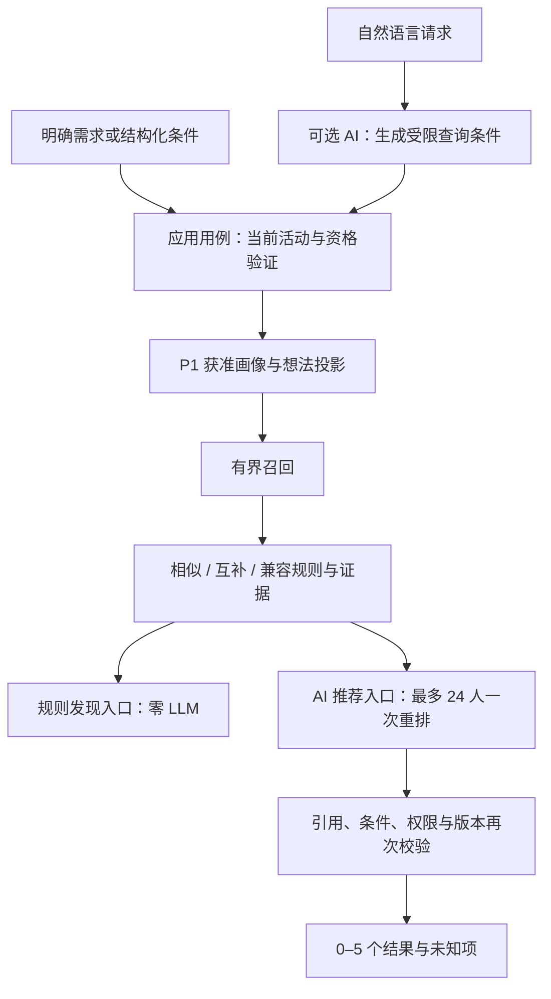

# 项目、角色与性格协作匹配

> 日期：2026-11-11。本文保留匹配设计及范围。R2 已实现结构化人物规则内核，实际能力与测试见 [07 R2 验收记录](07_R2规则配置与评分验收.md)；AI 接口、真实项目上下文与团队求解服务尚未实现。
> 继续遵守 [共享契约](../共享数据与接口契约.md) 和 [发现推荐设计](../发现推荐与Agent工具设计.md)。字段权威定义见 [普通资料与活动字段](../用户画像收集/03_用户资料与字段设计.md)。

## 1. 这次要解决的问题

推荐应能区分“兴趣接近”“可以一起做一个项目”“角色相互补足”“相处方式符合双方偏好”。这些关系可以同时成立，也可以冲突，不能用一个向量相似度替代。

用户举的“领导者配技术配商业”，适合解释为协调推进、技术实现、商业验证三类贡献。它们不是人格高低或固定身份；一个人可以会技术，也愿意负责客户访谈，还可能在本次活动只想做开发。长期能力、本次愿意承担的角色、当前项目真正缺什么，需要分别记录。

设计目标是返回一组有共同目标、贡献合适、协作条件可行、理由可核对的人。推荐只是认识或合作的建议，不能自动成为好友、加入项目或替人承诺承担职责。

## 2. 四种规则应分别建模

| 规则类型 | 比较什么 | 有用示例 | 不应怎么做 |
|---|---|---|---|
| 相似 similarity | 兴趣、项目主题、希望解决的问题 | 都想做教育工具，或都喜欢硬件创作 | 对所有字段都求相似，最后推荐三个完全同质的人 |
| 互补 coverage / supply-demand | 需求与贡献、项目缺口与候选意愿 | 当前已有协调和产品能力，需要技术实现；候选人愿意承担后端 | 看到两个标签不同就加分；按人格类型强制安排分工 |
| 兼容 preference compatibility | 本人的协作偏好与对方表达的习惯 | 一方愿意推动讨论，另一方明确希望有人协调；双方接受异步沟通 | 认为所有“相反”都互补，例如快决策与谨慎决策必然合适 |
| 约束 eligibility / explicit requirement | 当前活动、权限、明确硬条件、可用时间 | 用户明确必须线下到场，但候选只能远程，则不符合该次条件 | 用兴趣高分覆盖资格或硬条件冲突；缺失字段自动视为满足 |

相似与互补只对特定维度有意义。例如主题上相似、角色上互补、时间上有交集、沟通上能接受，才构成一个可解释组合。差异规则必须有明确的项目需要或本人偏好支持。

## 3. 三个产品场景共用一个内核

### 3.1 认识同好

以共同兴趣、长期方向和想聊的话题为主，再比较用户明确表达的协作/交流偏好。没有项目也能使用。此场景不为了“补齐技术商业角色”把兴趣完全不相干的人强塞给用户。

### 3.2 为项目找人，或为人找项目

当前已有的 `target_type=person/idea` 与 `current_idea_id` 可承载基本方向。项目提出需要什么，候选人提供什么、愿意做什么；反向也可看用户的贡献与获准想法需求是否相符。

判断贡献不能只看技术名词重合。例如项目处于用户验证阶段，缺的是访谈、行业经验和商业验证，额外加入相同技术栈的人未必解决当前缺口。项目阶段与缺口需要用户确认，不由模型自行改写。

### 3.3 为已有组合补充角色

“协调者 + 技术 + 商业”的需求进一步涉及组合整体。先计算当前已明确的贡献覆盖，再看加入某候选能补多少缺口，不能简单取人与人分数最高的前三位。

这是后续组合预览能力。现有讨论成员、想法关注者、好友都不能自动被视为承诺加入的团队成员；不新增隐式团队关系，也不把 `target_type` 擅自扩展为 team。正式增加组合接口与状态前需同步共享契约。

## 4. 输入字段与归属

普通资料插件 P1 `matcher-user-profile` 负责正式资料、确认和可见性。推荐插件仅读获准投影，不要求安装或完成引导。输入优先使用现有设计中的字段，不再发明一套独立画像库。

| 推荐使用的含义 | 已有设计字段/来源 | 应怎样解释 |
|---|---|---|
| 兴趣与长期方向 | interest、direction | 本人确认的兴趣与关注方向，不等于已掌握的技能 |
| 能力与经历 | skill、role、project | 可以提供什么及其来源；自述不冒充第三方认证 |
| 本次目标 | event_goal、event_seeking | 正在找项目、找搭档、交流或学习，可并存 |
| 本次角色与贡献 | event_role、event_contribution | 本次愿意承担什么；不能把所有历史技能都视为愿意投入 |
| 时间与方式 | event_availability、event_time_commitment、event_collaboration_mode | 时间区间、时区和投入意愿；未知项单列 |
| 协作习惯 | collaboration_preference、communication_preference | 本人自述的工作与沟通偏好 |
| 性格类型 | mbti，可选 | 仅本人自述；不自动推断，不作为客观测评结果 |
| 项目需要 | 当前获准 idea/活动关联投影 | 目标、阶段、所需贡献、约束，带确认和活动版本 |

建议在协作偏好字段的候选 schema 中表达“自己怎样做”与“希望对方怎样做”，例如决策节奏、主动发起讨论的意愿、计划详细程度、同步/异步沟通偏好。它们是待确认的子结构，不是已经存在的新 API 字段。可分别选择相似、互补、可接受范围或无偏好。

MBTI 可作为本人明确选择的查询偏好，但不预置“某类型必须配某类型”的通用兼容表。性格匹配也可以完全不用 MBTI，通过具体行为偏好实现。没有填写人格/协作字段不扣道德或能力分；返回“该项未知”。

一个人可具备多个角色。角色词表使用语义稳定的编码，显示文案可变；领导协调、技术实现、商业验证是首批讨论用分类，不应限制设计、研究、硬件、运营等贡献。能力与角色的对应关系需要证据和本人意愿，不能由管理员配置一条“外向=领导”规则代替。

## 5. 项目互补与双向匹配

### 5.1 缺口贡献

对当前项目确认的需求维度 d，定义需要量 need[d]、已明确覆盖量 coverage[d]，得到 gap[d]。候选贡献只能使用本人已确认且本次愿意投入的 offer[c,d]。

```text
gap[d] = max(0, need[d] - coverage[d])
gain(c) = sum(priority[d] × min(gap[d], offer[c,d]))
```

这个表达是规则设计示意，不是当前已经有了可比较的技能数值。首版可以采用“未覆盖/部分覆盖/已覆盖”及明确角色证据，而非凭简历自动生成 0–100 能力分。数量尺度、归一化和 priority 需要版本化与人工样本验证。

候选与当前成员不同，但不能填项目缺口时，互补分应为零。加入同类角色是否仍有价值由项目需要的数量、分工和投入决定，不能一概认为重复角色无用。

同一人能做多个角色，也不能在有限时间下被当成三个满额成员。组合求解时需显式分配任务/角色与容量；人数、时间和是否独占参与不能由算法臆造。当前项目规则允许参与多个想法，不得默认全活动每人只能分到一个项目。

### 5.2 双向需求

`A需要 ← B提供` 与 `B需要 ← A提供` 是两个方向。双方都明确表达时，能生成“双向互补”的理由；只知道一个方向时就说明单向满足和未知项。

在离线试验中可比较较小值或几何平均等聚合方式，避免单向高分掩盖另一方向冲突；在数据不足时不把缺失方向当作已满足。具体方式还需校准，本轮不修改当前线上评分定义。

### 5.3 从排名到组合

首版仍给用户推荐人物，不强制分组。将来组合预览可在同活动的有界合法集合内，用贪心覆盖或约束求解比较不同组合。求解器只读取匿名化候选 ID、获准特征与明确约束，不读取来源原文。

求解超时、无可行组合或未知信息不足时返回真实状态，不放宽活动/权限/用户硬条件，不改成全活动随机配组。返回的是建议，最终邀请、接受与角色承诺均由普通业务操作完成。

## 6. 推荐主插件与 AI 扩展

无 AI 独立运行、30 多人/300–400 人候选策略、评分后的弱匹配处理与工具契约进一步细化在 [候选规模、评分与 AI 扩展边界](04_候选规模评分与AI扩展边界.md)。主模块拥有完整规则匹配；AI 包单向依赖主模块契约，工具只向模型返回最多 24 个最小摘要。

建议仍只新增两个主要包：`matcher-recommendation` 与可选 `matcher-recommendation-ai`。相似、互补、兼容等是主插件内的策略实现，不必再拆成多个可安装插件。普通资料能力继续由独立 P1 提供。



接口建议：

- `ProfileProjectionPort`、`IdeaProjectionPort`、`CurrentEventAccess`、`ContactEligibilityReader` 提供经过授权的事实。
- `RuleEvaluator` 接收明确类型的事实与 QueryIntent，输出分项、命中证据、冲突和未知项；内核不导入 Yii、ORM、HTTP 或模型 SDK。
- `RuleRegistry` 只注册代码中审核过的规则类型。策略 JSON 选规则与参数，不执行任意 SQL/PHP/Python。
- `QueryInterpreter` 与 `CandidateReranker` 是可选 AI 端口；PHP 适配器可以调用现有模型网关，必要时再复用统一 Python worker，不先拆新微服务。
- `TeamCompositionSolver` 是后续可选适配器，不是首版人物推荐的必需依赖。

### AI 可以做的三件事

1. 把“我负责产品，想找对硬件感兴趣、愿意一起跑客户的人”整理为主题、角色需要、时间和偏好。只有明确要求才转硬条件，不能凭空补充人格、年龄、学历要求。
2. 理解不同表达之间的关系，例如项目目标与经历描述的语义相关性；必须引用已经确认的证据，不生成新的正式技能或人格。
3. 在获准候选中重排并解释“为什么合适、哪里互补、什么还未知”。模型不能增加候选人、越过活动边界、修改正式资料或发出邀请。

资料抽取属于 P1 与导入流程，推荐请求不重新解析简历、不重抓 GitHub、不从发帖内容持续推断人格。普通发现、翻页和切活动不触发模型。

### AI 输出与事实检查

建议内部结果包含 candidate_id、rule_hits、evidence_refs、unknowns、conflicts。证据引用绑定 attribute_id/idea 条目及版本，避免只返回一段无法验证的自由文案。所有字段都是内部 DTO 提案，公开结果仍遵守共享契约。

例如“候选人愿意做商业访谈”必须引用其明确意愿条目，不能仅凭有销售经历推出。“性格互补”应解释为双方明确的具体偏好，例如愿意协调讨论与希望有人协调，而非不透明的人格配对结论。模型输出未经授权的引用、池外 ID 或编造事实时，按原 run 的剩余预算修复或明确失败。

### 预算不因新增策略而增加

沿用最多 200 合并候选、最多 24 个最小摘要、最终 0–5 人；完整模型输入最多 24 KiB。不能对 200 人逐个调用模型或对所有人两两调用。

固定入口最多 2 次；自然语言无澄清最多 3 次，有澄清同一 run 最多 5 次且最多三轮问题，包含修复。条件生成、重排和修复共用预算，不能因为新增 personality/role 评估器就各自启动一个额外模型请求。无候选不精排；预算不足明确报错，用户可主动改用规则发现。

## 7. 配置如何表达相似与差异

采用“字段绑定 + 规则类型 + 触发条件 + 参数 + 理由模板”的版本化配置。对应 [策略草案](examples/matching-policy.draft.json)。它是设计格式，不是 HumHub 或开源引擎直接支持的现成配置，不由原来的字段映射校验脚本加载。

典型规则：共同主题用 similarity；当前项目缺口用 coverage_gain；本人需要与对方贡献用 supply_demand；协作习惯用 explicit_preference；时间用 interval_overlap。MBTI 的规则仅在本人明确选择该偏好时启用，不配置默认绝配矩阵。

配置负责选择规则，不负责授权。服务端活动范围、候选字段权限、联系排除和硬上限在策略之外执行，无法通过上传配置关闭。当前权重基线仍沿用主题 0.35、贡献/角色 0.35、时间 0.15、协作方式 0.15；本轮不擅自增加人格单独权重或把不同分数尺度直接相加。新规则先归入相应维度，在离线样本中验证聚合与归一化再发布。

对缺失条件沿用现有约定：没有提出的维度不参与；软条件未知单列并按现有中性逻辑处理，不能产生肯定理由；硬条件未知不能算满足。资料丰富度不是能力分。

AI 将来也可以辅助管理员提出映射或参数修改草案，但只输出可审核 diff、理由和受影响场景。管理员确认、类型检查、离线回放与策略发布是独立流程；模型不直接修改线上配置。这个管理辅助能力不在用户推荐 run 内偷偷执行。

## 8. 展示示例与验证场景

以下全部是假设案例，不是实际用户资料。

| 情况 | 期望结果 |
|---|---|
| A 想做教育硬件，负责产品；B 愿意做嵌入式；C 愿意访谈客户 | B、C 可分别补不同缺口，理由说明各自贡献，不只给最高兴趣相似者 |
| 两人兴趣相同，但必须线下/只能远程冲突 | 若线下为用户明确硬条件则不推荐；软偏好则如实提示 |
| 候选有商业经历，但本次只想学习开发 | 不把他写成愿意负责商业推进；当前意愿优先于履历推断 |
| 一人愿意协调讨论，另一人明确希望有人协调 | 可给出偏好兼容理由，不把二者定性为天生领导与服从者 |
| 两个人格标签不同，但双方没有表达希望互补 | 不因“不同”自动加分，也不编造冲突 |
| 只知道某候选符合我的需求，不知道对方需要什么 | 标记单向符合与反向未知，不写双向互补 |
| 第三人兴趣相近但无法补项目缺口 | 仍可能是交流对象，不能拿相似度冒充项目角色覆盖 |
| 候选退出活动、撤回字段权限或新资料取代旧版本 | 缓存、理由和异步结果均不得继续使用旧事实 |
| 新注册用户没发帖、没好友，但有确认的相关贡献 | 仍有正常推荐资格，不以账号年龄或关系数量挡住 |
| 当前活动没有符合条件的人 | 返回真实不足，不跨活动或隐式放宽硬条件 |

上线前应分别测规则事实正确性、解释引用、撤权、冷启动、角色覆盖和用户可控性。质量指标可观察真实申请/接受及明确反馈，不以人格标签组合或点击率自行证明合作效果。当前只完成文档和配置结构检查，没有运行这些业务测试。
