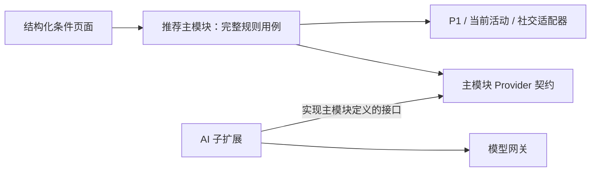

# 候选规模、评分与 AI 扩展边界

> 日期：2026-11-11。承接用户对 30 多人、300–400 人候选池及无 AI 独立推荐的要求。本文是执行设计；R2 的纯规则与合成验收见 [07 R2 验收记录](07_R2规则配置与评分验收.md)，尚未启用真实推荐服务或进行真实数据库性能测试。
> 上位规则见 [共享契约](../共享数据与接口契约.md)、[发现推荐设计](../发现推荐与Agent工具设计.md)。本轮细化包边界与选择策略，不新增公开 API 枚举，不改变活动、权限和调用上限。

## 1. 对用户建议的判断

以下方向采纳：

1. 推荐主模块必须先独立提供规则匹配，不需要模型密钥、AI 扩展或向量服务才能运行。
2. AI 作为推荐模块的可选子扩展，调用主模块的有界查询工具；不直接读取几百人的完整资料。
3. 用可解释评分排序，从较合适的人中挑选；条件强弱需要区分，避免软偏好全部变成硬筛选。

“无论如何都有推荐”需要限定。只要池中有合法且符合必要条件的人，就可以排序；但排名第一不证明达到推荐质量。没有合法候选、明确硬条件都不满足、或没有可引用依据时，打分也不能产生真实匹配。

产品目标应是让用户总有清楚的下一步，而非保证每次都有高质量人选。可以主动选择查看本活动成员、修改条件或补充自己的需求；不能跨活动补人、默认放宽硬条件或把低分人包装成高度匹配。

## 2. 先区分四个数量

- 活动/预选集合人数：可能 30 多，也可能 300–400；不等于都能进入本次推荐。
- 本次合法候选：扣除本人、资格/权限限制，并按入口执行关系政策和用户明确硬条件。
- 应用层粗排输入：最多 200 条轻量投影；这是上限，不是必须凑齐的数量。
- AI 上下文与最终结果：最多 24 个最小摘要、最终 0–5 张卡；也可以只有 4 个摘要、2 个结果。

数据库扫描多少索引行与应用收到多少候选是不同的指标。300–400 人可以参与同活动范围的数据库检索/预排序，应用仍最多接收 200 条粗排输入；不能先把 400 份完整资料读进模型再裁剪。

普通发现列表仍按签名 cursor 分页，默认 24、最大 48。AI 的五张卡限制不用于截断普通发现的全部可浏览人数；用户可通过普通发现继续查看当前活动的合法成员。

## 3. 两种规模的策略

| 场景 | 后端怎么做 | 怎样避免错误体验 |
|---|---|---|
| 约 30–40 人 | 优先使用当前活动内的精确结构化/全文检索；本地规则评估真实合法候选 | 不使用会无谓漏人的近似搜索；不要求满足所有软偏好；不强凑 24 个模型摘要 |
| 约 300–400 人 | 在数据库按活动资格、硬条件建立范围，按主题、所需贡献等召回；合并去重后最多 200 人粗排 | 不能取注册时间最早的 200 人；需要观测每路召回和遗漏，而非让模型看全部资料 |
| 有很多近似同分人 | 用共同目标、项目缺口、协作兼容及既有曝光轮换作选择 | 相近分数下减少重复角色/理由，避免首屏全是相同贡献；不为多样性引入无关人 |
| 合法候选很少 | 保留必要资格和明确硬条件；软偏好进入评分，未知项单列 | 真实有两人就显示两人，未填可选人格或没有发帖历史不自动淘汰 |
| 全部缺少明确匹配依据 | 不产生肯定匹配解释 | 提供需求补充与主动普通浏览入口，不把中性缺失分当成相似证据 |

继续沿用结构化 80、全文 40、可选语义 80 的各路上限，以及合并最多 200。没有语义提供者时该路关闭，剩余召回权重归一化；不把关闭一路解释成一定要用模型或补足 200。小池的结构化/全文路线应覆盖本次可用的明确证据，软偏好用 OR/排序组合，不能无意拼成大量 AND 条件。

每次查询只比较“本次需求/当前项目”与候选，不做全体用户两两 LLM 配对。30 与 400 的差别主要在后端检索和排序，不需要设计两套产品。当前没有压测结果，不承诺固定毫秒延迟或推荐成功率。

## 4. 哪些条件筛掉，哪些条件打分

| 类别 | 处理方法 | 示例 |
|---|---|---|
| 系统资格与权限 | 必须满足，不能由配置/AI 放宽 | 当前有效活动、合法入口、字段授权、屏蔽关系 |
| 用户明确的必要条件 | 先过滤；未知不能当满足 | “必须周六到现场”“只找愿意负责后端的人” |
| 用户表达的希望 | 参与排序，不做一票否决 | “最好也喜欢教育项目”“如果会硬件更好” |
| 可选且未提供的信息 | 标为未知，不生成肯定理由 | 未填人格、可用时间尚不明确、没有发帖 |

用户只说“找后端伙伴”时，需要区分“这是本次核心需求”与其是否表达了严格排他条件，按现有 QueryIntent/澄清规则处理。AI 不能把所有语义偏好都自动提升为硬条件，也不能为了返回结果擅自取消用户确认过的必要条件。

AI 人选推荐排除有效好友、任一方向 pending 申请和本人曾发过申请的对象；普通发现/规则批次继续展示真实关系状态，不套用 AI 的全部联系历史排除。该入口差异由主模块政策决定，不能交给模型自行选择。

## 5. 打分有用，但需同时记录依据与未知

沿用现有规则基线：主题 0.35、贡献/角色 0.35、时间 0.15、协作方式 0.15。没有提出的需求维度移除，再对这次查询统一归一化；所有候选使用同一组查询权重。

不能因为某个人只填了一个维度，就单独把这一项重标成 100% 权重。候选软条件未知仍按现有中性值 0.5 处理，并明确标记；这不是已匹配。0/0.5/1 的规则值及粗排公式保持原定义。

建议内部至少保留三组信息：

- **匹配分**：每一维的规则值、权重、理由和最终规则分。
- **证据覆盖**：本次所需维度中，哪些有当前可引用的明确证据，哪些仍未知。可按已知维度的查询权重汇总，但不当作成功概率或人的能力分。
- **冲突**：明确硬条件冲突直接拒绝；软偏好差异如实说明。

对相似、互补与兼容分别记录规则命中，例如共同主题、候选能补项目缺口、协作偏好互相接受。资料长短、GitHub 提交量、好友数和发帖次数不替代这些依据。

### 分数如何变成选择

1. 先通过资格、权限和硬条件检查。
2. 按既有粗排公式排序，不对每个候选池做 min-max 归一化把第一名强行变成满分。
3. 推荐质量门槛沿用至少一个明确主题/贡献依据、match_score 不低于 0.35；所有条件未知即使得到中性分也不能算推荐。该阈值是待校准的初始配置，不是已验证的准确率。
4. 满足门槛后按排序挑选；接近分数的候选按既有多样性和曝光规则选择，AI 最终最多五人。
5. 结果不足时如实显示，并给用户明确的主动探索入口。

例如，一个池里最高只有 0.2，它仍是第一名，但不能因此变成“高匹配”。另一个人所有信息都未知，可能有 0.5 的中性分，却没有一个支持推荐的事实。这说明分数与证据门槛必须一起使用。

### 如何降低打分错误的影响

用户可修改本次条件、权重策略的选择和明确硬条件，看到推荐理由并反馈“不符合技能/时间/协作偏好”。内部保存策略版本与证据引用，支持用人工标注的虚构样例回放。权重调整先离线比较，不因一次跳过或没有回复就全局惩罚候选。

首版不把规则分与模型分随意按比例相加。模型打出的 80 分与规则的 0.8 并没有天然相同含义。记录 rule_score 与 ai_rank 分开：规则入口直接用规则排序；AI 入口可在已经符合门槛的候选中重排，最终由主模块验证资格与证据。若以后融合分数，需要明确尺度、校准样本和版本，而不是先猜一个混合权重。

## 6. 空结果与弱匹配的呈现

| 真实情况 | 主结果区 | 可提供的下一步 |
|---|---|---|
| 有明确匹配 | 展示真实数量与理由，允许少于五人 | 查看详情、用户主动申请、修改需求 |
| 有合法人选，但未达到本次匹配门槛 | 说明“当前条件下暂未找到明确匹配” | 用户点击“浏览本活动成员”或“调整偏好”后进入普通发现 |
| 硬条件导致无人符合 | 清楚说明没有符合当前必要条件的人 | 本人主动改条件；系统和模型不能悄悄改 |
| 当前没有可用于本次推荐的合法新候选 | 真实空态 | 仍有权限时查看普通活动列表或已有好友；不透露被屏蔽者或私密资格信息 |
| AI 提供者失败/预算不足 | 明确失败，不能伪装成“没有合适的人” | 用户主动选择零模型规则发现 |

弱匹配探索是明确的用户操作和独立普通发现结果，不混入 AI 成功结果凑五张。用户主动放宽软偏好后，可以看到标有“相关性较弱/信息待补充”的合法对象；本人尚未放宽的硬条件仍有效。

这能避免整个页面只剩一片空白，但不能保证每次都有推荐对象。若活动内已没有获准人选，任何评分算法都无法诚实地产生候选。

## 7. 主模块必须能独立跑完整规则路径

### 两包职责

| 主模块 matcher-recommendation | 子扩展 matcher-recommendation-ai |
|---|---|
| 结构化条件与 QueryIntent 校验 | 将自然语言生成受限条件草案 |
| 当前活动、字段、关系与必要条件政策 | 按主模块许可发起工具请求 |
| 结构化/全文召回、相似/互补/兼容规则、内部评分 | 对最多 24 个获准最小摘要作语义重排与解释 |
| 规则理由模板、未知项、排序与分页 | 模型协议、提示版本和结构化输出转换 |
| 候选快照、反馈、策略版本、预算与结果复核 | 提供者的模型配置与能力注册 |
| run/job 的业务状态与适用性、缓存撤权 | 执行模型工作，返回结果给主模块决定是否可用 |

主模块依赖 HumHub 身份、P1 获准资料及活动/社交接口；“独立”指不依赖 AI 扩展和模型基础设施，仍正常依赖这些业务基础能力。模块内不强制引入 embedding SDK、模型密钥或 Gorse 服务。

产品层面 AI 是子模块扩展；打包上使用可单独安装/升级的 HumHub 模块，单向依赖主模块，更便于独立停用。无须以 Yii 嵌套模块代替可选包，也无须因此拆成两个微服务。



主模块定义 `QueryInterpreter`、`CandidateReranker` 等接口和纯数据类型。AI 包实现并注册，主模块通过接口调用；主模块代码不能 import AI 包的具体类。业务依赖始终是 AI 扩展 → 主模块契约，不形成安装依赖环。

### 不装 AI 时的路径

用户选择项目/主题、希望对方提供的贡献、时间和软硬条件 → 主模块验证 → 规则召回/评分 → 生成模板理由与未知项 → 返回规则匹配。普通发现和 rule 批次沿用现有 API，零模型调用；UI 清楚标为规则匹配，不需要先创建一个失败的 AI run 才能使用。

AI 不可用时，其入口应显示未启用或不可用；已有规则路径照常工作。用户已明确请求 AI 后发生故障，不自动切换结果类型。

### 停用与在途任务

暂停 AI 使用业务开关，停止新模型任务；已开始任务依 run 的状态和撤销规则处理。结果到达时若版本失效、权限撤回或任务不可用，不能发布。主模块保留自身策略、反馈与业务记录，AI 包的清理不能删除 P1 资料或主模块数据。

HumHub 原生 disable 会进入模块卸载/设置清理路径，不能把它当无损暂停。AI 包可以有自己的运行工作记录，业务层 run/job 的状态与 applicability 仍由主模块/统一任务域控制；移除提供者不会让晚到结果绕过主模块。

## 8. AI 怎样通过工具与后端合作

自然语言入口采用两阶段，工具由主模块执行：

```text
用户需求 + 本轮明确选择的本人最小字段
  → AI 解释需求，必要时有限澄清
  → 提出 search_candidates(target_type, intent, filters, current_idea_id?)
  → 主模块注入可信身份/当前活动，验证参数、资格和预算
  → 后端有界召回 ≤200，确定性评分并选出 ≤24 个最小摘要
  → AI 只在这些摘要中重排，引用证据，提出 ≤5 个结果
  → 主模块复核候选、硬条件、引用、权限和版本
  → 返回结果与真实未知项
```

固定结构化入口已经有 QueryIntent，直接由主模块准备候选，再调用一次 AI 重排，省掉让模型重新猜条件。

`search_candidates` 不接受模型提供的 viewer_id、event_id、SQL、任意字段列表或无限 limit。工具输出给 AI 的是精选摘要，主模块内部的 200 个粗排对象不会因为工具返回而全部进模型。原始资料、候选 friends/private 字段、联系人和私信均不返回。

内部工具结果建议带 run/snapshot 引用、候选 ID、规则依据、未知项及当前版本；这些是待实现的内部 DTO，不是本轮新增公共 API。快照绑定当前用户、活动和策略；不能用于跨用户、跨活动重放。向模型披露的计数与不足原因必须经过权限处理，不暴露隐藏用户或具体隐私过滤原因。

重排阶段不再提供检索工具。整个 run 仍最多一次 search_candidates，数据库各召回路在这一次后端执行内完成；不能靠模型反复换条件翻遍几百人。用户主动新建刷新遵循新的 run 与平台预算，不默默启动额外循环。

单候选序列化最多 768 字节、完整模型输入最多 24 KiB，候选最多 24 只是数量上限，超字节时减少数量。固定入口含修复最多 2 次模型调用；自然语言无澄清最多 3 次，有澄清同一 run 最多 5 次、最多三轮问题。所有适配器重试均计入预算，没有第六次修复额度。

模型不能决定最终授权：输出池外 ID、隐藏证据、编造意愿、违反硬条件或不合法结构时，主模块拒绝，按剩余预算有限修复或明确失败。模型重排也不能复活已经退出活动的人。

## 9. 验收应覆盖的场景

| 场景 | 必须验证的结果 |
|---|---|
| 35 人且只有 2 位有明确相关依据 | 返回真实的 2 位，不凑 5 位 |
| 35 人都有合法资料但全部不符合明确必要条件 | 空匹配结果与主动改条件入口，不宣称算法挑出最优即满足条件 |
| 35 人大部分没填可选性格字段 | 不因此剔除；有其他明确匹配证据者仍可推荐，性格项为未知 |
| 400 人且合格候选充足 | 应用粗排 ≤200，AI 摘要 ≤24 且总输入 ≤24 KiB，最终 ≤5 |
| 高分候选全是同一种贡献 | 相近分数下按项目真实缺口和多样性选择，不用无关人凑角色 |
| 所有维度未知得到中性分 | 不能产生明确匹配理由或冒充合格推荐 |
| AI 包未安装、未配置密钥、被关闭 | 规则路径可以启动与完成，模型/embedding 网关调用为零 |
| AI 工具请求跨活动或传入自定义 SQL | 参数拒绝，不能扩大候选范围 |
| AI 成功输出后候选权限变化 | 最终复核/缓存读取撤销不可用结果，允许结果不足 |
| AI 失败或预算用完 | 显示真实错误；规则结果只有用户主动选择后才返回 |

还要记录普通规则与 AI 两条路径的延迟、每路候选数、未知信息覆盖、推荐数量、明确反馈和策略版本。日志不记录完整资料、私密查询或模型密钥。以上是待执行的业务验收要求，本轮没有将文档检查描述为应用测试。
