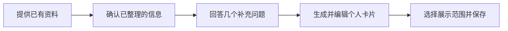

# 用户画像填写需求

> 设计日期：2026-11-11。本文定义用户体验与功能要求，配套后端、字段和 AI 扩展设计见本目录。

## 1. 产品目标

帮助参与创新活动的人，用已有资料和几次简短回答，形成一张能够介绍自己的个人卡片。用户主要做确认、选择和补充，系统负责组织材料与安排问题。

体验采用用户所描述的 Plan 模式节奏：**先了解资料，主动提出几个有针对性的问题，再把答案整理成可修改的用户画像。**

基础版本由后端规则、题库和模板完成整条流程；AI 接入后提升资料理解、提问和表达质量。两种方式共用资料、步骤、编辑和确认功能。

## 2. 用户最终得到什么

完成后，用户得到一份保存在普通个人资料中的确认版，包括：

- 我是谁：昵称、头像、一句话介绍。
- 我能带来什么：方向、角色、技能、经历和代表作品。
- 我希望怎样合作：兴趣、沟通与协作偏好。
- 我这次想做什么：当前活动的目标、希望承担的角色、可投入时间。
- 每条资料的展示范围：所有登录用户可见、好友可见、仅自己可见。

用户以后可以直接在个人资料页修改相同内容，也可以重新进入引导整理。填写流程和普通资料页共享同一份数据。

## 3. 入口与整体体验

首次注册后进入资料引导。GitHub 与邮箱验证码均可登录；GitHub 首次注册自动连接本人公开来源。简历上传与 GitHub 导入位于首个资料页面的主要区域，个人网站和粘贴文字作为补充。

顶部显示五个阶段和保存状态。每一阶段只有一个主要动作，用户可以回到已到达的步骤，也能保存退出。再次进入时恢复资料、问题和答案。

登录页可使用轻量弹幕展示示例自我介绍与想法短句，提供暂停和静态展示选项。主要表单与按钮保持稳定、清晰。组件沿用 AffectUI + Shadcn UI Kit。

## 4. 五个阶段的完整要求

### 第一阶段：提供已有资料

页面提示：“先给我一些已有资料，我来帮你整理。”

| 输入 | 用户动作 | 系统反馈 |
|---|---|---|
| 简历 | 上传或拖入文件 | 文件名、读取状态、已获得的正文；支持文本型 PDF、DOCX、MD、TXT |
| GitHub | 使用已连接账号，或主动连接 | 显示账号、已读取项目和来源更新时间 |
| 个人网站 | 输入公开个人主页或作品页地址 | 显示页面标题、读取状态和来源链接 |
| 一段自述 | 粘贴或输入经历、技能、作品介绍 | 保存原文，作为后续整理的材料 |
| 直接填写 | 选择“直接开始” | 进入简短基础信息编辑，再接补充问题 |

用户可以提供一种或多种材料。已有的本人确认资料会一并显示，便于在原有基础上补充。各来源分别保存，成功读取的材料可以继续使用。

页面提供“继续整理”。开启 AI 时，同一区域说明本次选中材料的用途和处理方式；基础版本按规则读取、展示和映射资料。

### 第二阶段：确认已整理的信息

系统先展示“目前了解到的你”，以简短清单呈现昵称建议、已有经历、项目和技能，条目旁显示来源。用户可以直接修改、删除或补一条。

基础版本优先填写来源中具有明确结构的值，并展示简历/网页正文供用户选取和补充；AI 版本增加语义提取和跨材料归纳。页面结构和编辑方式相同。

用户点击“这些信息正确，继续”，保存首批确认资料。下一阶段根据这些信息选择问题。此阶段以快速核对为主，主要编辑集中在用户想修改的条目。

### 第三阶段：主动补问几个问题

系统提示：“资料已经有了，我还想了解几个与你合作有关的问题。”

每批 3–8 题。材料较完整时选择较少的问题；需要补充的维度较多时增加问题。题目优先覆盖尚未明确的贡献方式、兴趣、协作习惯，以及当前活动目标。

| 交互 | 具体要求 |
|---|---|
| 提问顺序 | 后端准备并保存本批问题，页面逐题展示 |
| 回答形式 | 单选、多选为主；提供“我想自己说”与“暂时说不准” |
| 提问依据 | 显示简短说明，例如“已有你的项目资料，这一题主要了解本次合作目标” |
| 回答保存 | 每次回答后保存，显示“第 2 / 5 题”；支持返回修改 |
| 新增问题 | 重新整理时可建立新批次，原批次与答案保留对应关系 |
| 活动信息 | 已加入活动时询问该活动偏好；通用资料仍保存为全局资料 |

示例：用户已经确认自己做过前端项目，接下来可以问“这次你希望主要贡献哪一部分？”选项包括产品实现、交互体验、一起探索新方向和自由补充。系统随后了解时间安排与合作方式。

基础版本从题库按缺项和优先级选题，AI 版本结合已确认资料生成更贴近语境的题目。答案始终是可编辑的结构化输入。

### 第四阶段：生成并编辑个人卡片

用户完成本批问题后，系统将确认资料与回答整理成一份画像草稿：

| 卡片区域 | 呈现内容 |
|---|---|
| 基本介绍 | 昵称、头像、一句话自述 |
| 能力与作品 | 技能、角色、经历、代表项目 |
| 合作方式 | 本人选择的沟通、协作偏好 |
| 当前活动 | 本次目标、希望的角色、时间与参与方式 |

基础版本通过字段映射和固定模板组织卡片；AI 版本进一步归纳和调整表达。用户可以直接改文字、增删条目，也可以返回某个答案修改后重新整理。

页面用实际处理阶段展示进度，例如“整理已有资料”“合并补充答案”“准备卡片”。完成后展示可编辑结果。

### 第五阶段：选择展示范围并保存

每条资料旁提供“所有登录用户可见 / 好友可见 / 仅自己可见”。支持分组选择，再逐条调整。页面提供本人、普通登录用户、好友三种视角预览。

“是否必填”由普通资料的字段规则决定，页面标明当前操作需要的内容；“谁能看”由本人选择。两个设置分别显示。

点击“保存我的资料”后生成确认版本，普通个人资料页随即展示同一结果。用户可以进入后续想法阶段，或进入已有资格的应用功能。

## 5. 无 AI 的完整路径

| 环节 | 基础后端提供 | 用户能完成的动作 |
|---|---|---|
| 资料接收 | 上传、公开来源读取、文本解析、结构化字段映射 | 提供资料，查看读取结果，补充基础信息 |
| 补充提问 | 题库、缺项规则、题目批次、答案保存 | 逐题回答、跳过、修改、继续 |
| 画像整理 | 确认资料与答案映射、固定模板、卡片组装 | 获得完整草稿并编辑 |
| 资料确认 | 字段校验、逐条展示范围、版本保存 | 预览并确认个人资料 |
| 后续管理 | 普通资料编辑、来源管理、进度恢复 | 在个人资料页或引导中继续修改 |

这条路径作为第一阶段验收目标。随后在同一条流程中接入 AI 提取、AI 问题生成和 AI 画像表达。

## 6. 保存、恢复与异常体验

每次资料修改和回答都保存到服务端。用户重新打开页面时，先恢复当前版本，再显示对应步骤。若用户已经在普通资料页更新了内容，引导同步最新版本，并提示需要重新核对的部分。

单个来源读取失败时，页面保留其状态，提供重试和继续使用其他材料的选择。AI 处理遇到问题时，用户可以重试，也可以主动选择基础方式继续；已保存资料与回答仍可使用。

用户在来源管理中主动刷新或删除材料；普通资料编辑、活动切换和日常浏览使用已保存版本。

## 7. 与完整产品流程的衔接

本专项覆盖现有十步引导中的资料阶段：第 1–3 步处理与确认资料，第 4 步补问，第 5 步生成画像并预览展示范围。后续第 6–7 步进入独立想法阶段，第 8 步组合预览，第 9–10 步进入当前活动的发现体验。

个人资料与想法分别保存。组合预览使用已确认资料和当前想法草稿；发现服务使用服务端验证的当前活动与获准资料。

## 8. 体验验收

1. 首屏就能上传简历或使用已连接 GitHub，也能直接开始填写。
2. 已有材料先显示成可核对的信息，再进入几道补充问题。
3. 基础模式可完成资料、提问、画像草稿、编辑、隐私预览与保存，模型调用数为 0。
4. AI 模式沿用相同步骤与资料接口，能够改善预填、问题和文字表达。
5. 返回、刷新、保存退出和再次进入均恢复正确的资料与答案。
6. 普通资料页与引导显示相同的最新确认内容和展示范围。
7. 用户能清楚区分资料整理、草稿编辑与确认保存三个状态。

下一份：[后端能力与插件设计](02_后端能力与插件设计.md)。
