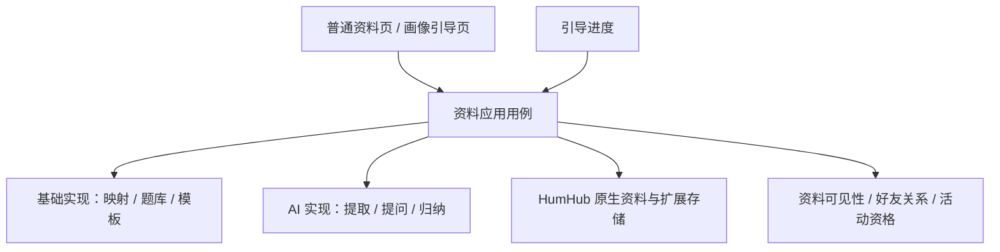
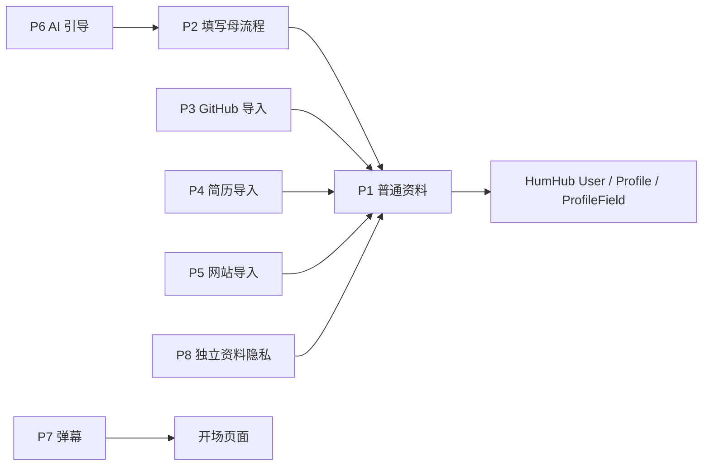

# 后端能力与插件设计

> 更新日期：2026-11-12。S1–S3 的普通资料、隐私和编辑能力继续复用；S4 已实现 rules 引导；S5 已接通 GitHub、简历、网站和粘贴文字。S6 已实现 AI 提取、补问与综合，当前集中后端 API，正式前端后续单独重做。S7.1/S7.2 已接通普通发现、资料概览与获准关系摘要；S7.3 已验证真实 400 人筛选，P1 0.9.1 缓存固定字段定义；S7.6 已补齐会话、任务与来源进度并完成组合恢复验收，P1/P2 为 0.10.0/0.4.0。S7.7 已完成真实 AI 链路和组合验收，未修改生产代码；最新验收见 [S7.7 报告](38_S77_AI组合验收报告.md)。

## 1. 后端的核心职责

普通用户资料服务建立在 HumHub 原生用户资料上，负责字段、草稿、确认版本和逐条展示范围。填写引导负责步骤与进度，调用这套资料服务。个人资料页也调用相同接口。

基础后端提供完整的资料读取、规则选题、回答保存、模板整理和确认能力。AI 作为这些处理步骤的可选实现接入。

领域规则、用例编排和外层适配器按项目 architecture-patterns 组织。业务逻辑可以用内存仓储和规则提供者独立验证；数据库、HTTP、模型 SDK 在适配层接入。

## 2. 八个插件及其交付位置

| 包 | 能力 | 依赖 | 交付位置 |
|---|---|---|---|
| P1 `matcher-user-profile` | 普通资料字段、编辑、草稿、版本、问答与私有来源记录 | HumHub 用户能力 | S1–S6 已实现，所有资料入口的基础 |
| P2 `matcher-onboarding` | 五阶段画像填写母流程、步骤/答案展示、进度恢复 | P1 | 0.4.0 已实现 rules/ai 会话接合与紧凑进度，复用 P8 预览和普通资料 |
| P3 `matcher-github-import` | 已验证本人 GitHub 的公开资料读取、结构映射 | P1 与 auth-github | 0.1.1 已实现读取，来源由 P6 执行 AI 提炼 |
| P4 `matcher-resume-import` | 简历接收、文本解析、段落/字段映射 | P1 ≥ 0.6.0 | 0.1.1 复用共用文本映射，来源由 P6 执行 AI 提炼 |
| P5 `matcher-web-import` | 个人网站读取、正文清洗、粘贴文字与字段映射 | P1 ≥ 0.6.0 | 0.1.1 已实现独立后端 API，来源由 P6 执行 AI 提炼 |
| P6 `matcher-onboarding-ai` | AI 提取、语境化补问、答案归纳与画像文案 | P1 ≥ 0.7.0、P2 ≥ 0.3.0 | S6 已交付 0.1.0，独立模型适配器 |
| P7 `matcher-danmaku` | 登录与开场的氛围组件 | 页面资源入口 | 体验完善阶段 |
| P8 `matcher-profile-privacy` | 逐条可见性、合法入口、联系人读取、获准投影与预览 | P1 | S3，独立于填写引导和 AI |

P1 可从普通资料页独立使用。P2 在 P1 之上完成基础引导；现有四张资料核心表继续使用，P1 新增问题批次与答案两张表，P2 新增一张会话表。三个已实现来源包可服务普通资料编辑和引导，P6 注册 AI 能力，复用母流程的步骤与交互。

共用提取库、模型适配器和 worker 作为内部运行依赖，八个包可以在同一 HumHub 应用中协作。P1 保存字段值、确认与范围元数据，P8 提供独立隐私规则和读取投影。

箭头表示调用/依赖方向。P1 中的资料可以长期使用，填写流程与 AI 功能按需启用。

## 3. 后端业务用例

| 用例 | 输入 | 输出及保存位置 |
|---|---|---|
| 开始/恢复资料编辑 | 当前用户、确认版引用 | P1 中的资料草稿和版本 |
| 导入资料 | 本人选择的文件、文字、公开来源或已验证身份 | P1 的来源记录、私有快照与读取状态 |
| 整理已有资料 | 已就绪来源、草稿版本、处理方式 | 预填条目、证据引用和待补维度 |
| 准备补充问题 | 已确认资料、全局/活动范围、处理方式 | P1 的完整 QuestionBatch；P2 展示 |
| 保存答案 | 批次、题目、选项/文字/跳过、期望版本 | P1 的 QuestionAnswer |
| 组织画像草稿 | 确认资料、题目批次、答案版本 | P1 的新版 ProfileDraft |
| 预览/确认资料 | 草稿版本、选中条目、展示范围 | 获准预览、确认版本和权限版本 |
| 保存引导进度 | 当前步骤、资料/批次引用 | P2 的 OnboardingSession |

每次写入以登录用户、对象归属和 expected_version 校验。普通资料页和引导分别打开同一份资料时，后端返回最新版本供用户继续编辑。

## 4. 基础模式怎样工作

### 4.1 规则整理资料

S4 首先读取本人已确认资料，并支持直接填写与自述补充。手工输入保存在独立 onboarding 草稿，用户核对后明确确认首批资料，再进入补问。

S5 的 GitHub 读取器提供账号与项目的结构化数据，文档解析器提供简历正文与段落，网页读取器提供页面正文与标题，粘贴文字在本地完成规范化。映射器把明确对应的值和来源位置交给同一草稿/核对流程。自由表述保留为私有原文，用户选择后可发起 S6 AI 提取，获得本人待核对候选。

已保存的确认资料直接复用，普通手工编辑中的草稿继续保留。P2 会话只保存步骤、版本和资源引用，资料和答案各自保存一份。

### 4.2 题库与选题规则

每个题目模板包含稳定 template_id、适用范围、目标字段、展示条件、优先级、单选/多选模式、选项与答案映射。

选题器读取已确认资料，按尚待了解的维度和当前活动上下文准备一批 3–8 题。题库覆盖贡献方式、兴趣、沟通习惯、协作节奏、活动目标与投入安排。选择结果按规则版本保存，供刷新和返回时恢复。

S4 提交答案时记录 answer_type、selected_options、free_text 和单答案版本，批次版本随答案变化递增。自由回答保存本人原文；规则映射明确的选项值。跳过保存为 skipped，页面显示“暂时说不准”。

### 4.3 模板组织画像

模板按“基本介绍—能力与经历—合作方式—当前活动”组装卡片。结构化选项映射到对应字段，自由回答呈现为本人自述。选中已有资料的条目保持其内容、来源和展示范围。

S4 模板可以将本人明确选择的全局角色和兴趣组合为一句自述，继承所用字段最严格的展示范围；本次目标留在 Space 草稿。字段可继续编辑，最终跨全局/Space 一次原子确认。全部跳过也可完成，画像保留本人已经确认的信息。

## 5. AI 的接入位置

| 处理角色 | 基础实现 | AI 实现 |
|---|---|---|
| ProfileExtractor | 结构化映射、正文整理 | 语义提取、跨材料合并、证据对齐 |
| QuestionProvider | 题库与缺项规则 | 根据资料和待补维度生成问题 |
| ProfileComposer | 答案映射、固定模板 | 归纳事实和偏好，组织自然表达 |

S4 已为 QuestionProvider 与 ProfileComposer 建立可注入端口，默认绑定纯规则实现；输入校验、批次版本、草稿保存和最终确认仍由普通资料用例负责。S5 接资料提取能力；S6 通过统一 ProfileAiEngine 的 extract/questions/compose 接入异步任务。P1 ProfileAiJobService 管理任务，P2 OnboardingAiWorkflow 将 AI 结果安装到相同批次和草稿，基础规则端口继续独立可用。

## 6. API 合同

统一使用 `/api/v1`。以下为资料工作流的概要，完整字段与公共错误见 [共享契约](../共享数据与接口契约.md)。

| 接口 | 用途 |
|---|---|
| GET /me/profile | 当前确认资料、编辑状态 |
| POST /me/profile/drafts；PUT /me/profile/drafts/{id} | 创建和编辑草稿 |
| GET /me/profile/source-capabilities；GET /me/profile/sources | 四种读取器能力及本人来源摘要 |
| POST /me/profile/sources；POST /me/profile/sources/resume | GitHub/网站/文字 JSON 导入与简历 multipart 上传 |
| GET/DELETE /me/profile/sources/{id}；POST /me/profile/sources/{id}/refresh | 本人来源详情、删除与显式刷新 |
| POST /me/profile/extractions | rules 采纳规则候选；ai 创建提取任务 |
| GET /me/profile/ai-capabilities；GET /me/profile/ai-jobs/{id} | 可用模式、限额和本人任务状态，读取为 0 次模型调用 |
| POST /me/profile/ai-jobs/{id}/apply、/cancel、/retry | 本人采纳、取消与明确重试 |
| POST /me/profile/question-batches；GET /me/profile/question-batches/{id} | S4：准备并读取本批问题与答案 |
| PUT /me/profile/question-batches/{batch_id}/answers/{question_id} | 保存单个答案 |
| POST /me/profile/syntheses | 合并确认资料与答案，生成画像草稿 |
| POST /me/profile/drafts/{id}/confirm | 确认条目及展示范围 |
| POST /onboarding/sessions；GET/PUT /onboarding/sessions/{id} | 创建、恢复、保存引导进度 |

S4 的 question-batches 与 syntheses 已实现 generation_mode=rules。创建问题和综合通过会话编排，返回附带批次或草稿的 SessionDTO；单答案更新返回 BatchDTO。实际请求载荷、状态码和动作以 [S4 合同](12_S4实施约定.md) 为准。S5 来源导入、刷新及候选采纳同步完成，精确合同见 [S5](15_S5实施约定.md) 与 [S5-B](19_S5B网站与文字来源约定.md)；S6 的 ai 模式返回 job_id/202，任务结果读取和准确请求见 [AI 合同](22_S6实施约定.md)。

QuestionBatch 已记录资料版本、generation_mode、schema_version 和 policy_version；单答案及会话分别校验自身 expected_version，综合与最终确认同时核对批次和资料版本。S4 返回实际 rules 模式和 llm_calls=0。S6 已记录 AI 任务输入版本、模型用量、适用性，并提供独立调用预算。

客户端现在可选择 AI 或 rules，从响应读取实际处理方式和任务结果。AI 有选项与最后自由填写入口，提取、补问和综合均返回本人复核提示；正式交互界面后续接入。

## 7. 资料、权限与任务的统一行为

普通资料服务按本人、合法入口和 Space 资格生成所需视图。37 类普通字段均可选，新增确认资料与可选联系方式默认 authenticated；S3 已由独立 P8 提供 authenticated/friends/private 逐条策略和三种预览，既有范围保留。未确认草稿、问题、答案和上传候选作为本人编辑资料管理。S4 完整复用这些规则，详情见 [S3 报告](10_S3实现与验证报告.md) 与 [S4 合同](12_S4实施约定.md)。

确认操作保存新的资料版本，权限调整推进权限版本。每个 AI 结果同时核对输入版本与当前授权：适用结果进入草稿，已被新编辑取代的结果标为 superseded，结果字段返回 null，不能继续采纳。本人主动删除来源时按资料删除流程处理相关记录。

前端根据能力列表呈现操作入口。基础模式可用时，用户始终有资料编辑、题库引导和确认保存的完整路径。

## 8. 后端优先的交付顺序

| 阶段 | 交付内容 | 阶段验收 |
|---|---|---|
| A 普通资料基础 | 原生字段适配、扩展字段、草稿/确认、可见性、普通资料编辑 | 两个编辑入口可共享同一份资料和权限 |
| B 基础引导 | P2、规则题库、答案保存、模板画像、进度恢复 | 全程模型调用为 0，完成资料→问题→画像→保存 |
| C 资料导入 | GitHub 公开读取、简历解析、来源管理与基础映射 | 首屏两个主要导入入口有真实读取路径，基础流程可继续 |
| D AI 增强 | AI 提取、AI 问题生成、AI 归纳表达 | 相同数据合同与确认流程，记录任务和模型用量 |
| E 体验整合 | 弹幕、交互细节、想法与活动入口交接 | 保存恢复、资料预览和后续流程完整衔接 |

首次对用户开放的基础版本包含 A–C。D 在基础链路验收后接入。验证采用内存用例、数据库/API 集成及页面流程三层，按阶段记录真实结果。

S4 已实现“提供已有资料/手工补充 → 核对 → 补问 → 编辑 → 范围确认”，并保存返回、退出和继续所需的进度。普通资料变化会使旧综合返回冲突，用户可主动重新核对；旧草稿、批次和答案保留对应关系。具体页面结果见 [独立网页验收](14_S4真实网页验收.md)，部署与最终验证结论见 [S4 主报告](13_S4实现与验证报告.md)。

配套：[资料字段设计](03_用户资料与字段设计.md)、[原生数据库落地规划](05_原生数据库复用与字段落地规划.md)、[实施任务](task.md)、[AI 增强与组件](04_AI增强与开源组件.md)。

S5-A 已交付 GitHub 双依赖识别、四种简历格式、共用来源与原流程采纳，详见 [S5 实现报告](16_S5实现与验证报告.md)。全新主界面也可单独通过插件交付，其与业务插件的兼容边界见 [主界面插件评估](18_全新界面插件与兼容边界.md)。

## S7.1 发现接合

matcher-recommendation 0.2.0 作为画像服务的调用方，通过 P8 批量获准投影和 P1 0.8.0 批量身份端口取得普通卡片。该能力沿用原有模块，不新增画像存储插件；普通发现不依赖 AI。本人每个 Space 的 discoverable 默认 false，开关与全局资料、活动偏好分别管理。完整接口和排序语义见 [S7 合同](25_S7普通发现与模拟人物实施约定.md)。

## S7.2 正式想法与资料概览

P1 0.9.0 保存学校/主主页引用；P8 0.2.0 负责获准概览与逐对象分享。独立 matcher-ideas 0.1.0 保存正式标题/简介、Space 发布和永久唯一的既有 Messenger 关联，通过可选来源端口提供摘要。聊天消息与原生参与者不复制进画像。具体 API 与限制见 [S7.2 合同](28_S72资料概览与关系摘要约定.md)。

## S7.6 阶段进度增量

P1 0.10.0 与 P2 0.4.0 为既有返回增加 progress，并提供会话、AI 任务和来源三个紧凑 GET。P1 通过可选仓储查询端口返回本人当前会话的任务；P2 使用纯领域投影整理步骤、题目计数、恢复原因和下一步动作。后端与前端通过固定状态码、label_code、poll_after_ms 和 revision_token 接合。准确字段及读取边界见 [S7.6 合同](34_S76阶段进度与组合验收约定.md)，部署和验收结果见 [实现报告](35_S76阶段进度与组合验收报告.md)。

## S7.7 组合验收结果

规则与 AI 的普通资料、隐私、Space 上下文和恢复不变量已通过组合验收。指定网关的提取、选项/自由回答、画像综合各一次成功，随后由本人编辑和确认；每阶段进度均可观察。模块版本维持原值，实际验证范围和单组样例的局限见 [S7.7 主报告](38_S77_AI组合验收报告.md) 与 [独立验收](39_S77独立验收.md)。
