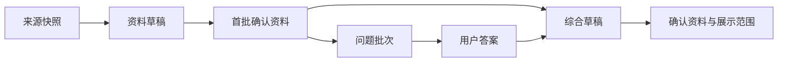

# 用户资料与字段设计

> 更新日期：2026-11-11。P1 普通资料插件扩展 HumHub 原生资料，P8 独立隐私插件负责展示策略。S4 的 P2 五阶段 rules 引导已复用同一组字段、草稿和确认版本。历史实现见 [S3 报告](10_S3实现与验证报告.md)，S4 验收与部署状态见 [主报告](13_S4实现与验证报告.md)。

## 1. 资料的组织方式

| 数据范围 | 内容 | 管理方式 |
|---|---|---|
| 展示身份 | 昵称、头像 | 身份编辑用例，复用 HumHub 用户关联 |
| 全局普通资料 | 能力、经历、作品、兴趣、默认协作偏好 | 普通资料插件，逐条编辑与确认 |
| 活动偏好 | 本次目标、希望角色、投入与参与方式 | 普通资料插件的活动上下文 |
| 联系方式 | 微信、二维码、QQ、电话、联系邮箱等 | 可选全局字段，新增确认条目默认 authenticated；P8 提供独立读取与逐条范围策略 |
| 来源和编辑材料 | 简历、网页快照、草稿、问题、答案、证据 | 普通资料插件的本人编辑空间 |
| 填写进度 | 当前步骤、对象引用、完成时间 | 引导插件 |

同一份普通资料同时服务个人主页、引导预览和当前活动的获准展示。全局资料长期复用，活动偏好分别保存。

## 2. 字段的两个维度

### 可见性

S1/S2 确定的新增确认条目默认 authenticated 规则继续适用于普通资料和可选联系方式。S3 已由独立 P8 matcher-profile-privacy 实现逐条策略，已有明确范围继续保留。当前支持以下范围：

| 值 | 标签 | 展示方式 |
|---|---|---|
| authenticated | 所有登录用户可见 | 登录用户通过合法资料入口读取 |
| friends | 好友可见 | 对当前及未来建立关系的有效好友展示 |
| private | 仅自己可见 | 作为本人资料保存与编辑 |

Space 字段同时验证对应空间的正式成员资格。新草稿以本人可见保存，确认时选择范围；重新编辑沿用当前选择。普通资料编辑页已提供本人、其他登录用户和好友三种服务器预览；S4 引导的范围确认阶段复用同一预览用例。草稿预览模拟确认后的展示，实际他人读取只使用已确认条目。完整产品第 8 步的想法组合预览继续在对应阶段接入。

真实详情还会验证当前 Space、有效好友或可访问的公开帖子作者等合法入口，并检查屏蔽与账号状态。好友关系对全局资料动态生效；Space 专属字段继续检查对应空间。原生页面和模块的实际适配范围见 [原生出口登记](11_S3原生出口适配登记.md)。

原始材料、未确认草稿和上传候选保存在本人编辑空间。联系字段由本人主动填写和确认，登录邮箱继续用于账号身份，联系邮箱单独填写。联系方式使用独立读取用例和详情展示区，人物目录、搜索与推荐摘要使用普通资料摘要。

### 必填

当前 37 类普通字段的 required_when 均为空，普通编辑和 S4 引导均保持可选。本人选择添加某条记录后，由字段目录校验该记录的必要内容与格式；展示范围独立保存。引导中的问题可以明确跳过，全部跳过也能完成。

- 最小展示身份要求本人确认昵称，头像可以采用默认图。
- 用户添加某条技能、项目或获奖记录时，校验该条目的名称/标题。
- 保存草稿允许资料尚待补充，确认时执行对应字段校验。
- Space 条目在保存和确认时验证字段范围与正式成员资格。

例如，一条已添加技能需要名称，用户仍可选择将该技能设为 private。必填与展示范围分别保存、分别呈现。

## 3. 原生资料如何复用

迁移前的 [HumHub 字段导出](../../backend/deploy/profile-fields.json) 包含 27 个 ProfileField。S1 已增加 4 项，运行库现为 31 项；S2 的复合字段和联系方式沿用条目表，逻辑字段目录为 27 类全局条目和 10 类 Space 条目。用户名、头像和登录身份由其他原生对象管理。

| 原生字段 | 本项目映射 |
|---|---|
| firstname、lastname | 可选真实姓名，与展示昵称分别管理 |
| title | 映射为 headline，一句话自述 |
| gender、birthday | 保留兼容能力；首期资料页优先提供可选年龄段 |
| street、zip、city、country、state | 常驻城市可参与普通资料，其他地址项按实际需要配置 |
| about | 普通简介 |
| mobile | S2 的 contact_phone 当前值，元数据与版本由普通资料服务管理 |
| phone_private、phone_work、email_virtual、fax、im_xmpp | 保留原生存储，P8 保护通用展示出口；具体联系人编辑按用途继续扩展 |
| url、url_facebook、url_linkedin、url_instagram、url_xing、url_youtube、url_vimeo、url_tiktok、url_twitter、url_mastodon | 根据用途映射为作品链接或联系入口 |

迁移前导出中 firstname/lastname 的 required 为 1，S1 已将其调整为可选。S2 所有普通字段的 required_when 均为空；用户选择添加一条记录后，校验该记录的标题、名称或格式。昵称使用独立身份确认规则。

## 4. 资料字段清单

基础编辑页已提供以下字段的直接填写与逐条确认。后续完整引导以前置资料导入开始，再根据已有信息补问；两种入口使用同一套字段。

身份字段为 `nickname` 与 `avatar_ref`：昵称 2–32 字符，头像采用本人上传图片或默认图。HumHub 物理映射分别使用新增的 profile.matcher_nickname 和原生头像资源，头像确认引用与身份版本由全局资料状态保存。

### 4.1 全局资料：27 类条目

| key | 内容 | 类型与填写规则 |
|---|---|---|
| real_name | 真实姓名 | 可选短文本，本人确认 |
| age_range | 年龄段 | 本人选择，附声明时间 |
| mbti | 本人自述 MBTI | 可选，支持“暂时不知道” |
| personality | 性格与做事风格 | 本人选择的特点与具体自述，可选；如怎样讨论分歧、习惯如何推进任务 |
| headline | 一句话自述 | 可编辑短文本 |
| bio | 自我介绍 | 可编辑长文本 |
| direction | 关注方向 | 多条标签或本人文字 |
| skill | 技能 | 名称、可选本人自评、说明；添加时名称必填 |
| role | 可贡献角色 | 多条角色，例如开发、设计、产品、运营 |
| interest | 兴趣领域 | 多条标签或本人文字 |
| seeking | 长期合作期待 | 希望认识的人、探索方向、协作需求 |
| language | 沟通语言 | 语言及可选本人水平 |
| city | 常驻城市 | 可选文本/地区值 |
| timezone | 时区 | 本人确认的时区标识 |
| collaboration_preference | 默认协作方式 | 选项与本人补充 |
| communication_preference | 默认沟通习惯 | 选项与本人补充 |
| education | 学业经历 | 学校、专业、学历、年份，可多条 |
| project | 项目经历 | 标题、个人角色、贡献、技术、成果和证明链接 |
| work_experience | 工作/实习经历 | 单位、角色、起止和描述，可多条 |
| award | 获奖/成果 | 名称、主办方、年份与本人确认的成果描述 |
| portfolio_link | 作品或公开证明 | URL、标签、对应作品及展示范围 |
| contact_wechat | 微信号 | 可选文本 |
| contact_wechat_qr | 微信二维码 | 本人上传资源引用与可选说明 |
| contact_qq | QQ 号 | 可选文本，按字符串保存 |
| contact_phone | 联系电话 | 可选，主号码复用 profile.mobile |
| contact_email | 联系邮箱 | 本人主动填写，与登录邮箱分别管理 |
| contact_other | 其他联系入口 | 名称和内容，可多条 |

每条经历或作品都有稳定 attribute_id，可单独修改和设置可见性。学校概览可引用用户选择的一条 education。已验证 GitHub 身份用于连接来源；本人选择展示的主页链接作为 portfolio_link 保存。

复合经历默认按整条设置范围。需要分别控制学校、年份等子项时，将它们组织为共享记录关联键的独立条目，分别保留 attribute_id 和可见性。

### 4.2 活动偏好：10 类条目

| key | 内容 | 类型与填写规则 |
|---|---|---|
| event_goal | 本次活动目标 | 多选及文字补充 |
| event_seeking | 本次希望找到的帮助 | 角色、能力、协作类型 |
| event_role | 本次希望承担的角色 | 多选及文字补充 |
| event_contribution | 本次可以提供的帮助 | 选项及本人自述 |
| event_time_commitment | 可投入时间 | 时长区间或文字说明 |
| event_availability | 可以参加的时段 | 起止时间与时区 |
| event_collaboration_mode | 协作方式 | 现场、线上、混合及说明 |
| event_presence | 本次参与安排 | 大致地点与参与方式 |
| event_contact_preference | 本次沟通偏好 | 本人希望的联系/讨论方式 |
| event_constraint | 本次协作需要说明的事项 | 可选本人文字 |

活动条目在字段目录中使用 scope=event。S2 请求推荐使用 scope=space、space_id，返回 scope=space:<id>；兼容的 event_id 也解析为同一个 Space 主键，由服务端验证成员资格。首次页面重点呈现目标、角色、投入和协作方式，其他内容按需展开。

这里的 event 对应 HumHub Space；物理范围为 space:<id>。性格、长期协作偏好、沟通习惯和联系方式保持全局。新的 Space 只复用全局资料，本次目标、意愿与时间安排由本人重新填写。Calendar 负责 Space 内的赛程。

### 4.3 参与的想法与活动

画像卡另设只读的关系摘要区，帮助访问者了解对方正在参与什么。活动从原生 Space 的名称、简介和正式成员关系生成；想法摘要从明确关联的想法业务读取标题、简介，再链接到对应活动中的 Messenger 多人会话。摘要由业务关系与当前授权生成，普通资料编辑页负责个人资料。

原生 Messenger 的 message 有 title，但没有独立 description、idea_id 或 space_id。S7.2 的 matcher-ideas 已保存正式简介和会话/活动关联，聊天入口继续检查实际参与资格。展示摘要时同时校验对象访问、成员展示设置、当前活动范围和资料所有者的展示选择。S1 建立只读关系端口，S7.2 已接通获准 API 查询；正式页面在前端阶段接入。本人逐对象分享默认 private，并与想法作者 members_visible、真实参与及当前 Space 资格取交集，详见 [S7.2 合同](28_S72资料概览与关系摘要约定.md)。

完整画像按“基本信息、能力与经历、性格与协作、此次投入、参与想法、参与活动”组织。项目的个人贡献、成果链接与可投入时间是合作判断的重要依据；本人确认标记和资料来源分别呈现，方便访问者判断哪些内容仍需沟通核实。

## 5. 来源、问答与画像的关系

S4 已将规则问答产出接入相同结构的 ProfileDraft。来源和 AI 阶段继续复用该合同，再逐步增加来源引用与证据。当前普通资料保存确认时间与版本，读取时只返回该入口获准的字段。

## 6. 数据库扩展

逻辑实体使用 [共享契约](../共享数据与接口契约.md)。HumHub 适配复用原生 user_id、Profile 与 ProfileField，通过扩展存储补齐多条经历、活动偏好、草稿、版本和权限。具体原生列、4 个新增字段与首批 4 张扩展表见 [字段落地规划](05_原生数据库复用与字段落地规划.md)。

| 对象 | 核心内容 | 所属 |
|---|---|---|
| FieldPolicy | key、scope、原生字段映射、值 schema、数量、required_when、允许可见性、展示顺序 | 普通资料插件的字段配置 |
| GlobalProfile / ProfileVersion | 当前确认版指针、确认快照、scope/event、内容版本与权限版本 | 普通资料插件 |
| ProfileAttribute | 稳定条目 ID、key/value、visibility、证据、确认时间 | 普通资料插件 |
| EventProfileContext | owner/event、当前活动资料版本、权限版本 | 普通资料插件 |
| ProfileDraft | base_profile_version、draft_version、fields、status | 普通资料插件 |
| SourceDocument / SourceSnapshot | 本人归属、来源类型/版本、原文、解析正文、哈希、读取时间 | 普通资料插件 |
| SourceFragment / ProfileEvidence | 来源定位、私密片段、可展示出处 | 普通资料插件 |
| QuestionBatch | 本人、Space、global/Space 资料版本、批次 version、固定题目、generation_mode、schema_version、policy_version | 普通资料插件，S4 已实现 |
| QuestionAnswer | 批次/题目、answer_type、selected_options、free_text、单答案 version | 普通资料插件，S4 已实现 |
| AIJob | 任务状态、输入版本、结果适用性、模型用量 | 普通资料处理用例 |
| OnboardingSession | 本人、global/Space 范围、当前/最远步骤、版本、资源引用、完成时间 | 引导插件，S4 已实现 |

FieldPolicy 由当前版本化 FieldCatalog 提供。S1–S3 已实现资料、条目、Space 上下文、草稿和版本的存储；S4 在原四张核心表之上新增问题批次、答案与引导会话三张表。会话保存引用，资料和答案各自保留一份。来源与 AI 任务按 S5/S6 接入。P8 继续复用现有值和可见性元数据，独立提供策略与获准视图。

### 存储与原生兼容

当前已确认单值由原生 user/profile 列保存，扩展条目保存多条资料及 Space 偏好，当前元数据保存逐条策略；历史资料由不可变 revision 快照保存。S2 已接通普通资料 API、原生受管字段编辑、时区和头像。S3 已接通基础编辑页面、独立 P8 策略，以及原生个人页、人物摘要、目录、搜索和 REST 的适配。已启用模块的处理方式与核验边界以 [出口登记](11_S3原生出口适配登记.md) 为准。

S4 的全局问答映射至同一组长期习惯、角色、兴趣和本人自述字段，活动问答只进入对应 Space 条目。已保存同 code 的多条记录保留原内容与备注；生成的一句话介绍只使用全局角色和兴趣，并继承来源最严格的可见性。QuestionProvider/ProfileComposer 可注入端口已建立，当前绑定纯规则实现。

内容或可见性确认保存资料修订，范围变化同时更新 permission_version。仅调整可见性或排序时保留内容的 last_confirmed_at；显式重新确认可以更新该时间。昵称/头像使用身份版本。尚待核对的原生值进入本人审核草稿或候选清单，用户正在编辑的草稿继续保留。

当前头像与联系二维码支持 JPEG、PNG、WebP，单个图片最多 5 MiB。后续来源导入沿用单个 20 MiB、每批最多 5 个来源、总计 50 MiB 的设计；来源原文私有保存，由本人主动刷新或删除。

### 约束与一致性

- `unique(version_id, attribute_id)` 保证版本内条目唯一；同 key 支持多条经历。
- 全局版本与活动版本分别确保 owner、scope、event 和版本唯一性。PostgreSQL 可用部分约束；MySQL/MariaDB 适配使用非空范围键或相应分表约束。
- `EventProfileContext(owner_id,event_id)` 和 `SourceSnapshot(source_id,version)` 各自唯一。
- 资料、答案和草稿写入携带期望版本；更新与显式删除采用明确字段动作。
- 来源证据、任务结果和资料读取均验证本人归属、当前资格与权限版本。

## 7. 后端完成标准

同一条技能在引导和普通资料页显示一致；多个项目可独立修改；全局资料与活动偏好各自保存；基础规则和 AI 结果都经过相同的草稿、编辑、确认和隐私流程。

资料、来源、答案和版本可以在关闭引导或 AI 后继续使用。每次读取根据实际入口和当前关系生成获准视图。

当前普通编辑入口为 /matcher-user-profile/editor/index，支持保存恢复、分批确认、旧资料采纳与版本冲突提示。S4 引导入口为 /matcher-onboarding/flow/index，提供已有资料/手工补充、核对、规则补问、画像编辑和范围确认；使用独立 onboarding 草稿保存修改，普通资料编辑中的草稿继续保留。具体行为见 [S4 合同](12_S4实施约定.md) 与 [真实网页验收](14_S4真实网页验收.md)，最终验收和部署见 [S4 主报告](13_S4实现与验证报告.md)。来源读取、AI 增强和正式主前端继续按 [task.md](task.md) 推进。

配套：[用户体验](01_用户画像填写需求.md)、[后端与插件](02_后端能力与插件设计.md)、[S3 实现与验证](10_S3实现与验证报告.md)、[原生出口登记](11_S3原生出口适配登记.md)。
