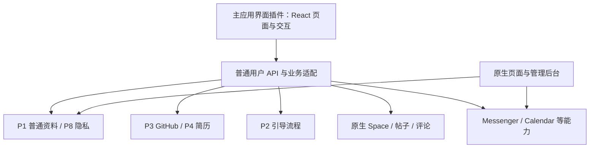

# 全新界面插件与兼容边界

2026-11-11。根据当前本地 HumHub 1.19.4、Messenger、Calendar 与已实现画像插件的源码核对。本文件记录方案判断，尚未创建全新主应用界面插件，也未改造原生主导航。

## 建议

把产品主界面作为一个独立 HumHub 插件交付是可行的。插件可以提供自己的控制器、页面入口、布局、编译后的 React/CSS 资源和 API 适配；普通资料、来源、Space、内容、消息等继续由后端能力插件负责。插件内仍然需要开发真正的新前端，它的交付方式是随 HumHub 插件安装和升级。

建议新增主界面插件时采用统一前端应用，让各业务插件提供数据合同与能力声明。导航、弹窗、页面状态和路由由主界面统一组织。AffectUI 与 Shadcn UI Kit 可放进同一 React 构建过程；现有 HumHub 原生页面作为独立入口保留，逐项接入新前台。

## 哪些冲突需要处理

| 边界 | 实际原因 | 接入方式 |
|---|---|---|
| 路由 | 模块的 urlManagerRules 会进入同一 Yii 路由集合 | 新界面使用独占前缀，例如 /app；避免覆盖全部原生路径或 API 通配路由 |
| 跳转 | 原生 PJAX 拦截链接并替换 #layout-content | 新应用内部由自己的路由接管；跨入原生模块采用整页跳转或明确生命周期适配 |
| 按钮行为 | 原生脚本在 document 上代理 data-action-click 等属性 | 新应用采用自己的根节点和组件事件，不复用未实现的原生行为属性 |
| CSS | AppAsset 引入 Bootstrap；现代组件库可能包含全局 reset | 独立界面控制资源加载，必要时为样式加作用域并关闭冲突 reset |
| 页面销毁 | PJAX 会替换节点并初始化/卸载 HumHub 模块 | React 明确 mount/unmount，避免重复绑定、重复提交与事件残留 |
| 登录与权限 | 某些原生 REST 入口使用单独的 JWT/Bearer/Basic 认证组合 | 普通用户 API 统一处理登录身份、CSRF、资源权限和版本，逐项核对原模块接口 |
| 通知与菜单 | Marketplace 模块监听原生 Widget 事件插入入口/徽标 | 新导航显式提供相应入口、未读计数及通知状态适配 |

按钮文字或组件名称相同不会直接造成后端冲突。重复路由、重复事件处理、不同身份验证方式和遗漏业务校验才是需要处理的接合问题。新页面调用已有业务服务及其合法接口，保留内容事件、权限与通知处理，避免绕开业务用例直接写表。

仅设置 layout=false 或移除 AppAsset 不足以证明页面已经独立。HumHub 的 Controller 与 View 仍可能注入 JS 状态、CoreJsConfig 和 LayoutAddons；专用页面入口需要明确控制渲染链。

## 其他插件的兼容性

需要分别判断三个层次。

1. **后端能力兼容**：原模块仍能加载，依赖、数据、权限和业务事件保持有效。
2. **原生页面兼容**：保留原路径与其资源，原模块的现成页面仍可访问。
3. **新前台体验兼容**：为新界面提供对应数据、按钮动作、错误状态和跳转，需要逐个模块适配。

前两项可以作为渐进替换的基本承诺。第三项需要实际接入与验收；安装一个 Marketplace 插件不会自动在全新的 React 导航中生成完整页面。

例如 Messenger 的原页面返回会话 HTML 和消息 Widget，并使用原生富文本与上传按钮。完全重画私聊页时，需要接入会话、消息、附件、未读状态等合同。Calendar 原页面使用 FullCalendar、User/Space 容器与时区/编辑参数，新日历必须继续执行这些业务规则。两者都有 REST 扩展，但仍需核对普通用户认证、权限和新交互所需字段。

新增业务插件可以按统一合同向主界面登记能力与入口；第三方插件需要明确适配清单。当前已经验证的画像与导入页面，只证明其相应范围，不等于任意第三方页面都已适配。

## 三种路线

| 路线 | 对当前项目的判断 | 兼容成本 |
|---|---|---|
| 主应用界面插件，内含 React 静态构建产物 | 当前优先；可同域部署并沿用后端插件 | 自己实现新界面与 API 适配，原页面可保留并行运行 |
| 直接修改 HumHub 原版前端文件 | 不建议作为长期主线 | 原生升级、Marketplace 模板与脚本依赖会扩大修改面 |
| 独立 React / Next 前端工程 | 适合确实需要独立部署或服务端渲染时 | 仍要补齐 API，另外处理部署、代理、认证与可能的跨域 |

React 静态构建产物可以由 PHP 插件提供。若选用 Next.js 的服务端渲染或服务端运行能力，则还需要对应 Node 服务，不能把这种运行能力简单装进 PHP 插件包。

## 当前源码依据

- [ModuleManager](../../backend/protected/humhub/components/ModuleManager.php)：模块命名空间、urlManagerRules、模块注册与事件。
- [Controller](../../backend/protected/humhub/components/Controller.php) 与 [View](../../backend/protected/humhub/components/View.php)：layout、PJAX 渲染、JS 状态与页面附加组件。
- [Theme](../../backend/protected/humhub/components/Theme.php)：pathMap 模板覆盖机制。
- [AppAsset](../../backend/protected/humhub/assets/AppAsset.php)：jQuery、Yii 表单、Bootstrap、PJAX 等原生依赖。
- [PJAX 客户端](../../backend/protected/humhub/resources/js/humhub/humhub.client.pjax.js) 与 [行为代理](../../backend/protected/humhub/resources/js/humhub/humhub.action.js)：链接拦截和全局行为属性。
- [Messenger 控制器](../../backend/protected/modules/mail/controllers/MailController.php) 与 [模块事件](../../backend/protected/modules/mail/Events.php)：服务端 HTML、菜单/通知入口与 REST 路由。
- [Calendar Widget](../../backend/protected/modules/calendar/widgets/FullCalendar.php) 与 [资源包](../../backend/protected/modules/calendar/assets/CalendarAsset.php)：原日历资源及容器参数。
- [REST 基类](../../backend/protected/modules/rest/components/BaseController.php)：可配置认证组合；不等同于当前自定义普通用户会话 API。

配套：[S5 实施报告](16_S5实现与验证报告.md)、[专项任务](task.md)。
