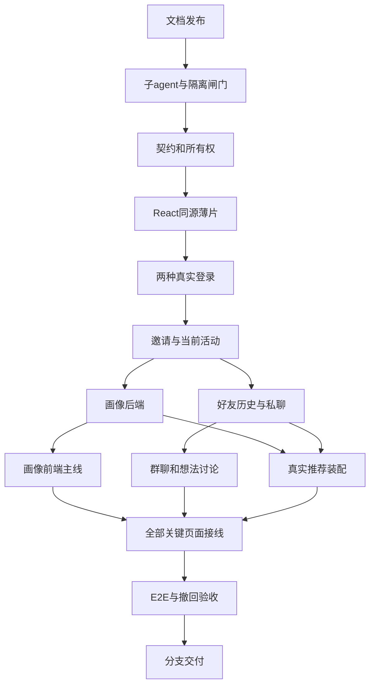

# task：前后端插件化整合与无人值守执行

> 状态：计划已批准；N00 文档批次已提交并推送，远端 SHA 核验通过，记为 done。当前实施分支为 `feat/overnight-integration-20261112`；原文档分支和发布回执见 [实施记录 R005](03_实施记录.md)。
> 本轮恢复（2026-11-12）：N00/N01 done；G1 同型号默认继承与 G2 隔离验收通过，N01 提交及远端 SHA 已核验。N02 in_progress，N03 尚未启动；用户另派 agent 已完成认证配置准备，本队将在 N03 后继续 N04 应用接入，真实双登录尚未通过。旧失败记录保留，本轮脱敏核验见[实施记录 R006–R008](03_实施记录.md)。
> 前置阅读：[基线](01_任务开始前情况.md) → [接入设计](02_插件使用与接入设计.md) → 本文件 → [实施记录](03_实施记录.md)。

## 1. 成功标准与禁止偷换的范围

最低可交付旅程：真实 GitHub／邮箱验证码登录 → 邀请兑换进入有效活动 → 本人导入或手填、核对、确认画像和逐项可见性 → 当前活动发现／真实推荐 → 发好友申请并接受 → 私聊 → 明确创建群聊、邀请和受邀者确认 → 当前活动内想法讨论邀请和消息。

GitHub 和邮箱验证码都必须真实打通。建群、入群确认、想法讨论邀请已由用户明确加入最低交付，不能再列为可选。缺配置、待用户操作、依赖不可用分别标 blocked，不用 mock 或已有测试账号把完整闭环改标 done。

保持以下核心规则：

- 活动=Space，想法是独立对象，聊天群是 Messenger 会话；三者不能靠改显示名称混成一个模型。
- R03 贯穿列表、筛选、搜索、分页、详情、AI、缓存与晚到结果。真实不足就返回不足，不跨活动补人。
- authenticated/friends/private 的范围与合法入口分别校验；公开帖作者入口可以跨活动联系，但不是全站人物检索。
- 好友／既有私聊不因切活动消失；想法在不同活动的讨论与成员不串用。
- 未确认原始资料和 AI 草稿私有；只有用户确认的条目按范围展示。第 3 步只核对草稿，第 5 步正式确认，第 8 步逐对象确认。
- 普通发现零 LLM；AI 无社交写权限，刷卡不发申请，不自动建群／拉人／发消息。

完整论坛新 UI、世界广场全量美化、想法 AI 长计划增强等不抢占上述最低闭环；本轮若未覆盖，必须逐项列出真实缺口与合法原生入口，不能假装按钮已经接通。手动想法计划、真实活动讨论和来源授权属于最低闭环，不在这一延期范围。

## 2. 启动闸门

| 闸门 | 当前状态 | 放行证据 | 不满足时 |
|---|---|---|---|
| G0 计划批准 | passed | 用户已通过计划审批；允许先发布文档 | 其他闸门仍独立生效，不等于应用实施无条件放行 |
| G1 子agent同型号默认继承 | passed（本轮已使用的 3 个子任务） | 主执行者只读核对 thread_spawn_edges 与各自 turn_context：root、baseline_gate_audit、backend_readiness、frontend_readiness 均为 provider=timo、model=gpt-6-astra、effort=ultra；3 个子任务均 fork_turns=all 且无模型／思考强度覆盖，已有具体只读任务成功返回 | 后续继承失败则停止对应代码工作，保留准确失败记录；不以显式换模型或主agent降级绕过 |
| G2 分支与数据隔离 | passed | 独立分支；专用空库／有限账号；首次和重复安装、备份恢复、清理幂等与 HTTP 保护通过。主预览计数、服务 PID 和冻结指纹不变，详见 R007 | 后续变更继续使用隔离目标，不碰主预览或真实数据 |
| G3 真实认证资源 | 配置已准备／应用验证待执行 | 用户报告另一个 agent 已保存 OAuth／SMTP 凭据并取得 Gmail SMTP 235（未发邮件）；主执行者只核验必要字段存在、回调、0600 和 Git 忽略。本人 OAuth、真实收信与两条应用登录尚未验证 | N03 后使用私有配置接 N04；N05 及其依赖仍须等待真实回执 |
| G4 推荐真实装配 | pending/未核验 | 有效历史、持久预算、provider 与所需迁移；有限真实调用成功 | 不伪造推荐；普通发现作为独立功能验收 |

本轮 G1 的适用范围按用户最新“多开子agent、选择同型号”要求调整，采用当前平台的实际父子线程元数据和具体任务结果核验，不再把旧客户端三项配置验收当作当前平台已经完成的事实。当前平台未暴露旧 context_tier 字段；未验证旧报告中的 TIMO GPT/gpt-6-sol、medium、long_context，也未验证实际 token 容量上限。R001 的调用失败和 R004–R005 的旧配置进展仍作为历史证据保留，本次通过不反向改写它们。

G1/G2 的验证证据不代替批次提交／推送回执。G3 已核验的是当时主预览配置，不据此断言用户没有其他私有配置；用户已将 GitHub 和邮箱交给另一个 agent，收到新的真实验收回执后再更新。G4 尚未核验。用户已许可对现有配置做小规模实测，不等于许可采购、改生产 DNS、创建 OAuth App 或触发大批邮件。

### 新会话恢复检查

1. 新会话先读取本文件、[实施记录](03_实施记录.md)及当前工作区，确认最新用户要求与当前工具契约；不要依赖旧会话的内存或 SQL 状态，也不把旧客户端的配置问题直接断言为新会话现状。
2. 当前要求为子agent与主agent同型号。本轮主执行者核验到父子线程均为 `timo/gpt-6-astra`、`ultra`；旧报告的 `TIMO GPT/gpt-6-sol`、`medium`、`long_context` 只作历史记录，未在本轮验证，不为复现旧数值显式换模型。
3. 调用有具体产出的只读子任务，使用 `fork_turns=all` 并省略 `model`、`reasoning_effort` 覆盖。当前工具未暴露 `context_tier`，不编造该参数。限定文件范围，禁止读取凭据或私有原文。
4. 留下任务 ID、实际结果和脱敏后的父子配置证据；优先读取工具返回元数据，必要时由主执行者只读核对获授权的线程关系和运行元数据。不能只凭任务成功推断具体模型、思考强度或上下文档位，也不向子agent转发原始日志。
5. 只确认实际使用的子任务与代理方式；本轮 3 个子任务的同型号核验通过不等于旧客户端六类代理全部通过，也不代表各子任务的业务验收已经完成。后续首次使用其他方式时按同一要求核对，不为凑齐测试启动无具体目标的代理。
6. 明确记录未暴露、未验证的字段；配置档位不等于实际 token 容量，不为测上限扩大费用或发送大量资料。若默认继承失败，则停止对应代码工作并记录，不自动改模型或无边界重试。

## 3. 任务与明确依赖

每项代码任务至少一个子agent承担明确文件范围，主执行者负责集成与验收。`done` 必须同时满足该行结果、验证、记录、提交／推送回执；仅写完代码为 in_progress。文档发布在用户修复子agent前可按本次明确例外继续，但同样需批准和记录。

| ID | 任务／主要范围 | 前置 | 验收结果 |
|---|---|---|---|
| N00 | 建立独立工作分支，发布本目录四份衍生文档；根 README 增加当前实施入口和历史状态说明 | G0 | 链接／结构检查通过，冻结稿与用户既有改动不动；文档提交也不落在 main |
| N01 | 修复后验证子agent；核对基线并建立隔离验证环境 | N00、G1 | 子任务有真实结果，明确数据保护／回退入口与配置阻塞 |
| N02 | 锁定 HumHub 实施映射、接口、能力、错误、版本与模块所有权 | N01 | 同步共享契约和对应专项；已有／拟新增明确，单一 current-event 与原生身份关系 |
| N03 | React 同源插件外壳与一页接入基础 | N02 | 原目录组件可构建，资源／字体／深链与未登录 401、CSRF 负例正确；已登录正向读取随 N04 验收 |
| N04 | GitHub 和邮箱验证码真实登录／回跳／账号关联 | N03 | 两条真实登录、插件页已登录读取、过期／重复验证码与失败恢复；不伪造授权，不重跑既有来源 |
| N05 | 活动邀请码加入、当前活动选择、有效成员与撤权 | N04 | 有效／失效／重复邀请码，跨活动伪造、退活动、旧上下文拒绝；邀请只改变合法 membership |
| N06 | P1/P8/P2：长文、确认边界、旅程引用、导入与恢复合同 | N05 | 长文不截断；步骤 3 私有、5 正式确认；三范围、版本冲突、失效 AI、全局／活动分离 |
| N07 | 原固定目录接通画像十步与普通编辑前半主线 | N03、N06 | 真实上传、真实问题与 progress、跨刷新恢复、无 AI 手填、步骤 5/8 预览；后半引用真实业务 |
| N08 | 好友来源授权、申请／接受／发出历史、真实私聊适配 | N05 | 两种合法来源、expected_version、幂等、持久历史；两用户真实读写并在切活动后保留私聊 |
| N09 | 手动想法计划、创建群聊、邀请确认、活动讨论业务 | N08 | 被邀请不等于成员；真实接受后可聊；多想法／多活动隔离、拒绝／撤销／重复提交、永久会话绑定 |
| N10 | 装配推荐历史／预算／provider，接通真实发现与推荐 | N06、N08 | 普通发现 0 LLM；边界与撤权正确；有限真实推荐成功；不足／超预算／不可用如实返回 |
| N11 | 其余固定前端目录接真实资料／活动／发现／推荐／消息群聊；收尾引导后半 | N07、N09、N10 | 不再以定时器、本地数组或浏览器状态冒充业务成功；原样式／移动交互维持 |
| N12 | 隔离浏览器 E2E、权限／恢复／升级／UI撤回回归 | N11 | 本文件验收矩阵全部通过或明确阻塞；不能只凭 build 通过判完成 |
| N13 | 最终记录、逐项状态和 GitHub 分支交付 | N12 | 最终验证回执、脱敏证据、commit 与 push 核验、缺口清单；不自动合并／部署 |

N07 中想法、推荐与社交组件的最终接线在 N11 完成；不能因前五步通过就宣称十步全部完成。N09 在最低闭环中先做手动计划和真实讨论，想法 AI 的完整长计划可单列后续增强，不伪造回答。

## 4. 并行规则与单写者

- N02/N03/N04/N05 先串行建立稳定接口和真实认证／活动边界。N04 未通过不推进其依赖任务。
- N05 通过后，画像后端 N06 与社交适配 N08 可并行，文件所有权不同；共享 API、迁移排序、composer/package lock 由单一集成人维护。
- N06/N08 通过后，N07、N09、N10 可按各自目录并行；推荐必须等真实申请历史合同，不能造占位历史来抢跑。
- N11 只在合同稳定后拆分页面子任务，不让多个代理同时改导航、共享客户端、主题配置或全局依赖。
- 子agent不拿凭据、私有原文或整个数据库，不接触 `.local/`，不自行 git commit/push；统一由主执行者序列化验证与提交。
- 每个子任务给出目标、可改路径、不可改路径、验收命令与停止条件；失败时记录准确原因，不启动无边界重复代理。

## 5. 每个可验证批次的固定流程

1. 读前置状态与本批文件；检查用户并发改动。不得 `git reset --hard`、`git clean`、全量 stash 或把原始情况描述加入提交。
2. 启动负责本批的同型号子agent并登记任务范围；仅在 G1 有效且本批其他前置满足时进入代码工作，后续继承失败则停止对应分支。
3. 实施一个边界清晰的增量。业务规则、外部依赖和 API 变化同步到对应当前文档，不写成已经生产验收。
4. 执行最小有效验证；新失败必须定位是否由本批引入。若已有验证失败，与本批证据分开记录。
5. 更新[实施记录](03_实施记录.md)，写明改了什么、为何改、代理结果、验证结果、数据影响、回退方式和剩余阻塞。
6. 定向检查 diff 和暂存路径；凭据、原始用户资料、数据库、缓存、商业快照不暂存。只 add 本批明确路径，禁止 `git add .`。
7. 原子提交代码＋直接相关文档＋测试＋本批记录，消息带规定 Co-authored-by。推送独立分支后比对远端分支 SHA 与本地提交。
8. 记录本批 commit/push 回执。为避免提交记录引用自身哈希的循环，当前批次以记录 ID 对应提交；完整 SHA／远端核验在下一条记录或最终交付回执补写。不反复 amend 制造自引用。

GitHub 不可用或推送被拒绝时，保留本地提交并标 push blocked，不改远端权限、不强推、不换仓库；不把“本地完成”当“已提交 GitHub”。

## 6. 验收矩阵

使用隔离环境和合成数据；至少有活动 A/B、同活动用户、异活动用户、既有好友和有权访问公开帖的作者。除用户本人完成必要 OAuth 或指定邮箱验证外，不导入真实简历／私聊作为测试素材。

| 场景 | 正向结果 | 关键反例／回归 |
|---|---|---|
| GitHub 登录 | 真实 OAuth 回调建立原生会话、保留邀请上下文 | state 错误、取消、失效回调、重复登录不重抓；不泄露 token |
| 邮箱验证码 | 指定测试邮箱真实收到并成功兑换，刷新仍登录 | 过期／重复／错误／限速；不等同密码登录或注册验证邮件 |
| 活动邀请 | 有效代码只加入对应 Space，重复兑换幂等 | 失效／撤销／无权 Space；浏览器伪造 event_id 不改变授权 |
| 画像确认 | 私有草稿 → 本人修改 → 显式确认 → 对应受众投影 | 20,000 字边界／换行／同类多段；旧 job、并发版本、撤权后缓存不泄露 |
| 导入与恢复 | 文件真实上传、公开 GitHub 来源、来源失败可恢复 | 超限明确拒绝；普通浏览／切活动／改可见性不触发 AI；退出后状态不是定时器复刻 |
| 普通发现 | 当前活动、签名 cursor、筛选、真实空态 | 所有入口包括深链／晚到结果都隔离；0 次模型请求 |
| 推荐 | 有限真实模型调用、可追溯预算与候选 | 缺历史／预算／provider 拒绝；人数不足不跨活动；最多 200→24→5 |
| 好友 | event_card 或 public_post 合法来源申请、对方明确接受 | 刷卡不申请；伪造来源／重复提交／旧 expected_version；公开帖联系不误拒跨活动 |
| 私聊 | 双方真实收发、刷新持久化、未读状态如实 | 非参与人不可读；切活动保留合法已有私聊；重试不双发 |
| 群聊 | 创建、邀请、本人接受后正式加入并收发 | 未接受不可读；拒绝／撤销不入群；重复接受不重复成员／消息 |
| 想法讨论 | 正式想法在当前活动发布，独立邀请／申请／批准 | 关注不等于好友／成员；多活动成员和消息不串用；绑定 tombstone 不可复用 |
| 原生入口绕行 | 新旧 UI 同样执行必要的业务边界 | 原生用户目录与 Mail 搜索不得成为全站人物发现；合法已有联系人仍可跨活动聊天 |
| 新 UI 撤回 | 返回原生入口，既有数据与保护层保留 | 不调用原生 destructive disable 来测试“无损”；画像隐私保护不因 UI 关闭失效 |
| 升级／恢复 | 隔离首次／重复迁移、旧数据兼容、备份恢复 | 不在主预览试 down migration，不删除 100 人预览或用户未提交文件 |
| 前端质量 | 桌面／手机、日夜、键盘、减少动效、字体与深链 | 控制台／资产／业务错误、跨设备状态、失败重试与假的成功提示 |

### 现有验证入口如何复用

- 后端先运行变更模块的 PHP 语法和已有 focused tests；如 [想法测试目录](../../backend/protected/modules/matcher-ideas/tests/)、[推荐测试目录](../../backend/protected/modules/matcher-recommendation/tests/)、画像已有 S76/S77 与 deploy 专项脚本。运行前读脚本副作用、确认目标是隔离库；不能盲目运行 cleanup、seed 或 main_smoke。
- 前端使用对应目录 package.json 的 `typecheck`／`build`，有 lint 才跑其 lint；画像有 `verify`。新增构建桥按同样原则提供验证，只有确实新增依赖时更新 manifest/lock 并安装。
- 浏览器使用项目现有工具和真实双用户会话，留下脱敏截图／请求证据；只有页面没有运行错误不能证明跨用户权限通过。
- 文档检查相对链接、Markdown 围栏／标题、规则一致性、状态用语与冻结指纹。当前这次只做文档验证，不把未来命令写成已经执行。

## 7. 无人值守决策与停止规则

可以自主处理：确定的字段/DTO 映射、保留设计下的布局和路由适配、准确空态/失败提示、已批准边界内的 bug 修复、针对性测试与文档同步。

必须暂停对应分支并记录：子agent不可用；真实认证资源缺失；需要本人 OAuth 同意；需要新付费资源；可能泄漏隐私／丢失数据；必须大改核心、改技术路线或降低已确认群聊／登录范围；冻结稿必须变更；已确认产品规则无法兼容。无需把每个普通接口字段都问一遍，但不能把这些重大问题默认为已授权。

不得停止后留下无限重试的 worker、重复邮件或模型调用。自身启动的临时检查进程用确切 session/PID 关闭；不终止用户已有服务。需要长期保留的新服务只有在明确授权后才启动并核验响应。

## 8. 最终交付必须如实陈述

交付包含分支、提交与推送结果、访问方式、真实完成场景、验证证据和阻塞清单。不自动合并、不生产部署、不把旧报告或测试适配器称为生产通过。任何必需登录、群聊、讨论或推荐仍被阻塞时，结论只能是“部分已实现，最低闭环未完成”。
