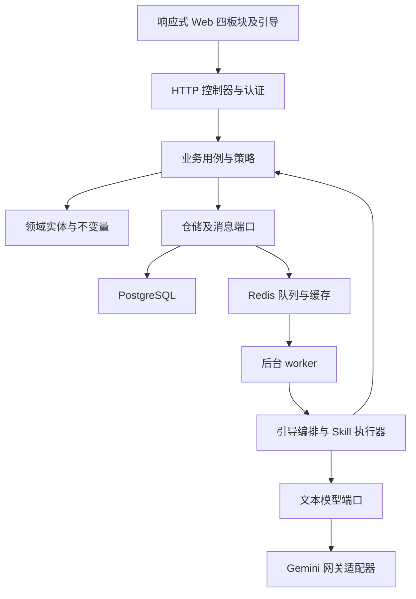
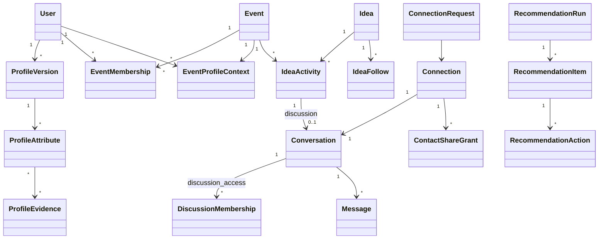

# 系统架构与领域设计

> 设计基线：2026-11-10。主方案见 [完整方案 v3](完整方案设计_v3.md)。本文件定义边界，不代表已有服务实现。
> 接口、状态和权限的唯一合同为 [共享数据与接口契约](共享数据与接口契约.md)。

## 1. 架构目标

先让基础社交可独立运行，再让 Agent 使用同一套受控业务能力。关闭模型网关不得影响登录、活动加入、手工画像、想法发布、普通发现、随机浏览、好友申请、聊天和广场。

首期使用模块化单体，而不是按每个领域部署微服务。领域实体和用例不导入 FastAPI、ORM 或模型 SDK；HTTP、数据库、Redis、解析器与模型网关是边缘适配器。

图中调用方向不等于源码依赖方向。应用依赖领域端口，具体适配器实现这些端口，由启动入口注入。后台 worker 复用同一用例，不能直接绕过权限更新正式业务表。

## 2. 领域所有权

| 模块 | 拥有的事实 | 提供能力 | 不拥有的决定 |
|---|---|---|---|
| 身份 | 账号、登录方式、会话、账号状态 | 验证当前用户、绑定身份 | 其他用户可见字段 |
| 活动 | 邀请、成员资格、角色、活动生命周期 | 验证活动范围、邀请兑换 | 全局好友关系 |
| 画像 | 来源、证据、草稿、确认版本、逐条可见性、活动偏好 | 本人编辑、生成用途视图 | 推荐排序、好友同意 |
| 想法 | 长期想法、活动关联、关注、阶段和更新 | 发布及维护想法 | 把关注者自动拉进群 |
| 讨论 | 活动想法讨论空间、入群请求、成员 | 加入/离开、成员权限 | 好友和联系方式共享 |
| 连接 | 全局好友对、待处理申请、定向联系方式授权 | 申请、接受、拒绝、撤回、解除 | 活动资格 |
| 消息 | 会话、消息、读游标 | 幂等发送、补拉、未读 | 自行授予成员资格 |
| 广场 | 帖子、评论、点赞、收藏、发布范围 | 内容发布、内容访问 | 开放全站用户检索 |
| 发现推荐 | 检索投影、批次、推荐运行和行为 | 普通列表、随机、候选排序 | 画像真实值与权限 |
| 治理通知 | 屏蔽、举报、处理、审计、通知 | 风险限制、推送与处理 | 通过模型推断用户已同意 |

模块之间传递 ID、不可变 DTO 和明确的策略结果，不共享一个包含全部用户资料的 ORM 对象。ProfileViewPolicy 综合身份、关系、活动和字段策略生成用途视图。

## 3. 核心模型与不变量

- 画像确认版本不可被 AI 原地覆盖；修改生成新的版本。字段稳定 ID 用于差异及可见性编辑。
- 普通画像 visibility 为 authenticated、friends、private；friends 是所有有效好友动态可见，不是逐好友静态快照。
- ContactShareGrant 只覆盖用户单独选择的联系方式，不能推广为读取原始材料。
- Connection 的规范化用户对全局唯一，event 只作认识来源。好友结束后重新添加开启新的申请轮次，旧授权不恢复。
- 同一用户对最多一个 pending 申请。反向发送不自动接受，必须由当前接收者确认准确请求版本。
- Idea 长期存在；IdeaActivity 连接活动；讨论空间按 IdeaActivity 隔离。DiscussionSpace 是对应 discussion 类型 Conversation 的领域称呼，不另建空间表。DiscussionMembership 是唯一群授权事实，ConversationParticipant 仅维护会话索引/未读等派生状态；关注与成员关系独立。
- 创建想法只创建必要的逻辑记录，不自动邀请人或建立跨活动群。
- RecommendationAction 是独立事件集合，不能用单个 action 字段覆盖看过、收藏和申请等历史。

## 4. 一致性与事务边界

### 4.1 接受好友申请

这是跨连接、会话和通知记录的一个本地数据库事务。协调用例通过端口操作，不从控制器跨表拼逻辑。

1. 锁定规范化用户对及申请，校验接收人、pending、expected_version、账号和屏蔽。
2. 活动来源重新校验原活动资格；公开帖子来源使用创建时合法的来源事实，不要求共同活动。
3. 创建或恢复唯一连接与唯一私聊；若是新的关系轮次，旧轮次授权不复活。
4. 将已确认首条消息幂等转为会话第一条业务消息，避免同时保留两个可重复发送来源。
5. 为双方实际选择的联系方式写定向 ContactShareGrant；普通画像无需逐人授权副本。
6. 写 outbox 及 notification_event_id，提交后由通知 worker 派发。

数据库唯一约束处理竞争，应用幂等键处理重试。相向申请、接受/撤回/屏蔽并发由同一用户对锁串行判定。通知失败不回滚已成功的关系，重放也不重复弹成功动画。

### 4.2 其他事务

| 用例 | 同事务内容 | 提交后异步动作 |
|---|---|---|
| 确认画像 | 新版本、字段/证据关联、展示策略版本 | 更新检索投影、失效缓存 |
| 修改可见性 | 字段策略及权限版本 | 清旧投影、通知已打开页面重取 |
| 邀请兑换 | 邀请次数、幂等结果、成员资格 | 欢迎通知 |
| 加入讨论 | 审核结果、成员及 join_seq | 通知，不授予好友权限 |
| 广场发布 | 帖子、内容版本、范围 | 分发索引及通知 |
| 发送消息 | 成员校验、client_message_id、会话序号、消息 | 通知及未读更新 |
| 删除资料 | 来源撤回标记、取消任务、依赖引用失效 | 物理清理及索引更新 |

权限敏感操作写主库版本后即生效，不能等待异步索引清理完成才拒绝读取。模型输出写草稿；确认正式数据的事务必须由本人操作触发。

## 5. 引导、Agent 和推荐的关系

OnboardingSession 保存阶段、题目批次、位置和任务关联，它是编排器，不拥有画像、想法或好友的事实。个人中心直接调用同样的画像/想法用例。

第一章采用简历/GitHub 前置导入。首次 GitHub 注册完成后，应用编排把已验证身份及初始公开导入意图交给画像模块，由 RegisterVerifiedGitHubSource 用例登记唯一来源和 outbox；worker 消费该读取任务，通过 GitHubPublicSourceReader 端口获取公开数据并保存快照，不重新执行身份绑定或来源登记。回调不等待外部读取或执行模型，普通再次登录不重入导入。简历使用同一 SourceStore/DocumentParser 管道；来源准备好后统一抽取，先预填再补缺。

资料固定工作流先由结构映射、规则题库和模板实现，完整覆盖资料输入、补问、画像草稿和确认。ProfileExtractor、QuestionProvider、ProfileComposer 各自提供 rules 与 ai 实现，共用普通资料用例。引导只编排步骤，普通资料页直接调用同一能力。建设顺序见 [画像后端设计](用户画像收集/02_后端能力与插件设计.md)。

活动匹配 Skill 将自然语言转为受控检索参数，再读取最多 24 条摘要完成精排。模型执行权由后端执行器掌握。

运行时 Skill 包含 instructions、input_schema、output_schema、allowed_tools、data_policy、budget、fallback 和版本。开发项目中的 [.agents/skills/architecture-patterns](../.agents/skills/architecture-patterns/SKILL.md) 仅指导开发，不作为产品读取用户数据的授权。

普通发现、随机浏览、好友、消息和广场均没有模型依赖。embedding 不可用时关闭语义召回，结构化与全文路仍可工作；文本精排失败则保留明确失败状态，由用户主动选择普通发现。平台 AI 预算不足直接报错，不自动降级。自然语言同一 run 合计最多 5 次请求，澄清等待不长期占用 worker；具体预算见 [推荐设计](发现推荐与Agent工具设计.md)。

## 6. 端口与适配器

| 端口 | 含义 | 生产适配器 | 测试替代 |
|---|---|---|---|
| ActorSession / EventAccess | 登录身份及活动权限 | 会话、成员仓储 | 内存成员与角色 |
| ProfileRepository / SourceStore | 版本、证据、私有原始资料 | PostgreSQL 私有表及加密载荷 | 内存版本/片段 |
| DocumentParser / GitHubPublicSourceReader | 简历文本解析、已验证账号的有界公开资料读取 | 隔离解析进程、服务端 GitHub 读取适配器 | 固定简历/公开项目样例、失败及重复回调替身 |
| ProfileExtractor / QuestionProvider / ProfileComposer | 资料映射、补充问题、画像组装 | 规则映射/题库/模板，以及可选 AI 提供者 | 固定资料、题库和模板；模型调用计数替身 |
| ConnectionRepository / ConversationRepository | 好友和聊天事实 | PostgreSQL | 内存状态机 |
| UnitOfWork / PairLock | 同事务与用户对竞争 | 数据库事务/行锁/唯一约束 | 确定性竞争模拟 |
| DiscoveryQuery | 活动过滤后的有限候选 | 结构化/全文/可选 pgvector | 固定候选集合 |
| TextModelGateway / EmbeddingGateway | 两种独立模型任务 | 受控服务端网关 | 固定 JSON、超时、恶意 ID |
| JobStore / TaskQueue / Outbox | 异步生命周期与提交后通知 | PostgreSQL + Redis worker | 可控乱序任务 |
| Clock / IdGenerator | 时间与唯一标识 | 系统实现 | 固定时间及序列 |

推荐服务不能依赖 SourceStore 的原始材料接口。模型网关不持有数据库凭据；数据库和第三方凭据只注入相应适配器，不进入 Skill、浏览器或日志。

## 7. 数据与运行策略

PostgreSQL 是唯一事实源；画像/好友可见性、活动资格和群成员从权威数据校验。Redis 缓存与推荐索引可重建，不是权限来源。

原始资料首期存私有数据库来源表、加密二进制载荷和提取文本，禁止通过通用资料序列化器返回。默认不自动到期，支持本人主动删除；仅用户明确选择资料重新编辑才再次送往模型。具体大小与格式边界见画像专题。

HTTP 写入消息与 SSE 通知分离；SSE 断线后凭事件游标补拉，数据库消息序号才是消息历史依据。API 横向扩容不能依赖单进程保存的会话、配对锁或任务进度。

后台系统触达另用 Web Push 适配器消费 outbox，不引入第二套 WebSocket 业务通道。订阅、通知偏好及当前会话绑定由共享契约定义；presence 是可过期的触达提示，不是权限或已读事实。退出登录/撤销会话在服务端撤销对应订阅，消息与关系事务不依赖推送成功。

错误日志记录任务 ID、耗时、错误码和预算，禁止记录原始简历、完整私信、验证码和 Authorization。审计记录事实与字段标识，默认不复制敏感字段值。

## 8. 外部参考与 Skill 来源

本节记录设计依据，外部宣传数字不是本项目压测成绩；本轮不引入上游代码。

| 来源 | 参考点 | 必须自行解决的问题 |
|---|---|---|
| [Matcha 匹配源码](https://raw.githubusercontent.com/Siriapps/Matcha/main/backend/teammate_matcher.py) | 前 50 预筛，20/30 人分批模型分析 | 改为有界召回与统一单批摘要，避免模型成本随人数增长 |
| [Matcha 应用入口](https://raw.githubusercontent.com/Siriapps/Matcha/main/backend/app.py) | 路由和匹配调用组织 | 第一位参与者充当当前用户、导入清空集合不能照搬 |
| [GameBuddy 会话源码](https://raw.githubusercontent.com/canngos/GameBuddy/67e63cdc7219686724aee4770598e2efe7cfc787/GameBuddy-backend/src/main/java/com/gamebuddy/match/domain/service/chat/ChatRoomService.java) | 按排序用户对定位私聊、建立参与关系 | 本项目并发唯一性、显式同意、活动边界、字段策略 |
| [HumHub README](https://raw.githubusercontent.com/humhub/humhub/master/README.md) | 社区内容、用户、空间和模块边界 | PHP 项目不直接替换 Next.js/FastAPI；需保持本项目权限语义 |

GameBuddy 参考固定提交 67e63cdc7219686724aee4770598e2efe7cfc787，本地许可证为 MIT。Matcha/HumHub 的 main/master 链接为可变参考，不声称已经锁定内容哈希；正式复制代码前记录具体提交和许可证。HumHub 的 [LICENSE](https://raw.githubusercontent.com/humhub/humhub/master/LICENSE) 列明 AGPL-3.0-only 或商业许可。Matcha 复用许可本轮不作结论。

项目级 architecture-patterns 来源 wshobson/agents，固定提交 9c61ab243def98f72da12abd41cfcf5bcd91af9d，MIT。安装元数据及校验值见 [INSTALLATION.json](../.agents/skills/architecture-patterns/INSTALLATION.json)。采用其领域边界、向内依赖、端口适配器和内存用例测试；不据此引入微服务、事件溯源或额外审批。

## 9. 架构验收

- 内存仓储和假模型能独立运行画像确认、好友申请/接受、候选过滤用例。
- 实际数据库集成测试验证唯一约束、事务回滚、用户对锁和 outbox；不能以单元测试替代。
- 前端和 Skill 使用同一权限/候选服务；不存在更宽松的 AI 专用全库查询。
- 关闭模型适配器后普通社交用例不报模型依赖错误。
- 活动权限与全局好友权限能分别撤销，缓存或旧 SSE 事件不能恢复访问。
- 代码实现阶段检查 domain/use_cases 不导入 HTTP/ORM/第三方 SDK；文档阶段先验证责任和接口无冲突。
