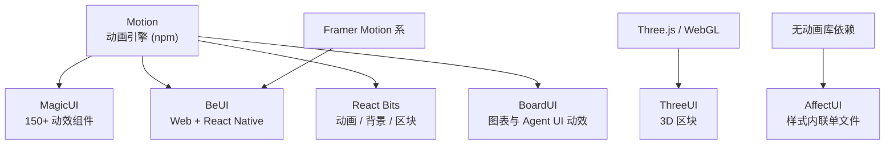

# 动画与动效库

> 调研日期：2026-11-10。
> 本文的 7 个站点可以分成两层：**Motion 是引擎**（npm 依赖），其余是**基于引擎搭建的动效组件来源**（复制源码）。
> 本项目的可访问性要求规定“减少动态效果时取消弹幕、卡片大位移和电路动画，但保留所有信息和成功反馈”，因此这一层的组件只能做增强，不能承载信息。

## 一、分层关系

多数动效组件最终都落到 Motion（前 Framer Motion）或原生 CSS 动画上。**先选引擎，再选组件来源**，可以避免同时引入两套动画运行时。

---

## 二、Motion（motion.dev）

| 项目 | 内容 |
|---|---|
| 原名 | Framer Motion |
| 类型 | 生产级动画库（引擎） |
| 支持 | React、Vue、原生 JavaScript |
| 安装 | `npm install motion`，可选 `npx motion-ai` |
| 许可 | 开源免费 |
| 体积 | 最小约 3.2kb（`animate` 迷你版）；可用 LazyMotion 按需加载 |

**核心能力**

| 能力 | 说明 |
|---|---|
| Layout animations | 用 transform 动画化 CSS 无法处理的位置、尺寸、顺序变化，支持跨组件（`layoutId`） |
| Gesture animations | 拖拽（含惯性抛出）、悬停、按压；`whileHover` / `whileTap` / `whileDrag` |
| Scroll animations | 把任意值绑定到滚动进度，优先使用浏览器 `ScrollTimeline` 做硬件加速 |
| Spring animations | 带速度的物理弹簧，参数为 stiffness / damping / mass |
| Exit animations | `AnimatePresence` 让组件等待退出动画结束再卸载 |
| 3D | 用同样的弹簧与时间轴驱动 Three.js 的 mesh、材质与 shader uniform |
| 硬件加速与性能 | 多数动画跑在浏览器自身动画引擎上，JS 繁忙时仍平滑 |

**官方定位**：“humans and agents alike”，同时面向开发者与 AI Agent，并提供 `motion-ai` 命令与文档站。

**为什么它是本项目的默认选择**

- 消息页的列表增删、卡片入场、抽屉开合都需要 exit 与 layout 动画；
- 它是 MagicUI、React Bits、BeUI、BoardUI 等库的共同底座，先引入它不会产生额外重复；
- 提供按需加载路径，可控制移动端包体积。

---

## 三、MagicUI（magicui.design / pro.magicui.design）

| 项目 | 内容 |
|---|---|
| 免费站 | 150+ 免费开源动画组件与特效 |
| 技术栈 | React + TypeScript + Tailwind CSS + **Motion** |
| 官方定位 | “**shadcn/ui 的完美搭档**” |
| 安装 | 复制源码，走 shadcn 生态 |
| Pro 站 | 模板集合：SaaS、Startup、Portfolio、Blog（MDX）、Changelog、Mobile、Dev Tool、AI Agent、Codeforge |
| Pro 定价 | **$49 买断**，含 50+ 组件与模板及后续更新 |

**特色**

- 免费层体量大、社区基础最广，是动效组件的默认来源。
- 组件偏**视觉特效**：文字动画、粒子/点阵背景（如 `DitherField`）、光束、跑马灯等；用法是声明式 props + className，例如点阵背景可指定 `pattern`（horizon / glow / aurora）与 `color`（单色或三色数组）与 `intensity`。
- Pro 主要是**落地页模板**，对 App 内界面帮助有限。

**适用**：适合公开广场、登录页等展示型页面的视觉增强；主应用列表页应谨慎使用，避免影响信息密度与减少动效模式。

---

## 四、BeUI（beui.dev / pro.beui.dev）

| 项目 | 内容 |
|---|---|
| 免费层 | **157 个 React 组件 + 73 个 React Native 组件**，5 个库分区，MIT，可商用 |
| 技术栈 | **Framer Motion + Tailwind CSS**；Web 端 React，移动端 React Native / Expo |
| 安装 | `bunx --bun shadcn add @beui/timeline` |
| Pro 数量 | 418 项：Web 区块、页面、插图、模板，另含 RN 区块与屏幕 |
| Pro 定价 | $179（Web 买断）/ $149（Mobile）/ $249（双端）；另有 Web 年付 $129 |

**代表组件**：Command Palette、Dynamic Island、Tabs、Switch、Animated Toast Stack、Action Swap、OTP Input、Timeline、Animated Alert、Animated Collapsible、Aspect Ratio、Arc Picker、Sortable List、Image Viewer、Date Range Picker。

**特色**

- **唯一同时产出 Web 与 React Native 的动效库**，两端共享同一设计语言。若未来做 App，这是最平滑的路径。
- Pro 模板是**完整 Next.js 站点**（如 Weave Workflow Builder $99、Hunch Social Prediction $99、Pair AI Workspace $69、Folio Finance Dashboard $99、Personal Website $39），可单独购买或随 Lifetime 获得。
- 免费层包含 Command Palette、Toast Stack、OTP Input 等**产品级而非装饰级**组件，实用度高。

**适用**：本项目的命令面板、Toast 反馈、OTP、时间线都很契合；若只做响应式 Web 而不做原生 App，Pro 的移动端价值为 0。

---

## 五、Arc UI（uiarc.dev）

| 项目 | 内容 |
|---|---|
| 公开数量 | 243 个动画组件 + 141 个区块 |
| 安装 | `npx shadcn@latest add @uiarc/button`；MCP：`claude mcp add --transport http arc https://uiarc.dev/api/mcp` |
| 免费层 | 121 组件 + 22 区块 |
| Pro | 122 组件 + 119 区块（价格未在本页给出） |
| 技术栈 | 未在首页明示具体 primitive，属于 React / Tailwind 生态 |

**特色**

- 免费与 Pro 的组件数量几乎对半，差异主要在**区块**（22 → 119），说明免费层已覆盖基础组件。
- 同时提供 shadcn CLI 与 **MCP server**（支持 Claude Code / Cursor / Codex 自动安装），AI 工作流友好。
- 官网表述为“新兴组件库，设计好、动画丝滑”，属于中小体量、专注动效质量的一家。

**注意**：本文未能在官网确认其 primitive 依赖（Radix UI 或 Base UI）与具体许可条款，接入前需查其安装文档的 shared styles 与依赖说明。

---

## 六、BoardUI（boardui.com）

| 项目 | 内容 |
|---|---|
| 类型 | **React 设计系统**，偏管理后台与 Agent 界面 |
| 公开数量 | 103 个组件（含 **19 种数据图表**）、10 套 Pro 模板、**400+ 设计 token** |
| 技术栈 | React 19.2 + Tailwind CSS v4 + **React Aria** + TanStack Table v8.21 + Recharts |
| 安装 | 自有 CLI：`npm boardui@latest add button-group` |
| 定价 | Starter 免费（个人开发者，无限项目，永久拥有代码）；Pro 为买断制（1 年更新或永久更新，无订阅、无自动续费） |
| 其他 | 3000+ 图标、MCP 支持、Discord |

**图表能力（19 种）**：雷达图、径向图、漏斗图、桑基图、环形/仪表盘、堆叠面积图、复合图（柱+线）、阶段条、获取图、雷达对比等，均为 Recharts 卡片，带**周期切换器、悬停高亮、统计 tile**，共用同一套 token。

**Agent UI 能力**：Multi-Agent Chat 模板（群聊、可定制 agent、丝滑交互）、**Composer Loader**（agent 工作时围绕聊天输入的光带与玻璃质感控件，可选颜色）。

**关键差异点**

- **不使用 shadcn CLI**，走自有 `boardui` 命令，安装方式与其余站点不同。
- **React Aria** 而非 Radix UI，是无障碍实现路径的另一种选择。
- 数据可视化是这个列表里最强的一家。若产品要做数据面板，它是目前最完整的选择。

---

## 七、AffectUI（affectui.com）

| 项目 | 内容 |
|---|---|
| 定位 | **AI 产品与 SaaS 专用**的 Agent-ready UI |
| 公开数量 | 173 项：组件、屏幕、区块、插图、动效 |
| 技术栈 | **每个组件是一个 `.tsx` 单文件，样式内联；不依赖 Tailwind、不依赖动画库、无其他依赖** |
| 安装 | shadcn CLI，或通过 MCP（Claude / Cursor / v0） |
| MCP 端点 | `https://www.affectui.com/api/mcp`（Streamable HTTP，支持 Claude Code / Cursor / VS Code / Codex） |
| Agent skill | 免费 skill + Pro skills（整屏、迁移、品牌、审计、键盘焦点、响应式） |
| 前提 | **需要 React 19** |
| 许可 | 46 项免费且开源（MIT）；其余为 Pro，**$249 一次性买断**（Individual）/ $699（Team），含商用许可与终身更新。无订阅、无续费 |

**组件清单（全部围绕 Agent 状态与协作）**

| 组件 | 表达的状态 |
|---|---|
| Agent Checkpoints | 一次 run 的检查点序列，可回退到任一检查点并从中分叉新尝试 |
| Agent Cursors | 多个 agent 像协作文档里的多人光标，带名字、逐字输入、图片缩放、代码修改等 |
| Agent Findings | 一群 agent 并行检查，每个一行进度，发现项滑入短信息流 |
| Agent Fleet | 多个 agent 并排，每张卡汇总其子 agent，点击展开树 |
| Agent Graph | agent 与其调用的工具构成活跃网络，每次调用有脉冲，忙碌连线变粗，等待授权时转琥珀色 |
| Agent Handoff | 任务在 agent 间接力传递，显示每段交接带走与丢失了什么 |
| Agent Inbox | 所有后台 agent 任务的统一列表：实时时钟、状态标签、带滚动计数的筛选 tab、可展开到最近步骤（Approve / Reject / Retry / Open） |
| Agent Lanes | 每个 agent 一条泳道的实时时间线，任务增长到 “now”，展示交接与审批 |
| Agent Ledger | agent 在系统中做的每项变更，逐行 before/after，可撤销，并显示撤销的连锁影响 |
| Agent Monitor | 单个 agent 的工作卡片：当前步骤、时钟、累计费用、时间条、已完成步骤的工具 logo |
| Agent Plan | agent 的分步计划，运行前可重命名、拖拽排序、增删步骤，运行时可重试失败步骤 |
| Agent Queue | 等待队列与吞吐：任务落入队列、滑入空闲 worker、进入 Done 或 Failed，另有深度图显示限流导致的积压与恢复 |
| Agent Recap | 离开期间 agent 做了什么：一晚的小图表 + 需要你处理 / 失败 / 已完成三块看板 |
| Agent Steering | 在 agent 工作时介入：排队一条 note 给下一步，或立即打断 |
| Agent Trail | agent 走过的步骤作为一条安静的轨迹，含 “3/5” 进度与子步骤实时计时器 |

**与本项目的直接对应**

本项目存在 `AIJob` 的 `execution_status`（queued / running / succeeded / failed / cancelled）与 `applicability`（current / superseded / revoked）两个维度，需要同时表达“任务是否在执行”和“结果是否仍然有效”。AffectUI 的 Agent Inbox、Agent Monitor、Agent Trail、Agent Recap 恰好覆盖这一类呈现，包括**失败重试、排队、等待用户批准**三种状态。

因此这条库在本列表中**参考价值最高**，可作为 AI 任务状态组件的设计参照（关注其信息组织方式），而非直接整体照搬其视觉风格。

**注意**：官方明确说明**不使用 Tailwind**、样式内联。若项目采用 Tailwind + shadcn 体系，引入后会出现两套样式策略并存的问题，需要评估是否接受。

---

## 八、ThreeUI（threeui.com）

| 项目 | 内容 |
|---|---|
| 类型 | 3D / Three.js 区块库 |
| 技术栈 | Three.js + WebGL |
| 组织方式 | 按**上游页面**拆分区块，如 “Testimonials — Kairo”、“Testimonials — Meridian”、“Hero — …”，每块是从完整页面中抽出的响应式单元 |
| 定价 | 有免费与付费层，具体价格本次未核实 |

**特色**

- 区块以真实页面为单位提取，保留原页面的排版、字体与动效，包括**日式太阳能风格等特定设计语言**、3D 圆柱轮播、拖动与键盘导航等交互。
- 命名即来源（Kairo / Meridian / RenderLab / Echo Vale / Aurora Link / Agent AI / Astral Atlas / Halvorsen / Vow Atelier / Terrane / Tangelo / MK·78 Keyboard / Morrow / Corvane Vault / Arca / Aniwall / DRIFT / Umbra / Sunset 3D / Sunseto 等），便于按视觉取向挑选。

**适用**：适合需要强烈视觉印象的宣传页或公开广场的展示位；**不适合**信息密度高的列表或表单页。WebGL 会带来包体积与移动端性能成本，且有降级路径要求。

---

## 九、这一层怎么选

| 需求 | 建议 |
|---|---|
| 需要一套统一动画引擎 | Motion（唯一需要进 `package.json` 的） |
| 需要免费、量大、可挑的动效组件 | MagicUI 免费层 |
| 需要产品级动效组件（Command Palette、Toast、OTP、Timeline） | BeUI 免费层（MIT） |
| 需要 AI 任务状态的设计参考 | AffectUI（注意其不使用 Tailwind） |
| 需要数据图表与 Agent 聊天界面 | BoardUI 的图表卡片与 Multi-Agent Chat |
| 需要营销页或展示位的强视觉 | React Bits Pro / ThreeUI |
| 只做响应式 Web、不做原生 App | 忽略 BeUI Mobile 与 HeroUI Native 部分，避免为用不到的资产付费 |

**共同风险**：动效组件普遍体积可观。本项目的窄屏移动端与“减少动态效果”要求意味着不能全量引入，应按页面挑选并保留关闭路径。
