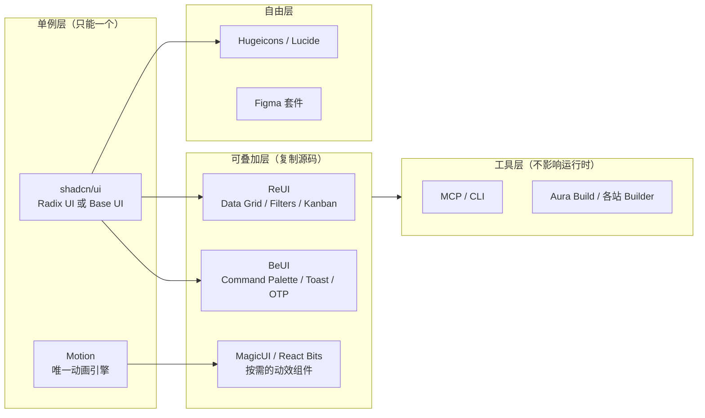

# 组合方案与选型建议

> 调研日期：2026-11-10。
> 本文给出技术栈兼容矩阵、组合冲突清单、推荐组合与预算估算。**这是建议，不是已批准的选型决定**；正式采用需按项目流程更新设计文档。

## 一、通用性判断：哪些能组合

| 层次 | 角色 | 能否自由组合 | 代表 |
|---|---|---|---|
| L1 样式与 primitive | 设计底座 | **只能有一层** | shadcn/ui（Radix UI 或 Base UI 二选一） |
| L2 区块 / 组件注册表 | 复制源码 | **可多层叠加**，但需风格统一 | ReUI、Shadcnblocks、ShadcnSpace、Efferd、21st、React Bits、Arc UI |
| L3 动画运行时 | npm 依赖 | **只能有一个** | Motion |
| L4 动效组件 | 复制源码，依赖 L3 | 可叠加 | MagicUI、BeUI、AffectUI、BoardUI 图表 |
| L5 图标 | 纯资源 | **可自由替换** | Hugeicons、Lucide、Tabler、Phosphor |
| L6 模板 / 参考 | 起步代码 | 参考用，不建议混装 | TailAdmin、Shadcn UI Kit、BeUI Pro 模板 |
| L7 生成工具 | 出稿 | 不受运行时约束 | Aura Build、Figma、各站 MCP |

**核心规则**：

1. **L1 和 L3 是单例层**，重复引入必然冲突或膨胀。
2. **L2 和 L4 可以叠加**，因为它们复制的是源码，只有风格一致性问题，没有依赖冲突。
3. **L5 完全自由**，这是唯一可以放心“换一家试试”的层。

---

## 二、技术栈兼容矩阵

行 = 站点，列 = 与本项目目标栈（Next.js / React / TypeScript / Tailwind / shadcn/ui）的兼容情况。

| 站点 | React | Next.js | TypeScript | Tailwind | 需 shadcn 初始化 | 与 shadcn 冲突风险 |
|---|---|---|---|---|---|---|
| 21st | 是 | 是（含 Vite/Remix/Astro） | 是 | 是 | 是 | 低（但多作者风格混杂） |
| ReUI | 是 | 是 | 是 | 是 | 是 | **无**（原生 shadcn 扩展） |
| Shadcnblocks | 是 | 是 | 是 | 是 | 是 | 低 |
| Shadcn Studio | 是 | 是 | 是 | 是 | 是 | 低 |
| ShadcnSpace | 是 | 是 | 是 | 是 | 是 | 低 |
| Shadcn UI Kit | 是 | 是（Next.js 16 / React 19） | 是 | 是（v4） | 是 | 低 |
| Efferd | 是 | 是（另有 TanStack） | 是 | 是 | 是 | 低 |
| React Bits | 是 | 是 | 是（含 JS 版） | 是（另有纯 CSS 版） | 是（Pro） | 低 |
| Motion | 是 | 是 | 是 | 无关 | 否 | 无 |
| Arc UI | 是 | 是 | 是 | 是 | 是 | 低（primitive 需核实） |
| BeUI | 是（含 RN） | 是 | 是 | 是 | 是 | 低 |
| BoardUI | 是（React 19） | 是 | 是 | 是（v4） | **否**（自有 CLI） | 中（React Aria + 自有 CLI） |
| AffectUI | 是 | 是 | 是 | **否**（样式内联） | 是 | 中（样式策略不同） |
| MagicUI | 是 | 是 | 是 | 是 | 是 | 无（官方称 shadcn 搭档） |
| ThreeUI | 是 | 是 | 未核实 | 未核实 | 未核实 | 中（WebGL 成本） |
| HeroUI v3 | 是（含 RN） | 是 | 是 | 是（v3 起） | **否** | **高（平行组件库与主题）** |
| FlyonUI | HTML/React/Vue | 是 | 需核实 | 是（v4） | **否** | **高（语义类 vs headless）** |
| Hugeicons | 是 | 是 | 是 | 无关 | 否 | **无** |
| TailAdmin | 是 | 是 | 是 | 是 | 否 | 中（完整模板代码） |
| Aura Build | **否**（输出原生 HTML） | 否 | 否 | 是（输出 Tailwind） | 否 | 不适用（非运行时） |

**读法**：冲突风险为“无/低”的可以直接叠加；“中”需要评估；“高”意味着二选一。

---

## 三、已知冲突清单

| 冲突 | 原因 | 处理 |
|---|---|---|
| HeroUI ↔ shadcn/ui | 两套完整的 Button / Dialog / Toast / 主题变量 | **二选一** |
| FlyonUI ↔ shadcn/ui | 语义 class 层 vs headless primitive + 自有样式 | **二选一** |
| Radix UI ↔ Base UI | 同一 primitive 的两套实现 | 在 `components.json` 中固定一套，所有站点保持一致 |
| Motion ↔ 其他动画库 | 若再引入 GSAP 或其他引擎，两套运行时并存 | 固定 Motion 为唯一引擎（ThreeUI 的 WebGL 除外） |
| BoardUI CSV ↔ shadcn CSV | BoardUI 用自有 `boardui` CLI 与 React Aria | 若采用，需接受独立的安装与无障碍路径 |
| AffectUI ↔ Tailwind 体系 | AffectUI 明确不使用 Tailwind、样式内联 | 只取其设计参考，或接受两套样式策略并存 |
| 多云模板混装 | 不同站点的圆角、间距、字重基线不同 | 先定 token（颜色/圆角/字体），再按 token 挑选区块 |
| 动效叠加过量 | MagicUI + React Bits + BeUI 同时全量引入 | 按页面挑选，移动端保留关闭路径 |

---

## 四、对本项目的推荐组合

本项目前端特征（来自 [前端主应用交互设计](../docs/前端主应用交互设计.md)）：

- 主导航为 **发现 / 广场 / 消息 / 个人**，移动端底部四栏、PC 左侧固定四栏；
- 大量**列表、卡片、表单、分页、消息**，以及**AI 任务状态**（含 superseded / revoked 的差异审阅）；
- 需要在 320px 到宽屏之间保持同一业务流程；
- 有**减少动效模式**要求。

### 4.1 最小可行组合（推荐起点）

| 层 | 选择 | 理由 |
|---|---|---|
| L1 | **shadcn/ui**（Radix UI 或 Base UI 择一） | 项目既定方向，headless + 自有样式，适合长期自有产品 |
| L2 | **[ReUI](https://reui.io) 免费层** | MIT、1264 组件 + 27 primitive，Data Grid / Filters / Kanban / Stepper / Timeline 正好覆盖本项目的表格、筛选与时间线；与 shadcn 无风格冲突 |
| L3 | **[Motion](https://motion.dev)** | 唯一动画引擎；消息列表增删、抽屉开合、卡片入场都需要 exit 与 layout 动画；可按需加载控制移动端体积 |
| L4 | **[BeUI](https://beui.dev) 免费层** | MIT 可商用，包含 Command Palette、Animated Toast Stack、OTP Input、Timeline 等**产品级**组件而非纯装饰 |
| L5 | **Hugeicons**（或沿用 Lucide） | 图标必须统一；仅在需要更大覆盖面时替换 |
| L7 | 各站 **MCP / CLI** | 配合 IDE 内 Copilot 使用，降低手写样板量 |

最小组合的总成本为 **$0**（全部为免费层 + 开源），且不引入冲突。

### 4.2 按需增量

| 触发条件 | 建议增补 |
|---|---|
| 需要营销页或公开广场展示位 | [React Bits Pro](https://pro.reactbits.dev)（$249）或 [MagicUI Pro](https://pro.magicui.design)（$49，仅模板） |
| 需要业务后台 / 运营后台 | [Shadcn UI Kit](https://shadcnuikit.com)（$79 起，含 16 套后台）或参考 TailAdmin 布局 |
| AI 任务状态需要更专业的呈现设计 | 参考 [AffectUI](https://www.affectui.com) 的 Agent Inbox / Monitor / Trail / Recap 信息结构（不建议整体引入，因其不使用 Tailwind） |
| 需要数据图表面板 | [BoardUI](https://www.boardui.com) 的 19 种图表卡片（注意其自带 CLI 与 React Aria） |
| 需要整页 3D 视觉 | [ThreeUI](https://threeui.com) 的单页区块（注意 WebGL 与降级） |
| 未来必须做原生 App | 重新评估 [HeroUI v3](https://heroui.com) / [BeUI Pro](https://pro.beui.dev) Mobile，届时考虑是否整体切换 |

### 4.3 明确不建议

| 不建议 | 原因 |
|---|---|
| HeroUI 与 shadcn 同时采用 | 两套完整组件与主题，维护成本翻倍 |
| FlyonUI 与 shadcn 混用 | 语义类层与 headless 层哲学冲突 |
| Aura Build 产物直接作为主应用代码 | 输出为原生 HTML + JS，非 React 组件 |
| TailAdmin 模板代码直接混入 shadcn 项目 | 两套样式体系，需大量对齐 |
| 多站动效库全量引入 | 包体积与减少动效模式不可控 |
| 21st 的多作者组件作为主应用设计来源 | 风格割裂，破坏自有设计语言 |

---

## 五、组合示意

---

## 六、预算估算

| 方案 | 内容 | 一次性成本 |
|---|---|---|
| 最小可行 | shadcn/ui + ReUI 免费层 + Motion + BeUI 免费层 + 图标 | **$0** |
| 加营销页 | 最小可行 + MagicUI Pro 模板 | 约 $49 |
| 加运营后台 | 最小可行 + Shadcn UI Kit Pro | 约 $79 |
| 完整内容库 | 最小可行 + React Bits Pro + Shadcnblocks $149 | 约 $398 |
| 上限参考 | 上述全部叠加（注意重叠与风格割裂） | 约 $800+ |

**结论**：本项目的界面以产品型列表与表单为主，**$0 的最小可行组合已能覆盖绝大多数需求**。付费项目的价值集中在两类：营销页模板，以及需要整页起步代码的场景。建议先用免费层搭建，确认真实缺口后再定向购买，避免为用不到的体量付费。

---

## 七、落地前需要确认的事

1. **primitive 选择**：在 `components.json` 中固定 Radix UI 或 Base UI，并确保所有第三方注册表产出与之一致。
2. **许可核对**：仅 ReUI 免费层与 BeUI 免费层在官网明确标注 MIT；其余站点商用前需逐站确认条款。
3. **可访问性对齐**：BoardUI 使用 React Aria、其余多为 Radix UI，两套无障碍实现并存会增加测试面。
4. **减少动效路径**：所有动效组件需验证在 `prefers-reduced-motion` 下的表现。
5. **移动端体积**：把动效组件纳入移动端包体积预算，按页面而非全站引入。
6. **主题一致性**：多站叠加前先定 token（颜色、圆角、字体、间距），否则会出现圆角与间距基线不一致。

---

## 八、一句话总结

这 21 个站点里，**只有 Motion 是必须进依赖的引擎，只有 shadcn/ui 是必须定的底座，其余全部是可替换的源码来源**。ReUI 补 primitive、BeUI 补产品级动效、MagicUI / React Bits 补展示位视觉、Hugeicons 补图标、AffectUI 与 BoardUI 提供 AI 状态与图表的参考；HeroUI 与 FlyonUI 是与 shadcn 平行的另一条路线，不应混用。

> 后续修订：AffectUI 已改为**必选**，共存判定见 [AffectUI 共存矩阵](07-AffectUI共存矩阵.md)；社交聊天、卡片发现与论坛广场类库的实际空缺见 [社交场景组件缺口](08-社交场景组件缺口.md)。本文第 4 节的组合建议在这两份文档中已被细化，仍保留原判断作为推理记录。
