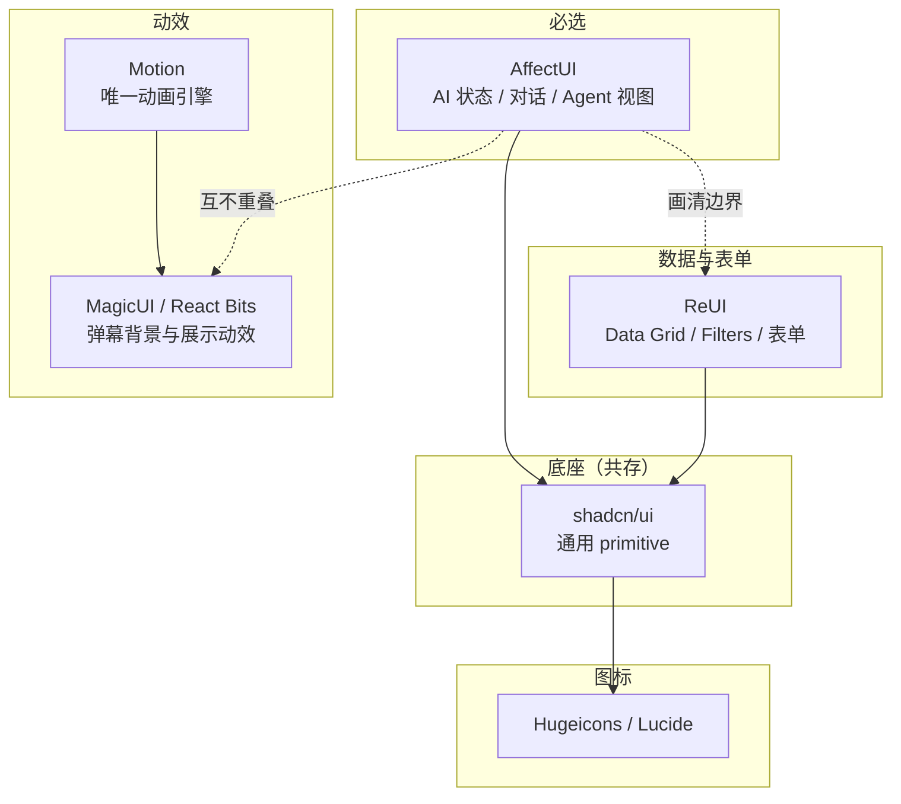

# AffectUI 必选前提下的共存矩阵

> 调研日期：2026-11-11。依据 AffectUI 官方 `llms.txt`、`/compare/shadcn-ui`、`/docs/*` 原文。
> **重要更正**：本文修正了 [06-Agent-Skill筛选](06-Agent-Skill筛选.md) 与 [03-动画与动效库](03-动画与动效库.md) 中对 AffectUI 的两处误判，见下节。
> **本轮场景补充**：五类页面的具体来源以 [2026-11-11 复核](08-社交场景组件缺口.md) 为准。AffectUI 本身有评论线程；Arc UI、Shadcn UI Kit、BeUI Pro、ShadcnSpace 和 React Bits Pro 的聊天/评论能力此前被遗漏。本文“共存/不建议”是集成判断，不是已做安装测试的结论，也不表示不同 UI 库存在必然的硬性依赖冲突。

## 一、对 AffectUI 的两处误判更正

| 先前判断 | 实际事实 | 来源 |
|---|---|---|
| “MCP / 文档入口全部 404，Agent skill 存疑” | **MCP 端点为 `https://www.affectui.com/api/mcp`（Streamable HTTP）**，支持 Claude Code / Cursor / VS Code / Codex；并有免费 skill 与 Pro skills（screens、migrations、branding、audits 等） | `llms.txt`、`/docs/agent-skill` |
| “与 Tailwind + shadcn 是两套样式策略，需评估是否接受” | **官方明确说明可共存**：“affectUI installs through the shadcn CLI and sits next to shadcn/ui in the same project”、“shadcn/ui for forms and dialogs, affectUI for the AI-specific parts” | `/compare/shadcn-ui` |

先前 404 的原因：文档实际路径为 `/docs/introduction`、`/docs/installation`、`/docs/theming`、`/docs/ai`、`/docs/agent-skill`，而 `/docs/mcp`、`/docs/agents` 确实不存在。这是路径猜测错误，不是产品缺失。

## 二、AffectUI 的硬约束（决定共存规则）

来自 `llms.txt` 与 `/compare/shadcn-ui` 的原文事实：

| 约束 | 原文依据 | 后果 |
|---|---|---|
| **组件的所有源码打包为单一 `.tsx` 文件** | “Every item is one .tsx file with its styles inside” | 自包含，可逐件引入 |
| **不需要 Tailwind** | “no Tailwind” / “works with or without Tailwind” | 与 Tailwind 项目**不冲突**，但组件内部不用 Tailwind 类 |
| **不依赖任何动画库** | “no animation library, no other dependencies” | **不与 Motion 冲突**，不共享动画运行时 |
| **需要 React 19** | 对比表 “Needs: React 19” | **硬性前提**，低于 19 需确认 |
| **不 import shadcn/ui** | “affectUI components are self-contained and don't import shadcn/ui” | 与 shadcn 组件并存，**不覆盖**其 Button/Dialog |
| **通过 shadcn CLI 安装** | `npx shadcn@latest add @affectui/<slug>` | 与全部 shadcn 生态站点同一条安装通道 |
| **颜色走 CSS 变量，支持 dark mode** | “carry their own CSS with variables for colors” | 可用变量对齐自有 token；`.dark` class 与 shadcn 约定一致（官网自身即用该约定） |
| **内建 reduced motion** | “dark mode and reduced motion built in” | 符合项目“减少动效”要求 |
| **两种风格** | “in two styles (classic and clean)” | 需选定一种，避免混用 |
| **Pro 需 access key** | `AFFECTUI_TOKEN`，无 key 返回 401 | 存在轻度工具链耦合 |

**关键结论**：AffectUI 是**自包含单文件**，既不依赖 Tailwind 也不依赖 Motion，也不 import shadcn/ui。这意味着**它几乎不与任何东西产生依赖冲突**——它带来的风险不是「装不上」，而是「视觉不统一」与「维护两套样式语言」。

## 三、共存矩阵

判定维度：(1) 依赖层是否冲突；(2) 样式语言是否冲突；(3) 视觉是否割裂。

| 对象 | 依赖冲突 | 样式冲突 | 判定 | 说明 |
|---|---|---|---|---|
| **shadcn/ui** | 无 | 无（并存） | ✅ **官方推荐共存** | 官方原话：多数 AI 产品两者都用，shadcn 管表单与对话框，AffectUI 管 AI 专属部分 |
| **Motion** | 无（AffectUI 不依赖动画库） | 无 | ✅ **共存** | AffectUI 自带动效，Motion 供其余界面使用；两套动画机制并行但互不干扰 |
| **ReUI** | 无 | **需注意** | ✅ **可共存（推荐）** | ReUI 是 shadcn 原生扩展；与 AffectUI 在相邻领域（AI 区块）**功能重叠**，需划分边界 |
| **Arc UI** | 无 | 需注意 | ✅ 可共存 | AffectUI 官方对比页列 Arc UI 为 “broad animated library”，两者定位互补 |
| **MagicUI** | 无 | 需注意 | ✅ 可共存 | 官方对比页明确：AffectUI 是对比 “Aceternity UI and Magic UI”，定位为「AI 产品本体 vs 落地页动画」，**不冲突** |
| **React Bits** | 无 | 需注意 | ✅ 可共存 | 同上，属落地页/展示型动画，与本项目的弹幕背景需求吻合 |
| **BeUI** | 无 | 需注意 | ✅ 可共存 | 但 BeUI 与 AffectUI 都在「动效组件」层，**重叠度高**，同时引入性价比低 |
| **BoardUI** | 无 | **中** | ⚠️ **谨慎** | BoardUI 用 React Aria + 自有 `boardui` CLI；虽官方对比页列为可组合，但 CSM/CSS 变量体系与 AffectUI 是两套 |
| **21st** | 无 | **中** | ⚠️ 谨慎 | 多作者风格；与 AffectUI 的 “classic/clean” 两种风格难以统一 |
| **Shadcnblocks / Shadcn Studio / ShadcnSpace / Shadcn UI Kit / Efferd** | 无 | 需注意 | ✅ 可共存 | 均为 shadcn registry，同一条通道；但都是营销/后台向，与 AffectUI 重叠少 |
| **HeroUI v3 / Pro** | **有** | **高** | ❌ **不建议** | HeroUI 是完整平行组件库 + 自有主题，与 shadcn 路线二选一；AffectUI 定位在 shadcn 侧 |
| **FlyonUI** | **有** | **高** | ❌ **不建议** | 语义 class 层，与 headless + 自有样式路线哲学冲突 |
| **ThreeUI** | 无 | 低 | ⚠️ 仅首页 | WebGL 独立层，与 AffectUI 无冲突，但仅适合展示位 |
| **Hugeicons** | 无 | 无 | ✅ **完全自由** | 纯图标层。**注意**：AffectUI 官网自身即使用 `HugeiconsIcon`，与其视觉天然接近 |
| **TailAdmin** | 无 | 中 | ⚠️ 仅参考 | 无 agent skill，传统模板，不进入依赖 |
| **Aura Build** | 不适用 | 不适用 | — | 出稿工具 |

## 四、AffectUI 与相邻对象的边界划分

共存的真正难点不是技术，而是**同一层内功能重叠**。必须明确划分：

### 4.1 AffectUI vs ReUI（最需要划界）

两者都覆盖 AI / Agent 界面，但层次不同：

| 领域 | 归属 | 理由 |
|---|---|---|
| Agent 状态视图（Inbox / Monitor / Trail / Plan / Ledger / Recap / Queue） | **AffectUI** | ReUI 无对应组件 |
| AI 对话（Chat Composer / AI Answer / Thinking State / Tool Call Card / Model Picker） | **AffectUI** | ReUI 的 `AI & Agents` 组是区块级，AffectUI 是组件级且更细 |
| Data Grid / Filters / Kanban / Gantt / Event Calendar | **ReUI** | AffectUI 无表格与筛选 primitive |
| 表单与对话框（Stepper / Tree / Autocomplete / Phone Input / Date Selector） | **ReUI** | AffectUI 不做通用表单 |
| 通用反馈（Alert / Badge / Toast） | **ReUI**（与 shadcn 一致） | AffectUI 的反馈类偏 AI 语义 |

**规则**：**AffectUI 管 “AI 在做什么”，ReUI 管 “数据与表单”**。两边都不要碰对方的基础组件。

### 4.2 AffectUI vs BeUI

| | AffectUI | BeUI |
|---|---|---|
| 底座 | 无（自包含单文件） | Framer Motion + Tailwind |
| 定位 | AI 产品状态与协作视图 | 通用动效组件 |
| 重叠 | Command Palette、Toast 类 | 同 |
| 判定 | **优先 AffectUI**（更贴合本项目），BeUI 仅在需要其独有组件时补入 | |

### 4.3 AffectUI vs MagicUI / React Bits（弹幕背景）

**完全不重叠，可放心共存**。AffectUI 官方对比页亲自划清了这条线：AffectUI 是 “the AI product itself”，Magic UI / Aceternity 是 “animated sections for landing pages”。

你的**弹幕滚动背景**属于展示层动效 → 归 MagicUI / React Bits，不归 AffectUI。

## 五、AffectUI 在本项目中的落位

结合 [前端主应用交互设计](../docs/前端主应用交互设计.md) 的约束逐条对应：

| 项目需求 | AffectUI 组件 | 契合度 |
|---|---|---|
| AIJob 执行状态（queued/running/succeeded/failed/cancelled） | Agent Inbox（筛选 tab + 滚动计数）、Agent Monitor（时钟 + 费用） | **高** |
| AIJob applicability（current/superseded/revoked） | Agent Ledger（before/after + **可撤销 + 撤销连锁影响**）、Agent Checkpoints（回退分叉） | **高**，这是唯一能表达该维度的 |
| §3.4 澄清续答（同一 run 最多 3 轮） | Chat Composer + Thinking State（实时计时 + 步骤逐个出现） | **高** |
| §3.4 失败重试 / 等待补充需求 | Agent Plan（失败步骤重试）、Agent Steering（排队 note / 立即打断） | **高** |
| §7.2 “网络断线先恢复任务订阅” | Agent Trail（步骤轨迹 + 子步骤计时） | 中 |
| §3.4 推荐依据展示（可读字段 + 依据） | Cited Answer（引用与来源联动）、AI Answer（来源卡片 + 引用 chip） | **高** |
| §5.2 聊天消息状态 | Chat Composer（流式、不跳动） | 中（私聊本身仍用 shadcn/ReUI 自建） |
| 弹幕背景 | — | **不适用**（归 MagicUI / React Bits） |
| 个人资料编辑 | — | **不适用**（归 ReUI + shadcn） |

## 六、推荐的共存组合

| 层 | 选择 | 与 AffectUI 关系 |
|---|---|---|
| AI / Agent 界面 | **AffectUI**（必选） | — |
| 通用 primitive | **shadcn/ui** | 官方推荐共存 |
| 数据与表单 | **ReUI** | 可共存，需划界（AffectUI 管 AI，ReUI 管数据） |
| 动画引擎 | **Motion** | 无依赖冲突 |
| 弹幕与展示动效 | **MagicUI** / **React Bits** 免费层 | 完全不重叠 |
| 图标 | **Hugeicons** 或 Lucide | 完全自由（AffectUI 自身即用 Hugeicons） |

**排除**：HeroUI v3/Pro、FlyonUI（与 shadcn 路线冲突）；BeUI（与 AffectUI 重叠且性价比低）；BoardUI（需接受第三套体系，仅在需要图表时评估）。

## 七、落地前必须确认

| # | 事项 | 为什么关键 |
|---|---|---|
| 1 | **React 版本是否 ≥ 19** | AffectUI 对比页写明 “Needs: React 19”，这是硬前提 |
| 2 | **选定 classic 或 clean 其中一种风格** | 官方提供两种风格，混用即割裂 |
| 3 | **AffectUI 的颜色 CSS 变量如何映射到自有 token** | 它自带 CSS 变量，需与 shadcn 的 `--background` 等对齐，否则深色模式两套 |
| 4 | **`prefers-reduced-motion` 联合验证** | AffectUI 内建 reduced motion，需与 Motion 的减少动效路径一起测 |
| 5 | **Pro access key 的存放方式** | `AFFECTUI_TOKEN` 属凭据，按项目规则不得进入公开文档或提交 |
| 6 | **106 项 Pro 的采购范围** | 46 项免费 MIT 已覆盖 Agent Ledger 之外的部分条目，建议先免费试用再定 Pro 范围 |
